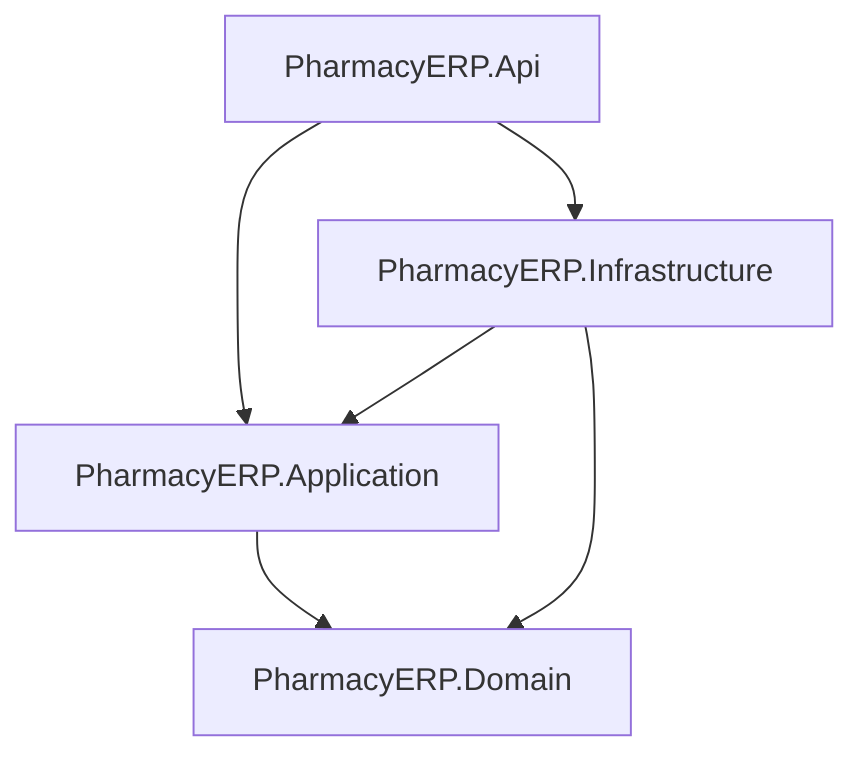

# Pharmacy ERP & Brain Platform

A multi-tenant, dual-runtime Pharmacy ERP platform built around a modular **.NET 10** backend (`apps/erp-backend`), a React/TypeScript web frontend (`apps/erp-frontend`), and an AI-assisted canonical integration layer (`apps/brain`).

> **Current Milestone:** **Stage 1 (Foundation, Identity & Auth, Product Catalog, Inventory & Immutable Ledger, Integration & Security)** is complete and verified with **713/713 automated tests passing (0 failures, 0 warnings)**.

---

## Monorepo Structure

```text
Pharmacy-ERP/
├── apps/
│   ├── erp-backend/        # .NET 10 ASP.NET Core Web API, EF Core, PostgreSQL (Stage 1 complete)
│   ├── erp-frontend/       # Vite + React + TypeScript ERP web application
│   └── brain/              # AI assistant & canonical integration service
├── contracts/              # Shared API contracts, OpenAPI specs, and schemas
├── infrastructure/         # Deployment & infrastructure definitions
└── README.md
```

For full backend architecture, controller tables, and schema details, see [`apps/erp-backend/README.md`](apps/erp-backend/README.md).

---

## 1. Project Overview & Architecture

The ERP backend (`apps/erp-backend`) is built with **.NET 10**, **ASP.NET Core**, **Entity Framework Core**, and **PostgreSQL**, following **Onion Architecture** with strict layer boundaries:



### Modular Domain Boundaries
- **`Identity`** — Multi-tenant organizations, branches, enrollment tokens, employees, user accounts, JWT/JWKS authentication, and branch-scoped RBAC.
- **`Catalog`** — Hierarchical product categories, products, multi-UOM conversions, barcode lookups, and branch-level reorder rules.
- **`Inventory`** — Branch locations, lot/batch tracking, optimistic-concurrency stock balances, and an append-only inventory ledger.
- **`Integration`** — Transactional Outbox event pipeline, HTTP `Idempotency-Key` enforcement, tamper-proof audit logging, and canonical read/write endpoints.

*(Sales/POS and Purchasing modules are scoped for Stage 2 and Stage 3.)*

### Dual Runtime Mode (`Cloud` vs. `BranchLocal`)
The API supports two deployment topologies configured via `ERP_RUNTIME_MODE` (default: `Cloud`) and enforced at the HTTP pipeline boundary by `RuntimeModeGuardMiddleware`:
- **`Cloud` Runtime:** Hosts organization provisioning, central catalog management, canonical AI feeds/configuration, and multi-branch reads. Blocks branch-local stock mutations (`/api/v1/inventory/adjustments`, `/opening-balances`, `/transfers`).
- **`BranchLocal` Runtime:** Deployed per enrolled branch (`ENROLLED_BRANCH_ID`) for low-latency local stock operations and branch-scoped logins. Blocks cloud-only endpoints (`/api/v1/organizations`, `/api/v1/canonical/*`, and catalog writes) while permitting catalog reads.

---

## 2. What Was Delivered in Stage 1

### Identity & Access Management (`identity` schema)
- **Multi-Tenant Provisioning:** Organizations, Branches, and single-use Branch Enrollment Tokens (`POST /api/v1/branches/{branchId}/enrollment-tokens`, `POST /api/v1/branch-enrollment`).
- **Employees & User Accounts:** Employee directory, User accounts, password resets, and session revocation.
- **RS256 JWT & JWKS:** Asymmetric RS256 access tokens with a standard public key discovery endpoint at `GET /.well-known/jwks.json`.
- **Session Security:** Rotating Refresh Tokens with reuse detection (revokes the entire token family on replay) and short-TTL `SecurityStamp` validation on every authenticated request for near-instant revocation.
- **Branch-Scope RBAC:** Role-based policies (`Admin`, `Pharmacist`, `Cashier`, `OrgAdminOnly`, `PlatformProvisionerOnly`) combined with `BranchScope` (`ALL` vs. `ASSIGNED`).

### Product Catalog (`catalog` schema)
- **Hierarchical Categories:** Parent/child `ProductCategory` management with self-parenting protection.
- **Products & Multi-UOM:** `Product` catalog with barcode lookup (`GET /api/v1/products/by-barcode/{barcode}`), lot-tracking flags, and multiple `ProductUom` records with conversion factors to the base unit (guarded against breaking changes once inventory history exists).
- **Branch Reorder Rules:** Per-branch, per-product `ProductReorderRule` thresholds (`ReorderPointBase`, `ReorderQuantityBase`, `MaxQuantityBase`).

### Inventory & Immutable Ledger (`inventory` schema)
- **Locations & Lot/Batch Tracking:** Branch-level `InventoryLocation` management (auto-seeded default locations per new branch) and `InventoryBatch` tracking for lot-tracked and non-lot products.
- **Optimistic-Concurrency Stock Balances:** `StockBalance` records protected with a `row_version` concurrency token and row-level locking (`FOR UPDATE`) to prevent negative stock under concurrent writes.
- **Append-Only Ledger:** Immutable `InventoryTxn` and `InventoryTxnLine` records supporting `OPENING_BALANCE`, `ADJUSTMENT_IN`, `ADJUSTMENT_OUT`, `SCRAP_OUT`, and `REVERSAL` (plus Stage 2/3 types), with UOM-aware base-unit quantity and unit-cost conversion.

### Integration, Audit & Reliability (`integration` schema)
- **Transactional Outbox:** Atomic `OutboxEvent` and `OutboxEventCursor` persistence within the business transaction, drained by `OutboxPublisherWorker`.
- **Idempotency Enforcement:** `IdempotencyRecord` backed by the `Idempotency-Key` HTTP header (replaying identical requests and rejecting payload mismatches with `409 IDEMPOTENCY_MISMATCH`).
- **Tamper-Proof Audit Trail:** Append-only `AUDIT_LOG` capturing actor identity, actor type (`USER`, `SYSTEM`, `AI_ASSISTED`), before/after snapshots, trace IDs, and optional AI `source_prompt_id`.

---

## 3. Database Security & Engineering Standards

- **PostgreSQL Row-Level Security (`ENABLE` + `FORCE ROW LEVEL SECURITY`):** Active on all **20 tenant-bound tables** across all four schemas. Every database transaction binds `app.current_organization_id` (or scoped `app.system_bypass` strictly for anonymous discovery queries) via `TenantRlsConnectionInterceptor`.
- **Least-Privilege Database Roles:**
  - `erp_migrator` — Owns schemas and executes EF Core DDL migrations (`NOSUPERUSER NOBYPASSRLS`).
  - `erp_app` — Runtime API role with `NOSUPERUSER NOBYPASSRLS NOCREATEROLE NOCREATEDB` and minimal table DML privileges (insert/select only on `AUDIT_LOG`).
- **Startup Security Gate:** `DatabaseSecurityStartupCheck` runs on application startup and refuses to boot if the runtime connection has superuser/bypass-RLS privileges or if any tenant table lacks `ENABLE` + `FORCE ROW LEVEL SECURITY`.
- **Database Immutability Triggers:** PostgreSQL `BEFORE` triggers enforce append-only immutability on `integration."AUDIT_LOG"`, `inventory."INVENTORY_TXN"`, and `inventory."INVENTORY_TXN_LINE"`.

---

## 4. Team Onboarding & Database Setup After `git pull`

### Prerequisites
- **.NET 10 SDK**
- **PostgreSQL 16+** (running locally on `localhost:5432` with `psql` available in `PATH`)

### Step 1: Run the Automated Setup Script
From the repository root, switch to `apps/erp-backend/` and run:

```powershell
cd apps/erp-backend
powershell -ExecutionPolicy Bypass -File .\setup-local-db.ps1
```

You will be prompted securely for your local PostgreSQL `postgres` superuser password. The script automates:
1. Creating the `erp_db` database if it does not already exist.
2. Provisioning the least-privilege `erp_migrator` and `erp_app` PostgreSQL roles and schema grants.
3. Installing `dotnet-ef` globally if missing and applying all EF Core migrations, RLS policies, and immutability triggers as `erp_migrator`.
4. Initializing `dotnet user-secrets` for `PharmacyERP.Api` and saving the `erp_app` runtime `ConnectionStrings:DefaultConnection`.
5. Setting the `ERP_IT_POSTGRES` user environment variable so PostgreSQL integration tests can provision and drop isolated throwaway databases automatically.

### Step 2: Run the Backend API
```powershell
dotnet run --project src/PharmacyERP.Api/PharmacyERP.Api.csproj
```

### Step 3: Run the Full Automated Test Suite (`713 / 713`)
```powershell
$env:Logging__EventLog__LogLevel__Default = "Critical"
dotnet test PharmacyERP.sln
```
- **Unit Tests (`PharmacyERP.UnitTests`):** 552 tests
- **Integration Tests (`PharmacyERP.IntegrationTests`):** 161 tests (provisions isolated throwaway PostgreSQL databases and drops them on teardown, leaving `erp_db` untouched)

---

## 5. Frontend Integration Quick Reference

| Setting | Value |
| :--- | :--- |
| **Local Base URL (HTTPS / HTTP)** | `https://localhost:7107` / `http://localhost:5007` |
| **API Route Prefix** | `/api/v1` |
| **Swagger UI (Development)** | `https://localhost:7107/swagger` (OpenAPI JSON: `/swagger/v1/swagger.json`) |
| **JWKS Public Key Endpoint** | `GET /.well-known/jwks.json` |
| **Idempotency Header (Writes)** | `Idempotency-Key: <unique-key>` (supported on all write endpoints; takes precedence over body property) |
| **Enum Serialization** | String names via `JsonStringEnumConverter` (e.g. `"Admin"`, `"ASSIGNED"`, `"OPENING_BALANCE"`) |
| **Trace Correlation Header** | `X-Trace-Id` (returned on all responses, including errors) |

### Unified Validation & Error Envelope (`422 Unprocessable Entity`)
All validation failures (including model binding and domain validation) return `ApiErrorEnvelopeDto`:

```json
{
  "error": {
    "code": "VALIDATION_ERROR",
    "message": "One or more validation errors occurred.",
    "details": [
      {
        "field": "sku",
        "issue": "The Sku field is required."
      }
    ],
    "trace_id": "00-4bf92f3577b34da6a3ce929d0e0e4736-00f067aa0ba902b7-01"
  }
}
```
