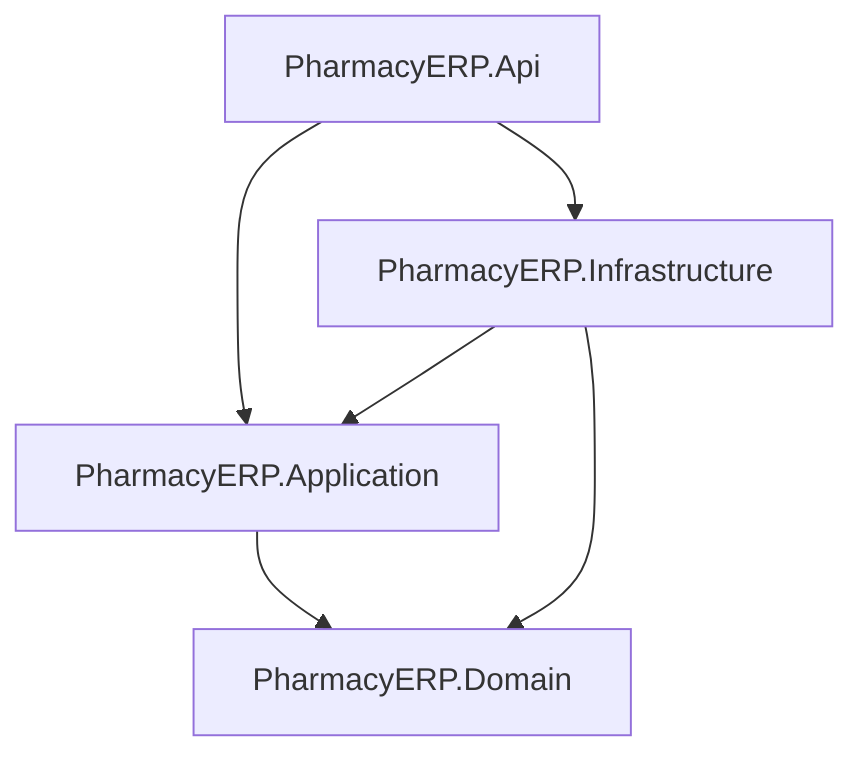

# PharmacyERP Backend (`apps/erp-backend`)

A multi-tenant, dual-runtime Pharmacy ERP backend built with **.NET 10**, **ASP.NET Core**, **Entity Framework Core**, and **PostgreSQL**, following **Onion Architecture** and modular domain boundaries.

---

## 1. Project Overview & Architecture

### Layering & Dependency Flow



### Solution Layout

```text
apps/erp-backend/
├── PharmacyERP.sln
├── setup-local-db.ps1                      # Automated local PostgreSQL + migrations + user-secrets setup
├── src/
│   ├── PharmacyERP.Domain/                 # Pure domain entities, value objects, enums, invariants, exceptions
│   │   ├── Entities/
│   │   │   ├── Identity/                   # Organization, Branch, Employee, UserAccount, UserBranchAccess, BranchEnrollment, UserRefreshToken
│   │   │   ├── Catalog/                    # ProductCategory, Product, ProductUom, ProductReorderRule
│   │   │   ├── Inventory/                  # InventoryLocation, InventoryBatch, StockBalance, InventoryTxn, InventoryTxnLine
│   │   │   └── Integration/                # OutboxEvent, OutboxEventCursor, IdempotencyRecord, AuditLog
│   │   ├── ValueObjects/                   # Address, etc.
│   │   └── Enums/                          # UserRole, BranchScope, ErpRuntimeMode, InventoryTransactionType, ErrorCode, etc.
│   │
│   ├── PharmacyERP.Application/            # Use cases, services, DTOs, FluentValidation validators, abstractions
│   │   ├── Common/                         # Result<T>, ApiErrorEnvelopeDto, PagedResult<T>, interfaces
│   │   └── Features/
│   │       ├── Identity/
│   │       ├── Catalog/
│   │       ├── Inventory/
│   │       └── Integration/
│   │
│   ├── PharmacyERP.Infrastructure/         # EF Core, PostgreSQL RLS, repositories, auth, outbox worker
│   │   ├── Auth/                           # JwksKeyProvider, PasswordHasherService, UserSecurityStampValidator
│   │   ├── BackgroundServices/             # OutboxPublisherWorker, LoggingOutboxEventDispatcher
│   │   ├── Persistence/
│   │   │   ├── Configurations/             # Fluent API IEntityTypeConfiguration classes
│   │   │   ├── Database/                   # PharmacyDbContext (partial classes per module), UnitOfWork, TenantRlsConnectionInterceptor
│   │   │   ├── Migrations/                 # Unified Stage 1 EF Core migrations
│   │   │   ├── Repositories/               # Module-scoped repositories
│   │   │   ├── Security/                   # provision_db_roles.sql, DatabaseRoleSecuritySql, DatabaseSecurityStartupCheck
│   │   │   └── Triggers/                   # RlsAndAuditProtectionSql, InventoryLedgerImmutabilitySql
│   │   └── Services/                       # Context providers (TenantContext, RuntimeModeProvider, DateTimeProvider)
│   │
│   └── PharmacyERP.Api/                    # ASP.NET Core Web API host
│       ├── Auth/                           # AuthorizationPoliciesExtensions, JwksEndpointExtensions
│       ├── Common/                         # ApiResultMapper
│       ├── Controllers/                    # 13 Stage 1 REST controllers
│       ├── Filters/                        # AllowHeaderIdempotencyKeyAttribute
│       └── Middleware/                     # ExceptionHandling, Traceparent, RuntimeModeGuard, TenantResolution
│
└── tests/
    ├── PharmacyERP.UnitTests/              # 552 unit tests (Domain, Application, Infrastructure, Middleware)
    └── PharmacyERP.IntegrationTests/       # 161 integration tests (PostgreSQL RLS, concurrency, immutability, API)
```

### Dual Runtime Mode (`Cloud` vs. `BranchLocal`)
Configured via `ERP_RUNTIME_MODE` (defaults to `Cloud`) and optional `ENROLLED_BRANCH_ID`, enforced by `RuntimeModeGuardMiddleware` before authentication:

| Runtime Mode | Allowed Operations | Blocked Operations (`404 NOT_FOUND`) |
| :--- | :--- | :--- |
| **`Cloud`** (default) | Organization provisioning, branch/user management, catalog reads & writes, canonical feeds & AI configuration, inventory reads | Branch-local stock mutations (`POST`/`PATCH`/`PUT`/`DELETE` on `/api/v1/inventory/adjustments`, `/opening-balances`, `/transfers`) |
| **`BranchLocal`** | Branch-scoped auth & operations, inventory adjustments/reads, catalog `GET` reads, `/api/v1/canonical/capabilities` | `/api/v1/organizations`, `/api/v1/canonical/*` (except capabilities), and catalog writes (`/api/v1/product-categories`, `/api/v1/products`, `*/reorder-rule`) |

---

## 2. Stage 1 Delivered Features & API Endpoints

### Identity & Access Management (`identity` schema)
- Multi-tenant `Organization`, `Branch`, `BranchEnrollment`, `Employee`, `UserAccount`, `UserBranchAccess`, and `UserRefreshToken`.
- RS256 JWT issuance and validation with public key discovery at `GET /.well-known/jwks.json`.
- Refresh token rotation with family-wide revocation on replay detection.
- `SecurityStamp` + active-account verification in `JwtBearerEvents.OnTokenValidated` (short-TTL cached) so password resets, role/scope changes, deactivations, and session revocations invalidate tokens promptly.
- Branch-scope RBAC (`BranchScope.ALL` vs. `BranchScope.ASSIGNED`) and policies (`AdminOnly`, `OrgAdminOnly`, `PlatformProvisionerOnly`).

| Controller | Base Route | Endpoints |
| :--- | :--- | :--- |
| `JwksEndpointExtensions` | `/.well-known/jwks.json` | `GET` (Public RS256 JWKS key set) |
| `AuthController` | `/api/v1/auth` | `POST login`, `POST refresh`, `POST logout`, `GET me` |
| `OrganizationsController` | `/api/v1/organizations` | `POST ""` (`PlatformProvisionerOnly`) |
| `BranchesController` | `/api/v1` | `GET branches`, `GET branches/{id}`, `POST branches` (`OrgAdminOnly`), `PATCH branches/{id}`, `POST branches/{branchId}/enrollment-tokens`, `POST branch-enrollment` |
| `EmployeesController` | `/api/v1/employees` | `GET ""`, `GET {id}`, `POST ""`, `PATCH {id}` |
| `UsersController` | `/api/v1/users` | `GET ""`, `GET {id}`, `POST ""`, `PATCH {id}`, `POST {id}/password-reset`, `POST {id}/revoke-sessions` |

### Product Catalog (`catalog` schema)
- Hierarchical `ProductCategory` with cycle/self-parenting validation.
- `Product` master records with SKU/barcode uniqueness per organization, barcode lookup, and lot-tracking configuration.
- Multi-UOM (`ProductUom`) definitions with base-unit conversion factors, protected against destructive changes once stock or posted ledger history exists.
- Branch-level `ProductReorderRule` thresholds (`ReorderPointBase`, `ReorderQuantityBase`, `MaxQuantityBase`).

| Controller | Base Route | Endpoints |
| :--- | :--- | :--- |
| `ProductCategoriesController` | `/api/v1/product-categories` | `GET ""`, `GET {id}`, `POST ""`, `PATCH {id}` |
| `ProductsController` | `/api/v1/products` | `GET ""`, `GET by-barcode/{barcode}`, `GET {id}`, `POST ""`, `PATCH {id}`, `GET {id}/uoms`, `POST {id}/uoms`, `PATCH {id}/uoms/{uomId}` |
| `ReorderRulesController` | `/api/v1/branches/{branchId}/products/{productId}/reorder-rule` | `GET ""`, `PUT ""` |

### Inventory & Immutable Ledger (`inventory` schema)
- Branch `InventoryLocation` management (default sellable locations are automatically seeded when an organization or branch is created).
- `InventoryBatch` lot/expiry tracking plus deterministic non-lot batch initialization for non-lot-tracked products.
- `StockBalance` with optimistic concurrency (`row_version` concurrency token) and PostgreSQL row-level locking (`FOR UPDATE`) to prevent negative stock under concurrent adjustments.
- Append-only `InventoryTxn` and `InventoryTxnLine` ledger supporting `OPENING_BALANCE`, `ADJUSTMENT_IN`, `ADJUSTMENT_OUT`, `SCRAP_OUT`, and `REVERSAL` (with UOM-aware base-unit quantity and unit-cost conversion).

| Controller | Base Route | Endpoints |
| :--- | :--- | :--- |
| `InventoryLocationsController` | `/api/v1/inventory/locations` | `GET ""`, `POST ""`, `PATCH {id}` |
| `InventoryController` | `/api/v1/inventory` | `GET batches`, `GET balances`, `GET transactions`, `POST adjustments` |

### Integration, Audit & Reliability (`integration` schema)
- **Transactional Outbox:** `OutboxEvent` and `OutboxEventCursor` written atomically in the same database transaction and published asynchronously by `OutboxPublisherWorker` (configurable via `Outbox:WorkerEnabled`).
- **Idempotency:** `IdempotencyRecord` keyed by tenant + operation + `Idempotency-Key` header; identical replays return the stored response while mismatched payloads return `409 IDEMPOTENCY_MISMATCH`.
- **Tamper-Proof Audit Log:** `AuditLog` (`AUDIT_LOG`) recording actor metadata, `AuditActorType` (`USER`, `SYSTEM`, `AI_ASSISTED`), before/after JSON snapshots, trace IDs, and `source_prompt_id`.
- **Canonical Feeds & Configuration:** Keyset-paginated read feeds and audited AI-assisted configuration endpoints.

| Controller | Base Route | Endpoints |
| :--- | :--- | :--- |
| `CanonicalCapabilitiesController` | `/api/v1/canonical/capabilities` | `GET ""` |
| `CanonicalCatalogController` | `/api/v1/canonical` | `GET products`, `POST configuration/products`, `PUT configuration/reorder-rules` |
| `CanonicalInventoryController` | `/api/v1/canonical/inventory` | `GET ""` |

---

## 3. Database Security & Engineering Standards

### Row-Level Security Across All 20 Tenant-Bound Tables
Every tenant-bound table in PostgreSQL has both **`ENABLE ROW LEVEL SECURITY`** and **`FORCE ROW LEVEL SECURITY`** applied by EF Core migrations:

| Schema | Tables (20 Total) |
| :--- | :--- |
| `identity` (7) | `ORGANIZATION`, `BRANCH`, `EMPLOYEE`, `USER_ACCOUNT`, `USER_BRANCH_ACCESS`, `BRANCH_ENROLLMENT`, `USER_REFRESH_TOKEN` |
| `catalog` (4) | `PRODUCT_CATEGORY`, `PRODUCT`, `PRODUCT_UOM`, `PRODUCT_REORDER_RULE` |
| `inventory` (5) | `INVENTORY_LOCATION`, `INVENTORY_BATCH`, `STOCK_BALANCE`, `INVENTORY_TXN`, `INVENTORY_TXN_LINE` |
| `integration` (4) | `OUTBOX_EVENT_CURSOR`, `OUTBOX_EVENT`, `IDEMPOTENCY_RECORD`, `AUDIT_LOG` |

- `TenantRlsConnectionInterceptor` sets `SET LOCAL app.current_organization_id = '<org-guid>'` on every active database transaction (`SET LOCAL app.system_bypass = 'on'` is restricted to short anonymous discovery transactions such as login/refresh/enrollment).
- `PharmacyDbContext` also applies a dynamic global EF Core query filter on `OrganizationId` and enforces `DeleteBehavior.Restrict` across foreign keys.

### Least-Privilege Roles & Startup Enforcement
- **`erp_migrator`:** Owns the four schemas (`identity`, `catalog`, `inventory`, `integration`) and runs EF Core migrations (`NOSUPERUSER NOBYPASSRLS NOCREATEROLE NOCREATEDB`).
- **`erp_app`:** Runtime application role (`NOSUPERUSER NOBYPASSRLS NOCREATEROLE NOCREATEDB`) with schema `USAGE` and table DML grants; `REVOKE ALL` + `GRANT SELECT, INSERT` on `integration."AUDIT_LOG"`.
- **`DatabaseSecurityStartupCheck` (`IHostedService`):** Executes on API startup and fails fast if the runtime connection has `rolsuper = true` or `rolbypassrls = true`, or if any of the 20 tenant tables lacks `ENABLE` + `FORCE ROW LEVEL SECURITY`.

### Immutability Triggers
- `trg_audit_log_immutable` (`integration."AUDIT_LOG"`) — Rejects any `UPDATE` or `DELETE`.
- `InventoryLedgerImmutabilitySql` (`inventory."INVENTORY_TXN"` & `inventory."INVENTORY_TXN_LINE"`) — Enforces append-only immutability on posted inventory ledger headers and lines.

### EF Core Migrations
All Stage 1 schema, indexes, RLS policies, triggers, and `erp_app` grants are captured in:
1. `20261121210049_Stage1InitialSchemaAndSecurity`
2. `20261121213818_AddUserSecurityStamp`

---

## 4. Team Onboarding & Local Database Setup After `git pull`

### Prerequisites
- **.NET 10 SDK**
- **PostgreSQL 16+** running on `localhost:5432` with `psql` in your system `PATH`

### Step 1: One-Command Local Database & Security Setup
Run this inside `apps/erp-backend/`:

```powershell
powershell -ExecutionPolicy Bypass -File .\setup-local-db.ps1
```

When prompted, enter your local PostgreSQL `postgres` superuser password. The script automatically performs all 5 setup steps:
1. Creates the `erp_db` database if it does not already exist.
2. Runs `src/PharmacyERP.Infrastructure/Persistence/Security/provision_db_roles.sql` to create/update `erp_migrator` and `erp_app` with least-privilege permissions.
3. Installs the `dotnet-ef` global tool if missing, then applies all EF Core migrations, RLS policies, and immutability triggers using `erp_migrator` (`ERP_MIGRATOR_CONNECTION`).
4. Initializes `dotnet user-secrets` on `PharmacyERP.Api` (if not already initialized) and stores the `erp_app` runtime `ConnectionStrings:DefaultConnection`.
5. Sets the `ERP_IT_POSTGRES` user environment variable so integration tests can create and drop isolated throwaway databases (`erp_*_it_<guid>`) without touching `erp_db`.

### Step 2: Run the API
```powershell
dotnet run --project src/PharmacyERP.Api/PharmacyERP.Api.csproj
```
By default in `Development`, Swagger UI launches at `https://localhost:7107/swagger` (or `http://localhost:5007/swagger`).

### Step 3: Run the Full Test Suite (`713 / 713`)
```powershell
$env:Logging__EventLog__LogLevel__Default = "Critical"
dotnet test PharmacyERP.sln
```
- **`PharmacyERP.UnitTests`:** 552 tests
- **`PharmacyERP.IntegrationTests`:** 161 tests (provisions isolated throwaway PostgreSQL databases with `FORCE ROW LEVEL SECURITY` and least-privilege `erp_it_app`, then drops each database on teardown)

---

## 5. Frontend Integration Quick Reference

### Connection & Discovery
- **HTTPS Base URL:** `https://localhost:7107`
- **HTTP Base URL:** `http://localhost:5007`
- **REST API Prefix:** `/api/v1`
- **Swagger UI (Development):** `/swagger`
- **OpenAPI Spec (Development):** `/swagger/v1/swagger.json`
- **JWKS Discovery:** `GET /.well-known/jwks.json`

### Request & Serialization Conventions
- **Authentication:** Send `Authorization: Bearer <access_token>` on all protected endpoints.
- **Idempotency Header:** Supply `Idempotency-Key: <uuid-or-unique-key>` on write endpoints (`POST`, `PATCH`, `PUT`). Actions decorated with `[AllowHeaderIdempotencyKey]` accept the key via header even when omitted from the JSON body; when both are sent, the HTTP header takes precedence.
- **String-Serialized Enums:** `JsonStringEnumConverter` is enabled globally—send and expect enum string names (e.g., `"Admin"`, `"Pharmacist"`, `"Cashier"`, `"ALL"`, `"ASSIGNED"`, `"OPENING_BALANCE"`, `"ADJUSTMENT_IN"`, `"ADJUSTMENT_OUT"`, `"REVERSAL"`).
- **Trace Correlation:** Every HTTP response includes `X-Trace-Id` (aligned with W3C `traceparent`).

### Unified Error & Validation Envelope (`ApiErrorEnvelopeDto`)
Model-binding failures, FluentValidation errors, and domain validation errors all return **`422 Unprocessable Entity`** in the standard envelope:

```json
{
  "error": {
    "code": "VALIDATION_ERROR",
    "message": "One or more validation errors occurred.",
    "details": [
      {
        "field": "sku",
        "issue": "The Sku field is required."
      }
    ],
    "trace_id": "00-4bf92f3577b34da6a3ce929d0e0e4736-00f067aa0ba902b7-01"
  }
}
```

Common HTTP status / `error.code` mappings:
- `400` → `MALFORMED_REQUEST`
- `401` → `UNAUTHORIZED`
- `403` → `FORBIDDEN`, `FORBIDDEN_BRANCH`
- `404` → `NOT_FOUND`
- `409` → `CONFLICT`, `IDEMPOTENCY_MISMATCH`, `OUT_OF_STOCK`, `INVALID_STATE_TRANSITION`
- `422` → `VALIDATION_ERROR`, `EXPIRY_POLICY_VIOLATION`
- `500` → `INTERNAL_SERVER_ERROR`
