# الدليل الهندسي الشامل للمرحلة الأولى — PharmacyERP Backend (`Stage 1 Complete Guide`)

> **هدف هذا الملف:** هذا ليس مجرد "توثيق روتيني" — هذا هو **المرجع التعليمي والهندسي الكامل** لكل سطر كود وكل قرار معماري وأمني تم بناؤه في **Stage 1** داخل `apps/erp-backend/`، مكتوب بتسلسل منطقي مبسّط ورسومات توضيحية كثيرة، بحيث أي عضو في الفريق يقرأه من الأول للآخر يفهم **إحنا بنينا إيه، وليه بنيناه بالطريقة دي، وإيه المشكلة اللي كل جزء بيحلها**، ويكون جاهز يدخل على **Stage 2** وهو فاهم المنظومة بالكامل بدون أي "سحر" أو غموض.

---

## بطاقة الحالة النهائية للمرحلة الأولى (Stage 1 Verified Snapshot)

| المعيار | الحالة الفعلية في الكود |
| :--- | :--- |
| **الـ Tech Stack** | `.NET 10` · `ASP.NET Core` · `EF Core` · `Npgsql` · `PostgreSQL 16+` |
| **المعمارية** | `Onion / Clean Architecture` (`4` مشاريع أساسية + `2` مشاريع اختبارات) |
| **قاعدة البيانات** | قاعدة بيانات واحدة (`erp_db`) · `4` Schemas · **`20` جدول Tenant-Bound** · `2` Migrations موحّدة |
| **الحماية والعزل** | `ENABLE + FORCE ROW LEVEL SECURITY` على الـ `20` جدول + أقل صلاحيات (`erp_app` بـ `NOSUPERUSER NOBYPASSRLS`) + `DatabaseSecurityStartupCheck` |
| **الـ API Endpoints** | **`48` Live HTTP Endpoint** (`13` Controller = `47` Action + `GET /.well-known/jwks.json`) · `76` OpenAPI Schemas موثّقة في `contracts/openapi.v1.json` + نظام ثنائي التشغيل (`Cloud` / `BranchLocal`) |
| **حالة البناء (Build)** | **`0 Error(s), 0 Warning(s)`** |
| **الاختبارات الآلية** | **`767 / 767 Passed`** (`590` Unit Tests + `177` Integration Tests على PostgreSQL حقيقي، `0 Failed`, `0 Skipped`) |
| **اختبارات الأداء والتحمّل** | **اختبار السعة الأولي (`05_`):** `126,645` طلب HTTP حتى `100` مستخدم متزامن (`0.0%` أخطاء) · **المحاكاة الإنتاجية بعد التوحيد (`09_`):** `100,170+` طلب (`90/90` E2E + عاصفة `100,000` طلب على Dual-Host `Cloud` + `BranchLocal` بـ `0` HTTP `500` ودقة مخزنية `100%`) |

---

## خريطة قراءة الملف (الفهرس المتسلسل)

اقرأ الفصول بالترتيب — كل فصل بيبني على اللي قبله:

1. **[الفصل 1: الصورة الكبيرة — إحنا بنبني إيه أصلاً؟](#الفصل-1-الصورة-الكبيرة--إحنا-بنبني-إيه-أصلاً)**
2. **[الفصل 2: المعمارية وتنظيم المشروع — من أول سطر كود (Onion + Wave 0)](#الفصل-2-المعمارية-وتنظيم-المشروع--من-أول-سطر-كود-onion--wave-0)**
3. **[الفصل 3: رحلة الـ HTTP Request من الباب للداتابيز (Middleware Pipeline)](#الفصل-3-رحلة-الـ-http-request-من-الباب-للداتابيز-middleware-pipeline)**
4. **[الفصل 4: قاعدة البيانات وعزل الصيدليات — Multi-Tenancy & PostgreSQL RLS](#الفصل-4-قاعدة-البيانات-وعزل-الصيدليات--multi-tenancy--postgresql-rls)**
5. **[الفصل 5: الموديول الأول — Identity & Auth (الهوية، الفروع، والصلاحيات)](#الفصل-5-الموديول-الأول--identity--auth-الهوية-الفروع-والصلاحيات)**
6. **[الفصل 6: الموديول الثاني — Catalog & Multi-UOM (الكتالوج ووحدات القياس)](#الفصل-6-الموديول-الثاني--catalog--multi-uom-الكتالوج-ووحدات-القياس)**
7. **[الفصل 7: الموديول الثالث — Inventory & Immutable Ledger (المخزون والدفتر المحاسبي)](#الفصل-7-الموديول-الثالث--inventory--immutable-ledger-المخزون-والدفتر-المحاسبي)**
8. **[الفصل 8: الموديول الرابع — Integration & Reliability (Idempotency, Outbox, Audit)](#الفصل-8-الموديول-الرابع--integration--reliability-idempotency-outbox-audit)**
9. **[الفصل 9: الاختبارات، رحلة الـ Audit وتوحيد العقود، ونتائج الأداء (767 Tests & 100K/126K Benchmarks)](#الفصل-9-الاختبارات-رحلة-الـ-audit-وتوحيد-العقود-ونتائج-الأداء-767-tests--100k126k-benchmarks)**
10. **[الفصل 10: الجسر إلى المرحلة الثانية — إزاي Stage 1 بتخدم Stage 2؟](#الفصل-10-الجسر-إلى-المرحلة-الثانية--إزاي-stage-1-بتخدم-stage-2)**
11. **[الفصل 11: آلية عمل الـ AI وأفضل طريقة لإدارة هذا المشروع بالـ AI](#الفصل-11-آلية-عمل-الـ-ai-وأفضل-طريقة-لإدارة-هذا-المشروع-بالـ-ai)**

---

# الفصل 1: الصورة الكبيرة — إحنا بنبني إيه أصلاً؟

قبل ما ندخل في أي كود، لازم نسأل السؤال الأهم: **ليه مشروع `PharmacyERP` مش مجرد تطبيق CRUD عادي بنعمل فيه Add/Edit/Delete على شوية جداول؟**

لأن نظام صيدليات حقيقي (Enterprise Multi-Tenant Pharmacy ERP) بيواجه **6 تحديات حقيقية في أرض الواقع**، وكل قرار هندسي في Stage 1 اتعمل عشان يحل واحد من التحديات دي:

| # | التحدي الحقيقي في الصيدليات | الحل الهندسي اللي بنيناه في Stage 1 |
| :---: | :--- | :--- |
| **1** | **أكثر من سلسلة صيدليات على نفس السيرفر (Multi-Tenancy):** ممنوع منعاً باتاً صيدلية A تشوف دواء أو سعر أو مخزون صيدلية B حتى لو مبرمج غلط ونسى `WHERE` في Query! | عزل متعدد الطبقات (**5 طبقات دفاع**) آخرها `PostgreSQL FORCE ROW LEVEL SECURITY` مع مستخدم داتابيز بصلاحيات محدودة (`erp_app`). |
| **2** | **النت ممكن يفصل في الفرع (Offline-First / Dual Runtime):** الكاشير في الفرع لازم يقدر يشتغل ويدير مخزونه حتى لو الاتصال بالسحابة اتقطع. | نفس الكود يشتغل بوضعين عبر `ERP_RUNTIME_MODE`: وضع **`Cloud`** (الإدارة المركزية والكتالوج والذكاء الاصطناعي) ووضع **`BranchLocal`** (عمليات الفرع والمخزون والـ POS). |
| **3** | **الدواء ليه تشغيلة وتاريخ صلاحية (Batch / Lot / Expiry):** علبة Augmentin بتنتهي في 2026 مش زي علبة بتنتهي في 2027، وفي منتجات تانية (زي جهاز ضغط) مش محتاجة رقم تشغيلة. | كيان `InventoryBatch` بمعرّف حتمي (`Deterministic UUIDv5`) + نظام `NON-LOT` للمنتجات غير المتتبّعة بالتشغيلة + تقييم الصلاحية بتوقيت المنظمة (`IANA TimeZone`). |
| **4** | **وحدات القياس المتعددة (Multi-UOM):** الصيدلية تشتري بـ `BOX`، وتجرد بـ `STRIP`، وتبيع بـ `TAB` — لو المخزون اتخزن بكل وحدة لوحدها الحسابات هتضرب! | توحيد كل حركات المخزون في الدفتر على **وحدة الأساس (`Base UOM`)** بدقة `numeric(18,4)` ومعامل تحويل `numeric(18,6)` مع تحويل تكلفة الوحدة للأساس. |
| **5** | **الرقابة المالية والدوائية (Immutability & Auditability):** ممنوع أي موظف "يمسح" أو "يعدّل" فاتورة أو حركة مخزون قديمة عشان يغطي على عجز أو سرقة أدوية. | دفتر مخزون **Append-Only** (`INVENTORY_TXN` / `INVENTORY_TXN_LINE`) محمي بـ **PostgreSQL Triggers** تمنع تعديل أو حذف أي حركة `POSTED`، وتعديل الغلط يكون بـ **`REVERSAL`** فقط + سجل تدقيق `AUDIT_LOG` غير قابل للتعديل. |
| **6** | **التكامل مع الذكاء الاصطناعي (`AI Brain`) والأنظمة الخارجية:** محتاجين واجهات قراءة موحّدة وتحديثات موثوقة بدون ضياع أحداث أو تكرار عمليات عند إعادة المحاولة. | طبقة `Integration`: **Idempotency** (منع التكرار)، **Transactional Outbox** (ضمان نشر الأحداث)، وواجهات **`Canonical APIs`** مسجّلة في الـ Audit كـ `AI_ASSISTED`. |

## الرسم المعماري العام للمنظومة (System Context)

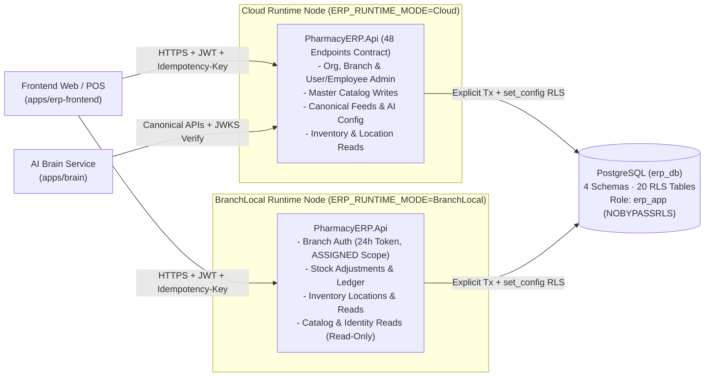

## توزيع العمل في Stage 1 بين المطورين الأربعة

عشان نفهم إزاي 4 مطورين بنوا المشروع بالتوازي من غير ما يدمروا شغل بعض، دي كانت خريطة الملكية في Stage 1:

| المطور | الموديول (Module) | الـ Schema | الدور الأساسي |
| :--- | :--- | :--- | :--- |
| **Dev 1** | **Identity & Auth** | `identity` (7 جداول) | المنظمات، الفروع، الموظفين، الحسابات، الصلاحيات، JWT/JWKS، Refresh Tokens، وتفعيل الفروع (`BranchEnrollment`). |
| **Dev 2** | **Catalog & Multi-UOM** | `catalog` (4 جداول) | التصنيفات الشجرية، المنتجات، الباركود، وحدات القياس، قواعد إعادة الطلب (`ReorderRule`)، وواجهات `CanonicalCatalog`. |
| **Dev 3** | **Inventory & Ledger** | `inventory` (5 جداول) | مواقع التخزين، التشغيلات (`Batches`)، الأرصدة (`StockBalance`)، الدفتر غير القابل للتعديل (`InventoryTxn`)، التسويات والعكس (`REVERSAL`)، وواجهات `CanonicalInventory`. |
| **Dev 4** | **Core Infra & Integration** | `integration` (4 جداول) | نواة `PharmacyDbContext`، `UnitOfWork`، `TenantRlsConnectionInterceptor`، الـ Middlewares، `Idempotency`، `Outbox`، `AuditLog`، وواجهات `CanonicalCapabilities`. |

---

# الفصل 2: المعمارية وتنظيم المشروع — من أول سطر كود (Onion + Wave 0)

## 2.1 ليه اخترنا Onion / Clean Architecture؟

**المشكلة اللي بنحلها:** لو حطيت كود الـ SQL و EF Core و HTTP Controllers وقواعد البيزنس في مكان واحد، أي تغيير في قاعدة البيانات أو الـ API هيكسر قواعد البيزنس، والاختبارات (`Unit Tests`) هتبقى مستحيلة من غير داتابيز حقيقية.

**الحل:** قسمنا الـ Solution (`PharmacyERP.sln`) إلى **4 طبقات متحدة المركز** — القاعدة الذهبية إن **الاعتمادية (Dependency) بتمشي للداخل فقط**:

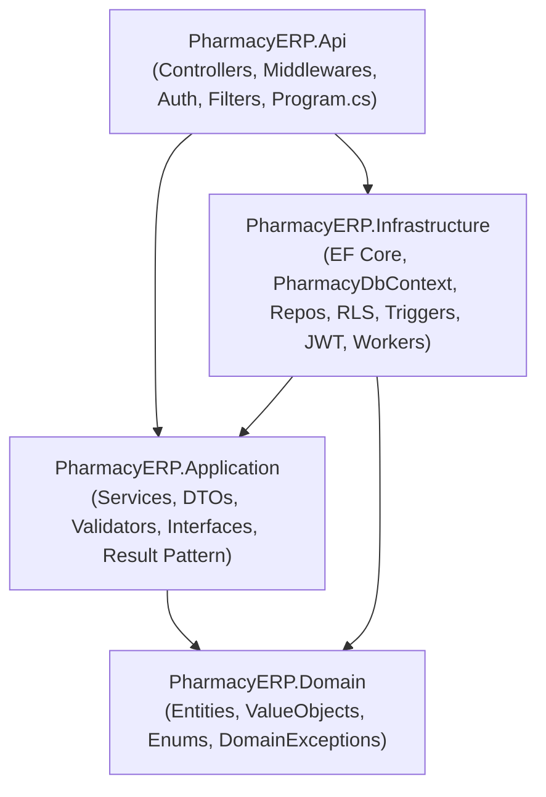

### دور كل طبقة بالتفصيل:

1. **`PharmacyERP.Domain` (القلب النقي — Pure Business Rules):**
   - **دورها:** تحتوي على الكيانات (`Entities`)، القيم الثابتة (`ValueObjects` مثل `Address` و`DeterministicBatchIdGenerator`)، الـ `Enums`، والـ `DomainExceptions`.
   - **القاعدة الصارمة:** **صفر** اعتماد على EF Core أو ASP.NET Core أو Npgsql! كل Entity بيحمي نفسه بنفسه (مثلاً: مينفعش تعمل `UserAccount` بـ `BranchScope.ALL` لو دوره مش `Admin` — الـ Constructor نفسه بيرفض).
2. **`PharmacyERP.Application` (العقل المدبّر — Use Cases):**
   - **دورها:** تحتوي على الـ Services التي تنفّذ سيناريوهات العمل (مثل `AuthService`, `ProductService`, `InventoryAdjustmentService`, `IdempotencyService`)، والـ DTOs، والـ Validators، والواجهات (`Interfaces`) الخاصة بالـ Repositories والـ `IUnitOfWork`.
   - **القاعدة الصارمة:** تعرف `Domain` فقط! لا تعرف إننا بنستخدم PostgreSQL ولا EF Core — بتتكلم مع الواجهات (`IProductRepository`, `IUnitOfWork`)، وده بيخلينا نختبر `590` Unit Test في ثواني معدودة!
3. **`PharmacyERP.Infrastructure` (العضلات والتنفيذ الفعلي):**
   - **دورها:** تنفّذ كل الواجهات اللي في `Application` باستخدام EF Core وPostgreSQL: `PharmacyDbContext`، ملفات `IEntityTypeConfiguration<T>`، الـ Repositories، `UnitOfWork`، `TenantRlsConnectionInterceptor`، سكربتات الـ RLS والـ Triggers، الـ JWT/Password Hasher، و`OutboxPublisherWorker`.
4. **`PharmacyERP.Api` (البوابة الخارجية — HTTP Edge):**
   - **دورها:** Controllers **نحيفة جداً (Thin Controllers)** لا تحتوي على أي منطق بيزنس! كل وظيفتها استلام الـ HTTP Request، سحب `Idempotency-Key` من الـ Header، استدعاء Service واحدة في `Application`، وتحويل النتيجة عبر `ApiResultMapper`.

---

## 2.2 استراتيجية "Wave 0 Clean Root Files" (ليه `Program.cs` و`PharmacyDbContext.cs` ممنوع لمسهم؟)

**المشكلة اللي بنحلها:** في مشاريع الفرق (4 مطورين شغالين في نفس الوقت)، أكتر ملفين بيحصل فيهم **Merge Conflicts كارثية** هما `Program.cs` و`DbContext.cs`، لأن كل مطور بيضيف `DbSet` و`AddScoped` و`UseMiddleware` في نفس السطور!

**الحل العبقري اللي اتعمل من أول يوم (Wave 0):**
1. **`src/PharmacyERP.Api/Program.cs` (38 سطر فقط — ثابت لا يتغير):**
   لا يحتوي على أي `AddScoped` أو `UseMiddleware` مباشر، فقط يستدعي 4 امتدادات نظيفة:
   ```csharp
   builder.Services.AddApplicationServices();
   builder.Services.AddInfrastructureServices(builder.Configuration);
   builder.Services.AddApiServices();
   ...
   app.UsePharmacyErpMiddlewares();
   app.MapControllers();
   ```
2. **`src/PharmacyERP.Infrastructure/Persistence/Database/PharmacyDbContext.cs` (46 سطر فقط — ثابت لا يتغير):**
   يتم تعريفه كـ `public partial class PharmacyDbContext`، وبيعمل 3 حاجات أوتوماتيكية لكل كيان جديد في المشروع **بدون ما تعدّل فيه حرف**:
   - يكتشف كل ملفات `IEntityTypeConfiguration<T>` أوتوماتيكياً بـ `ApplyConfigurationsFromAssembly(...)`.
   - يركّب **Global Query Filter** أوتوماتيكياً على أي Entity فيه خاصية `OrganizationId`.
   - يفرض `DeleteBehavior.Restrict` على **كل** الـ Foreign Keys في المشروع لمنع أي مسح متسلسل (`Cascade Delete`) يدمّر بيانات صيدلية!
3. **كل موديول ليه Partial Class خاص بيه للـ `DbSet`s:**
   - `PharmacyDbContext.Identity.cs`
   - `PharmacyDbContext.Catalog.cs`
   - `PharmacyDbContext.Inventory.cs`
   - `PharmacyDbContext.Integration.cs`
   *(وفي Stage 2 هنضيف `PharmacyDbContext.Sales.cs` بدون لمس `PharmacyDbContext.cs`!)*
4. **ملف Configuration واحد لكل جدول** تحت `Persistence/Configurations/<Module>/<Entity>Configuration.cs`.
5. **سلسلة Migrations موحّدة واحدة** تحت `Persistence/Migrations/` لقاعدة بيانات واحدة `erp_db` (ممنوع كل مطور يعمل `DbContext` خاص بيه!).

---

## 2.3 نمط `Result<T>` وتوحيد الأخطاء (`ApiErrorEnvelopeDto`)

**المشكلة اللي بنحلها:** لو الـ Service بترمي `Exception` لكل خطأ متوقع (زي "المنتج مش موجود" أو "الرصيد غير كافي")، الكود بيبطأ، الـ Control Flow بيبقى فوضوي، وكل Controller بيرجع شكل JSON مختلف للأخطاء وده بيخنق فريق الـ Frontend!

**الحل:**
- كل أخطاء البيزنس المتوقعة بترجع كقيمة نظيفة من خلال `Result` / `Result<T>` (`src/PharmacyERP.Application/Common/DTOs/Result.cs`) مع كود من `ErrorCode` (`src/PharmacyERP.Domain/Enums/ErrorCode.cs`).
- كل الـ Controllers بترجع النتيجة من خلال `ApiResultMapper` (`src/PharmacyERP.Api/Common/ApiResultMapper.cs`) اللي بيوحّد شكل أي خطأ في النظام كله إلى `ApiErrorEnvelopeDto`:

```json
{
  "error": {
    "code": "VALIDATION_ERROR",
    "message": "One or more validation errors occurred. Please check the request details.",
    "details": [
      { "field": "lines[0].entered_qty", "issue": "EnteredQty must be greater than zero." }
    ],
    "trace_id": "00-4bf92f3577b34da6a3ce929d0e0e4736-00f067aa0ba902b7-01"
  }
}
```

### جدول التحويل الموحّد بين `ErrorCode` و`HTTP Status`:

| `ErrorCode` | HTTP Status | المعنى ومتى يُستخدم؟ |
| :--- | :---: | :--- |
| `MALFORMED_REQUEST` | `400` | JSON فاضي أو مشوّه (`JsonReaderException` / فشل Root `$`)، أو غياب `Idempotency-Key` في Header وBody معاً |
| `UNAUTHORIZED` | `401` | مفيش توكن، أو توكن منتهي/مسحوب (`SecurityStamp`)، أو بيانات دخول/تفعيل غلط (مع Header `WWW-Authenticate: Bearer`) |
| `FORBIDDEN` | `403` | الدور (`Role`) أو الصلاحية مش مسموحة، حساب موقوف/مقفول عند الدخول، أو `organization_id` لـ Tenant تاني |
| `FORBIDDEN_BRANCH` | `403` | الموظف بيحاول يوصل لفرع مش ضمن صلاحياته (`!_currentUser.CanAccessBranch(branchId)`) أو الدخول على `BranchLocal` لفرع غير مصرح |
| `NOT_FOUND` | `404` | الكيان غير موجود (أو مخفي بـ RLS)، أو الـ Endpoint محجوب بسبب `RuntimeMode` (`Cloud` vs `BranchLocal`) |
| `CONFLICT` | `409` | تكرار Unique Key (`SKU`/`Barcode`)، تعديل UOM تاريخي، تعارض تزامن (`row_version`)، أو `40001`/`40P01`/`23505` |
| `INVALID_STATE_TRANSITION` | `409` | انتقال حالة غير قانوني (مثل `OPENING_BALANCE` على رصيد له تاريخ، أو عكس حركة غير `POSTED` أو عكسها مرتين) |
| `OUT_OF_STOCK` | `409` | رصيد المخزون المتاح أقل من الكمية المطلوب سحبها |
| `IDEMPOTENCY_MISMATCH` | `409` | نفس `Idempotency-Key` اتبعت تاني بس بـ Request Body مختلف! |
| `VALIDATION_ERROR` | `422` | JSON سليم نحوياً لكن فشل في نوع الحقل، أو Enum رقمي مرفوض، أو Pagination/FluentValidation/DomainException (مع `error.details[].field` بـ `snake_case`) |
| `EXPIRY_POLICY_VIOLATION` | `422` | مخالفة سياسة الصلاحية (منتج منتهي الصلاحية أو في الحجر) |
| `INTERNAL_SERVER_ERROR` | `500` | خطأ خادم غير متوقع يلتقطه `ExceptionHandlingMiddleware` بدون تسريب تفاصيل داخلية |

> **قواعد الـ Wire Format والتسلسل الصارمة (`Api/DependencyInjection.cs`):**
> 1. **Strict `snake_case` عالمياً:** جميع الـ Controllers والـ Middlewares (`ExceptionHandlingMiddleware`, `RuntimeModeGuardMiddleware`) ومعالجات المصادقة (`ApiErrorAuthorizationMiddlewareResultHandler`, `JwtBearerEvents`) تتشارك `DependencyInjection.ApiJsonSerializerOptions` المضبوط على `JsonNamingPolicy.SnakeCaseLower` — وبالتالي كل الحقول والـ Query Parameters (`[FromQuery(Name = "...")]`) وأسماء الحقول داخل `error.details[].field` (عبر `NormalizeModelStateFieldName`) بتطلع وتدخل بـ **`snake_case`** (إرسال `camelCase` يرفضه الـ Model Binding بـ `422`).
> 2. **String-Only Enums (`allowIntegerValues: false`):** الـ `JsonStringEnumConverter(namingPolicy: null, allowIntegerValues: false)` يطبع الـ Enums كـ Strings صريحة (`"Admin"`, `"ADJUSTMENT_IN"`, `"ASSIGNED"`) ويرفض الأرقام (`1`, `2`) بـ **`422 VALIDATION_ERROR`**.
> 3. **التفريق الدقيق بين `400` و`422` (`IsMalformedJsonOrProtocolRequest`):** الـ JSON المكسور نحوياً أو الـ Body الفارغ أو غياب `Idempotency-Key` يرجع **`400 MALFORMED_REQUEST`**، بينما الـ JSON السليم نحوياً اللي فيه نوع قيمة غلط أو Enum رقمي أو خطأ تحقق يرجع **`422 VALIDATION_ERROR`** بنفس `ApiErrorEnvelopeDto`.
> 4. **معيار `201 Created` + `Location`:** جميع الـ 11 Endpoint الخاصة بإنشاء موارد جديدة ترجع **`201 Created`** مع Header `Location` عبر `ApiResultMapper.ToCreatedResult(...)`.
> 5. **توحيد `401` و`403` على مستوى الـ Auth Middleware:** تنفيذ `ApiErrorAuthorizationMiddlewareResultHandler` و`JwtBearerEvents` (`OnChallenge` / `OnForbidden`) يضمن إن رفض `[Authorize]` أو السياسات يرجّع دايماً `ApiErrorEnvelopeDto` كامل ومستحيل يرجّع Body فاضي!

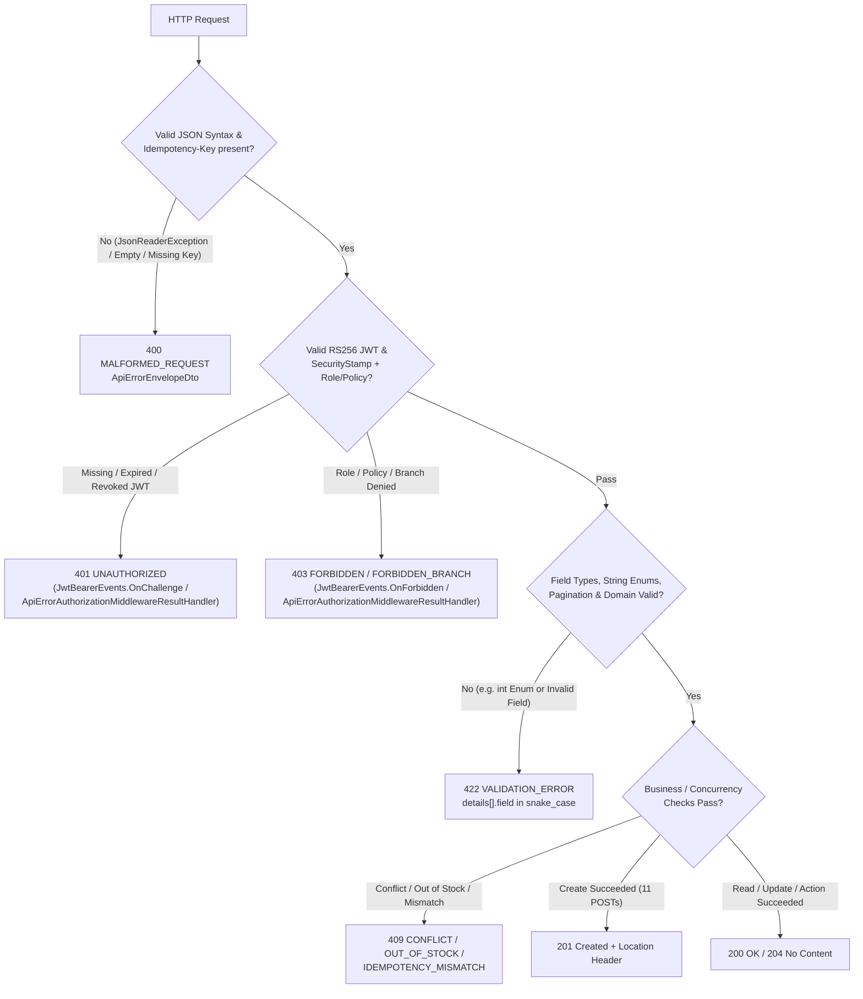

---

# الفصل 3: رحلة الـ HTTP Request من الباب للداتابيز (Middleware Pipeline)

كل Request بيدخل السيرفر بيمر على **سلسلة Middlewares مرتّبة بدقة جراحية** داخل `src/PharmacyERP.Api/Middleware/MiddlewareExtensions.cs`. **الترتيب ده مش عشوائي — لو بدّلت مكان اتنين بس ممكن تكسر الأمان أو الـ CORS!**

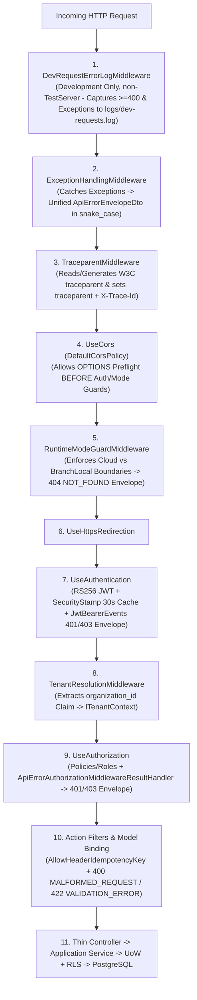

## ليه كل Middleware موجود وليه في الترتيب ده بالذات؟

1. **`DevRequestErrorLogMiddleware`** *(أول واحد، في `Development` فقط ومش في الـ TestServer)*:
   - **دوره:** يلفّ حول الـ Pipeline كلها عشان بعد ما `ExceptionHandlingMiddleware` يمسك أي خطأ ويكتب الرد، يسجّل سطر JSON كامل في `logs/dev-requests.log` فيه الـ `traceId` والـ `statusCode` والـ `organizationId` والـ `role` والـ `exception` (بأمان عبر `SemaphoreSlim`).
   - **المشكلة اللي بيحلها:** لما فريق الـ Frontend يجرب الـ API وتطلع أخطاء، نقدر نعملها Triage أوتوماتيكياً بـ `/triage-api-logs`!
2. **`ExceptionHandlingMiddleware`**:
   - **دوره:** شبكة الأمان العالمية — يلتقط أي Exception غير متوقع أو متعمّد (`ValidationException` → `422`, `AppException` → كوده، `DomainException` → `422`, `DbUpdateConcurrencyException` → `409`, PostgreSQL `40001`/`40P01`/`23505` → `409`, `JsonException` → `400`, وأي خطأ داخلي مجهول → `500 INTERNAL_SERVER_ERROR` برسالة عامة بدون تسريب تفاصيل السيرفر أو الداتابيز!)، ويستخدم `DependencyInjection.ApiJsonSerializerOptions` (`snake_case`).
   - **ملحوظة مهمة:** لو العميل ألغى الطلب (`OperationCanceledException` مع `RequestAborted`), بيسجلها كـ `Information` ومبيعتبرهاش `500`!
3. **`TraceparentMiddleware`**:
   - **دوره:** يقرأ معيار W3C `traceparent` (أو يولّد Trace ID جديد بـ `00-<32hex>-<16hex>-01`)، يخزّنه في `HttpContext.Items["TraceId"]`، ويرجّع الاتنين في Response Headers (`traceparent` و`X-Trace-Id`) في كل رد.
   - **المشكلة اللي بيحلها:** ربط أي شكوى من مستخدم بالـ Log والـ `AUDIT_LOG` في الداتابيز بنفس الـ `trace_id`.
4. **`UseCors(DefaultCorsPolicy)`** *(لازم قبل `RuntimeModeGuard` و`UseAuthentication`!)*:
   - **المشكلة اللي بيحلها:** المتصفح بيبعت طلب `OPTIONS` (Preflight) من غير Token عشان يسأل السيرفر هل مسموح يبعت `Authorization` و`Idempotency-Key`. لو حطينا الـ CORS بعد `UseAuthentication` أو `RuntimeModeGuard`، المتصفح هيترفض قبل ما الطلب الحقيقي يوصل!
   - في `appsettings.json` مضبوط على `["*"]` للتطوير (مع `AllowCredentials` عبر `SetIsOriginAllowed(_ => true)`), وفي الإنتاج بيتقفل على الدومين الفعلي من الـ Config من غير تعديل كود.
5. **`RuntimeModeGuardMiddleware`**:
   - **دوره:** بوابة الفصل الصارمة بين **`Cloud`** و**`BranchLocal`** قبل حتى ما نستهلك CPU في فك التوكن!
   - **المشكلة اللي بيحلها:** منع كتابة حركات مخزون مباشرة على `Cloud` (`/api/v1/inventory/adjustments`)، ومنع إنشاء المنظمات أو استخدام تفعيل الفروع (`/api/v1/branch-enrollment`) أو مسارات `/api/v1/canonical/*` (ما عدا `capabilities`) أو أي كتابة على الكتالوج والإدارة (`branches`, `users`, `employees`, `products`, `product-categories`, `reorder-rule`) على `BranchLocal`! مع ملاحظة أن `GET /api/v1/canonical/capabilities` متاح في الوضعين ويرجع مصفوفات فارغة `[]` في `BranchLocal`.

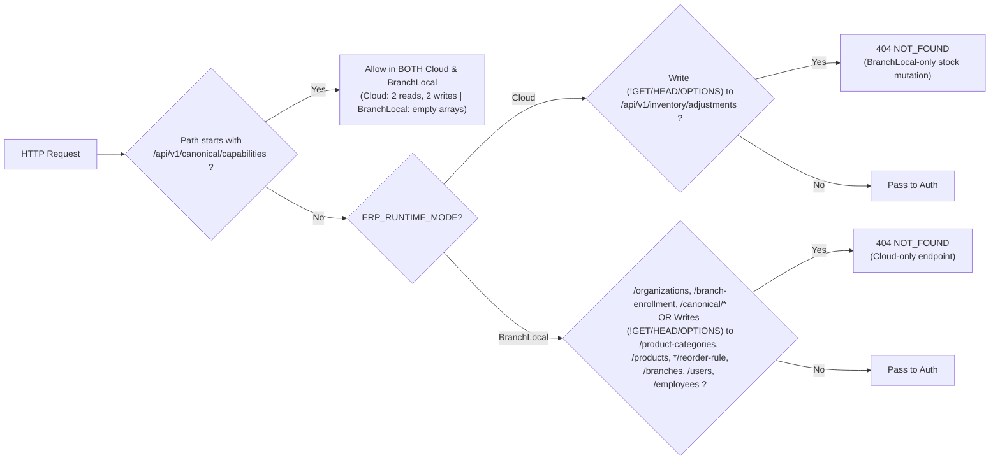

6. **`UseAuthentication()` + `JwtBearerEvents`**:
   - يتحقق من توقيع RS256 باستخدام المفتاح العام من `JwksKeyProvider` (`RoleClaimType = "roles"` و`NameClaimType = "sub"`)، ويتحقق من `Issuer`, `Audience`, `Lifetime` (`ClockSkew = 30s`)، ثم ينفّذ `OnTokenValidated` (استثناء `PlatformProvisioner` التشغيلي، ثم استدعاء `IUserSecurityStampValidator.ValidateAsync(...)` للتأكد إن المستخدم لسه Active وإن `security_stamp` متغيرش بـ Cache 30 ثانية). وفي حالة الفشل يستدعي `OnChallenge` / `OnForbidden` لكتابة `ApiErrorEnvelopeDto`.
7. **`TenantResolutionMiddleware`** *(لازم **بعد** `UseAuthentication` و**قبل** `UseAuthorization`!)*:
   - يقرأ `organization_id` من الـ JWT Claims الموثّق ويعمل `tenantContext.SetTenant(organizationId)`.
   - لو الطلب غير مصادق عليه وموجّه فقط لأحد مسارات الاكتشاف المسموحة (`login`, `refresh`, `branch-enrollment`, `organizations`, `canonical/capabilities`) يسمح مؤقتاً بـ `AllowSystemBypass()`.
8. **`UseAuthorization()` + `ApiErrorAuthorizationMiddlewareResultHandler`**:
   - يفحص السياسات (`AdminOnly`, `OrgAdminOnly`, `PlatformProvisionerOnly`, أو `[Authorize(Roles = "...")]`). لو فشل الطلب، يعترضه `ApiErrorAuthorizationMiddlewareResultHandler` ليرجّع `401 UNAUTHORIZED` (مع `WWW-Authenticate: Bearer`) أو `403 FORBIDDEN` بصيغة `ApiErrorEnvelopeDto` الموحّدة بدل Body فاضي!
9. **`[AllowHeaderIdempotencyKey]` Filter + `InvalidModelStateResponseFactory`**:
   - **المشكلة اللي بيحلها:** في معايير REST، الـ Frontend بيبعت `Idempotency-Key` في الـ HTTP Header مش جوه الـ JSON Body. الـ Filter (`src/PharmacyERP.Api/Filters/AllowHeaderIdempotencyKeyAttribute.cs`) بيزيل خطأ الـ ModelState الخاص بـ `IdempotencyKey` طالما موجود في الـ Header، وبعدين الـ Controller يدمجه (والأولوية دايماً للـ Header المجرّد من المسافات). ولو غاب في الاتنين يرجّع `400 MALFORMED_REQUEST` (`field: "Idempotency-Key"`). أما أخطاء الـ Model Binding الأخرى فتفرزها `IsMalformedJsonOrProtocolRequest` بين `400 MALFORMED_REQUEST` و`422 VALIDATION_ERROR`!

---

# الفصل 4: قاعدة البيانات وعزل الصيدليات — Multi-Tenancy & PostgreSQL RLS

ده **أهم فصل هندسي في المشروع كله** — لو فهمته كويس، هتفهم 80% من ليه الكود مكتوب بالشكل ده!

## 4.1 المشكلة: ليه "أعمل `WHERE organization_id = @orgId`" مش كفاية؟

تخيّل إن قاعدة البيانات فيها بيانات 500 صيدلية منافسة. لو اعتمدنا بس على إن المبرمج يفتكر يكتب `.Where(x => x.OrganizationId == orgId)`:
- لو مبرمج واحد في يوم تعبان نسى `.Where(...)` أو كتب Raw SQL أو استعمل `IgnoreQueryFilters()` — **كارثة قانونية وتجارية (Cross-Tenant Data Leak)!**
- ولو استخدمنا Connection Pooling (زي Npgsql أو PgBouncer) وضبطنا متغير جلسة عادي (`SET app.organization_id = ...`)، الاتصال هيرجع للـ Pool وهياخده Request بتاع صيدلية تانية ببيانات الصيدلية الأولى!

## 4.2 الحل: جدار الحماية ذو الـ 5 طبقات (Defense-in-Depth)

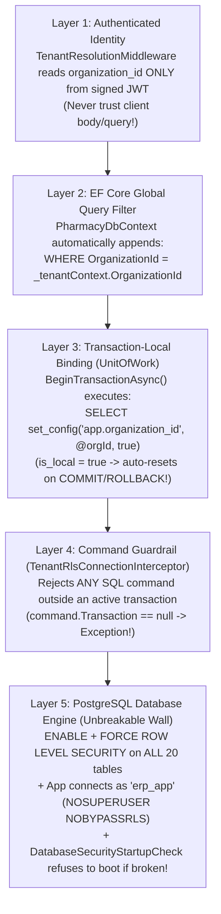

### أسئلة ذكية هتخطر في بالك وإجاباتها:

#### سؤال 1: ليه حتى عمليات القراءة (`GET`) لازم تفتح `BeginTransactionAsync()` وبعدين تعمل `RollbackTransactionAsync(CancellationToken.None)`؟
لسببين مترابطين:
1. في PostgreSQL، أمر `set_config('app.organization_id', @orgId, true)` بياخد المعامل التالت `is_local = true` — يعني القيمة دي بتعيش **جوه الـ Transaction الحالية فقط** وبتمسح نفسها تلقائياً بمجرد انتهاء الـ Transaction (وده اللي بيخلي Npgsql Pool وPgBouncer آمنين 100%). **لو مفيش Transaction مفتوحة، `is_local = true` ملهاش تأثير والـ Query هترجع 0 صفوف!**
2. `TenantRlsConnectionInterceptor` بيراقب كل أمر SQL طالع من EF Core، ولو لقى `command.Transaction == null` بيرفضه فوراً قبل ما يروح للداتابيز!
3. بنعمل `RollbackTransactionAsync(CancellationToken.None)` في `finally` على القراءة عشان ننهي الـ Transaction الخفيفة دي فوراً ونرجّع الاتصال للـ Pool ونمسح الـ `ChangeTracker` — وبنبعت `CancellationToken.None` عشان حتى لو العميل قفل المتصفح فجأة، أمر الـ `ROLLBACK` يتنفّذ غصب عنه وميسيبش Transaction معلّقة!

#### سؤال 2: ليه فصلنا بين `erp_migrator` و`erp_app` وعملنا `DatabaseSecurityStartupCheck`؟
في PostgreSQL، المستخدم `postgres` (الـ Superuser) أو أي Role عنده `BYPASSRLS` **بيتجاهل الـ Row Level Security تماماً** حتى لو عملت `FORCE ROW LEVEL SECURITY`!
عشان كده فصلنا الصلاحيات لـ 2 Roles (عبر `provision_db_roles.sql` و`DatabaseRoleSecuritySql.cs`):
- **`erp_migrator`**: يملك الـ 4 Schemas ويطبّق الـ EF Migrations فقط (ليس `SUPERUSER` وليس `BYPASSRLS`).
- **`erp_app`**: الدور اللي الـ API بتشتغل بيه وقت التشغيل (`LOGIN NOSUPERUSER NOBYPASSRLS NOCREATEROLE NOCREATEDB`)، عنده `SELECT/INSERT/UPDATE/DELETE` على الجداول العادية، وعنده **`SELECT, INSERT` فقط** على `integration."AUDIT_LOG"`!
- **`DatabaseSecurityStartupCheck` (`IHostedService`)**: أول ما الـ API يقوم، بيسأل PostgreSQL سؤالين:
  1. هل المستخدم الحالي `rolsuper = true` أو `rolbypassrls = true`؟ **لو آه → يرفض تشغيل الـ API فوراً (Fail-Fast)!**
  2. هل الـ 20 جدول اللي فيهم `OrganizationId` كلهم عليهم `relrowsecurity = true` و`relforcerowsecurity = true`؟ **لو واحد بس ناقص → يرفض تشغيل الـ API فوراً!**

#### سؤال 3: إزاي المستخدم يعمل `Login` أو `Refresh` قبل ما نعرف هو تابع لأنهي Organization أصلاً؟ (رقصة الـ Discovery Bypass!)
دي واحدة من أذكى الحتت في Stage 1 (**Approved Decision A-04**). شوف التسلسل:

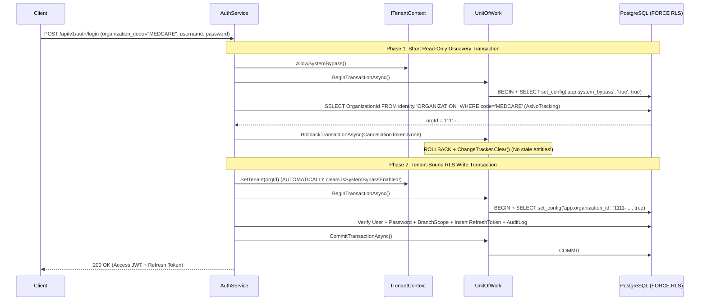

> **لاحظ الأمان هنا:** بمجرد استدعاء `SetTenant(orgId)`، الـ `IsSystemBypassEnabled` بيتصفّر تلقائياً (`false`)، والـ `RollbackTransactionAsync` بيمسح الـ `ChangeTracker` عشان مفيش أي كيان من معاملة الاكتشاف يسرّب بيانات قديمة (Stale Entity) لمعاملة الكتابة!

#### سؤال 4: ليه كل Foreign Key في المشروع مركّب `(organization_id, <fk_id>)` و`DeleteBehavior.Restrict`؟
تخيّل لو جدول `STOCK_BALANCE` فيه FK عادي على `product_id` بس. إيه اللي يمنع Bug معين يربط رصيد في صيدلية A بمنتج موجود في صيدلية B؟
لما نعمل **Composite Alternate Key** على كل جدول أب `(organization_id, product_id)` ونعمل الـ FK في الجدول الابن `(organization_id, product_id)`، **قاعدة البيانات نفسها مستحيل تسمح بربط صف من Tenant A بصف من Tenant B!** ومع `DeleteBehavior.Restrict` مستحيل حذف فرع أو منتج يمسح تاريخه المحاسبي بالخطأ (الحل الصحيح دايماً Soft Deactivation عبر `is_active = false`).

---

## 4.3 خريطة قاعدة البيانات الكاملة (4 Schemas · 20 Tables)

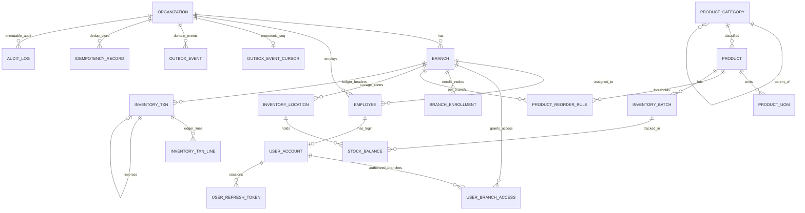

### الـ 20 جدول والـ 2 Migrations الموحّدة:
1. **`20261121210049_Stage1InitialSchemaAndSecurity.cs`**: ينشئ الـ 4 Schemas والـ 20 جدول بكل القيود (`CHECK` constraints, Composite Alternate Keys, Indexes, `row_version`)، ثم ينفّذ مباشرة:
   - `RlsAndAuditProtectionSql.GenerateCompleteStage1SecuritySql()` (تفعيل وإجبار RLS على الـ 20 جدول + Trigger حماية `AUDIT_LOG`).
   - `InventoryLedgerImmutabilitySql.CreateFunctionAndTriggerSql` (Triggers منع تعديل أو حذف أو إضافة سطور على حركات المخزون الـ `POSTED`).
   - `DatabaseRoleSecuritySql.GenerateAppRoleGrantsSql()` (منح الصلاحيات الأقل لـ `erp_app`).
2. **`20261121213818_AddUserSecurityStamp.cs`**: يضيف عمود `security_stamp` على `USER_ACCOUNT` ويحدّث الـ Partial & Performance Indexes (مثل `IX_USER_REFRESH_TOKEN_active_family`، `IX_OUTBOX_EVENT_pending_org_seq`، `IX_STOCK_BALANCE_organization_id_updated_at`، `IX_INVENTORY_BATCH_organization_id_expires_on_batch_number`).

---

# الفصل 5: الموديول الأول — Identity & Auth (الهوية، الفروع، والصلاحيات)

## 5.1 الدور والمشكلة التي يحلها
مسؤول عن **مين إنت؟ تبع أنهي صيدلية؟ مسموحلك تدخل أنهي فروع؟ وإيه صلاحياتك؟** بالإضافة لتأمين تسجيل الدخول، تدوير التوكنات، إيقاف الجلسات فوراً عند فصل موظف، وربط أجهزة الفروع المحلية (`BranchLocal`) بالسحابة (`Cloud`).

## 5.2 الكيانات الأساسية (`identity` Schema — 7 جداول)

| الجدول | الدور | قرار هندسي مهم |
| :--- | :--- | :--- |
| `ORGANIZATION` | الكيان الجذري لكل سلسلة صيدليات (Code, Name, `BaseCurrency`, `TimeZoneId`, `Address`) | يستخدم `ComplexProperty` للـ `Address` (**Approved A-01**) بدون جداول إضافية. `TimeZoneId` يُستخدم لحساب تاريخ العمل الفعلي وصلاحية الأدوية. `OrganizationDto` يضيف `enrollment_setup_state` (`"PENDING"`). |
| `BRANCH` | فرع فعلي داخل المنظمة (`Code`, `Name`, `Address`, `IsActive`) | عند إنشاء منظمة أو فرع جديد، يتم استدعاء `IBranchDefaultLocationSeeder` داخل نفس الـ Transaction لإنشاء مواقع التخزين الافتراضية فوراً! و`BranchDto` يعرض `created_at` و`updated_at`. |
| `EMPLOYEE` | الموظف البشري (الاسم، الهاتف، الفرع الأساسي، العنوان) | مفصول عن `USER_ACCOUNT` لأن مش كل موظف لازم يكون ليه حساب دخول، وحركات المخزون (`created_by_employee_id`) بترتبط بالموظف مش بحساب الدخول! و`EmployeeDto` يعرض `created_at` و`updated_at`. |
| `USER_ACCOUNT` | حساب الدخول الوحيد في النظام (`Username`, `PasswordHash`, `Role`, `BranchScope`, `SecurityStamp`, `LockoutEnd`, `LastLoginAt`, `AccessFailedCount`) | **مفيش جداول ASP.NET Identity الافتراضية!** فقط هذا الجدول. `UserRole` يحتوي: `Admin`, `Pharmacist`, `Cashier`. و`UserDto` يعرض `last_login_at`, `lockout_end`, و`access_failed_count`. |
| `USER_BRANCH_ACCESS` | جدول ربط `(OrganizationId, UserId, BranchId)` | يحدد الفروع المسموح بها للمستخدم ذي النطاق `BranchScope.ASSIGNED`. |
| `BRANCH_ENROLLMENT` | توكنات تفعيل لمرة واحدة (15 دقيقة) لربط جهاز `BranchLocal` بفرع معين | يُخزَّن الـ Hash فقط (`SHA-256`) ويُقفل بـ `FOR UPDATE` لمنع استخدامه مرتين. |
| `USER_REFRESH_TOKEN` | سجل جلسات التجديد (`TokenHash`, `FamilyId`, `ConsumedAt`, `RevokedAt`) | يطبّق **Refresh Token Rotation + Family Revocation** عند اكتشاف سرقة التوكن! |

## 5.3 كيف يعمل الأمان المتقدم في الـ Auth وبنية الـ JWT والردود؟

### أ) التوقيع الرقمي `RS256` و`GET /.well-known/jwks.json` وبنية الـ JWT Claims
- نوقّع الـ JWT بـ **Asymmetric RSA 3072-bit (`RS256`)** عبر `JwksKeyProvider` (وليس مفتاح سري مشترك `HS256`).
- المفتاح العام يُنشر على `GET /.well-known/jwks.json` عبر `IStartupFilter` (`JwksEndpointExtensions` — **Approved A-02** عشان منعدّلش `Program.cs`)، بحيث خدمة `AI Brain` أو أي خدمة تانية تقدر تتحقق من الـ JWT بدون امتلاك المفتاح الخاص!
- عمر الـ Access Token: **15 دقيقة** على `Cloud`، و**24 ساعة** على `BranchLocal` (**Approved A-05**) لدعم العمل في الفرع بدون انقطاع.
- كلمات المرور تُشفّر بـ **PBKDF2-HMAC-SHA512 (100,000 iteration)** عبر `PasswordHasherService` + حد أدنى `12` حرفاً (`[MinLength(12)]`) عند إنشاء مستخدم أو إعادة ضبط كلمة المرور + قفل الحساب `15` دقيقة بعد `5` محاولات فاشلة.
- **بنية الـ JWT Payload (`JwtTokenGenerator.cs`):** يصدر `iss`, `aud`, `sub`, `employee_id`, `username`, `organization_id`, `branch_scope`, `branch_ids` (JSON string array), `security_stamp`, `iat`, `exp`، والأهم أن **`roles` و`scopes` بتصدر كـ JSON string arrays** طبقا لـ Blueprint §8.5 المغلق:
  - `Admin`: `["user:admin", "inventory:read", "inventory:write", "sales:read", "sales:write"]` *(مفردات Blueprint §8.5 المغلقة فقط — بدون أي scopes خارج المواصفة)*.
  - `Pharmacist`: `["inventory:read", "inventory:write", "sales:read"]` *(قراءة المبيعات فقط بدون صلاحية كتابة المبيعات)*.
  - `Cashier`: `["inventory:read", "sales:read", "sales:write"]`.

### ب) الفرق بين `LoginResponse` و`GET /api/v1/auth/me` وسلوك `BranchLocal`
- **`POST /api/v1/auth/login` و`POST /api/v1/auth/refresh`** يرجعان **`LoginResponse`** الذي يحتوي على: `access_token`, `access_token_expires_at`, `refresh_token`, `token_type` (`"Bearer"`), `issuer`, `audience`, `key_id`, و`user: CurrentUserDto`.
- **`GET /api/v1/auth/me`** يرجع **`CurrentUserDto` مسطّح (Flat)** مباشرة على الـ Root بنفس الـ 9 حقول: `user_id`, `employee_id`, `organization_id`, `username` (مقروء من الـ JWT claim الحقيقي)، `role` (`UserRole` enum)، `branch_scope` (`BranchScope` enum)، `branch_ids`, `scopes`, و`runtime_mode` (`ErpRuntimeMode`: `"Cloud"` أو `"BranchLocal"`).
- **تقييد النطاق في `BranchLocal`:** حتى لو كان المستخدم Org Admin بنطاق `ALL`، عند الدخول أو التجديد في وضع `BranchLocal` يتحول `branch_scope` إلى `"ASSIGNED"` و`branch_ids` إلى `[ENROLLED_BRANCH_ID]` و`runtime_mode` إلى `"BranchLocal"` بشكل متطابق داخل الـ JWT و`LoginResponse.user` و`GET /api/v1/auth/me`.

### ج) تدوير الـ Refresh Token واكتشاف السرقة (Token Rotation & Replay Detection)
**المشكلة:** لو هاكر سرق الـ Refresh Token بتاع صيدلي، إزاي نكتشف ده ونوقف الجلسة كلها؟

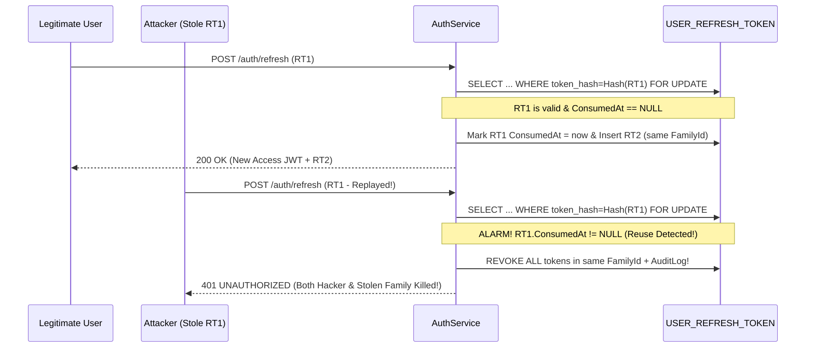

### د) `SecurityStamp` + Cache 30 ثانية (`UserSecurityStampValidator`)
**المشكلة:** لو موظف اترفد الساعة 9 الصبح ومعاه توكن `BranchLocal` صالح لمدة 24 ساعة، الـ JWT Stateless بطبيعته فكان هيفضل شغال لحد تاني يوم!
**الحل:** أضفنا عمود `security_stamp` (`Guid`) في `USER_ACCOUNT` وبنحطه جوه الـ JWT. أي تغيير حساس (فصل/تعطيل حساب، تغيير Password، تغيير Role أو BranchScope، أو `revoke-sessions`) بيدوّر الـ `SecurityStamp` فوراً. ومع كل Request، `JwtBearerEvents.OnTokenValidated` بيسأل `UserSecurityStampValidator` — والذكي هنا إنه مخزّن في **`IMemoryCache` لمدة 30 ثانية فقط**:
- يضمن طرد الموظف خلال ≤ 30 ثانية كحد أقصى!
- وبيوفّر **>99.9%** من استعلامات الداتابيز تحت الضغط (وصل `GET /auth/me` في اختبار السعة الأولي `05_` إلى **1,575.7 RPS**!).

### هـ) حماية تصعيد الصلاحيات (`IUserManagementAuthorizer` + `OrgAdminOnly` + Idempotency + Partial PATCH)
**المشكلة:** في النظام يوجد نوعان من الـ Admin:
- **Org Admin:** `Role = Admin` + `BranchScope = ALL` (يدير كل المنظمة والفروع — سياسة `OrgAdminOnly`).
- **Branch Admin:** `Role = Admin` + `BranchScope = ASSIGNED` (يدير فرع أو فرعين فقط).
لو مفيش حارس مخصص، Branch Admin كان ممكن يبعت `PATCH /users/{hisId}` ويحوّل نفسه لـ `ALL` أو يغيّر باسورد صاحب الصيدلية!
**الحل:** أنشأنا `UserManagementAuthorizer` يفرض 4 قواعد حديدية:
1. فقط `OrgAdminOnly` (`Admin + ALL`) يقدر ينشئ/يعدّل مستخدم `Admin` أو `ALL` أو يدير مستخدمي `ALL` أو ينشئ/يعطّل فروع جديدة (`is_active` في `PATCH /branches/{id}`).
2. الـ `ASSIGNED` Admin يدير فقط المستخدمين اللي فروعهم مجموعة جزئية (`Subset`) من فروعه المصرح بيها، ويقدر يعيّن لهم فروع من فروعه فقط.
3. ممنوع أي مستخدم يعدّل دوره (`Role`) أو نطاقه (`BranchScope`) أو حالته (`IsActive`) لنفسه!
4. على `BranchLocal`، الدخول والتجديد ممنوع (`403 FORBIDDEN_BRANCH`) إلا لو المستخدم فعلاً معيّن على `EnrolledBranchId` (أو `Admin + ALL`).

**اكتمال عقود الـ Identity بعد التحديث (`07_` / `08_` / `11_`):**
- **`Idempotency-Key` في كل خدمات الـ Identity الأربع:** مفعّل على `OrganizationProvisioningService` (`CheckGlobalAsync` + `pg_advisory_xact_lock` قبل ربط الـ Tenant على `POST /organizations`), `BranchService` (`POST/PATCH` + Header-only على `enrollment-tokens`), `UserService` (`POST/PATCH/password-reset` + Header-only على `revoke-sessions`), و`EmployeeService` (`POST/PATCH`), بينما `/auth/login`, `/auth/refresh`, `/auth/logout`, و`/branch-enrollment` معفاة.
- **True Partial `PATCH`:** كل من `UpdateBranchRequest`, `UpdateUserRequest`, و`UpdateEmployeeRequest` يقبل الحقول الاختيارية (مثل إرسال `{"is_active": false}` فقط) مع الحفاظ على القيم السابقة (بما فيها `branch_ids` و`address`) دون مسحها.
- **مؤشر المزامنة الحقيقي عند تفعيل الفرع (`BranchService.RedeemEnrollmentAsync`):** يقرأ قيمة `OUTBOX_EVENT_CURSOR.LastEventSequence` الفعلية بعد إدراج حدث `identity.branch.enrolled` بدل إرجاع `0` ثابت.
- **ضبط الـ RBAC الدقيق:** قراءة الموظفين (`GET /api/v1/employees*`) مقيدة بسياسة `AdminOnly` (`Pharmacist` و`Cashier` يحصلون على `403 FORBIDDEN`)، بينما قراءة الفروع (`GET /api/v1/branches*`) متاحة عبر `[Authorize]` لكل الأدوار ومحصورة في `AuthorizedBranchIds` (وكافة كتابات الـ Identity + `branch-enrollment` تعمل على `Cloud` فقط وترجع `404` على `BranchLocal`).

## 5.4 خريطة Endpoints الخاصة بالـ Identity (`22` Live Endpoints)

| Controller | المسار الأساسي | الـ Endpoints والصلاحيات |
| :--- | :--- | :--- |
| `JwksEndpointExtensions` | `/.well-known/jwks.json` | `GET` (عام — مفاتيح `RS256` العامة) |
| `AuthController` | `/api/v1/auth` | `POST login` (عام), `POST refresh` (عام), `POST logout` (`[Authorize]` -> `204`), `GET me` (`[Authorize]` -> `CurrentUserDto`) |
| `OrganizationsController` | `/api/v1/organizations` | `POST ""` (`PlatformProvisionerOnly`, Cloud-only, `201 Created + Location`, `CheckGlobalAsync` Idempotency) |
| `BranchesController` | `/api/v1` | `GET branches` (`[Authorize]`), `GET branches/{id}` (`[Authorize]` + branch), `POST branches` (`OrgAdminOnly`, Cloud, `201`), `PATCH branches/{id}` (`AdminOnly`, Cloud), `POST branches/{branchId}/enrollment-tokens` (`AdminOnly`, Cloud, `201`, **Header-only** Idempotency), `POST branch-enrollment` (عام, Cloud-only) |
| `EmployeesController` | `/api/v1/employees` | `GET ""` (`AdminOnly`), `GET {id}` (`AdminOnly`), `POST ""` (`AdminOnly`, Cloud, `201`), `PATCH {id}` (`AdminOnly`, Cloud) |
| `UsersController` | `/api/v1/users` | `GET ""` (`AdminOnly`), `GET {id}` (`AdminOnly`), `POST ""` (`AdminOnly`, Cloud, `201`), `PATCH {id}` (`AdminOnly`, Cloud), `POST {id}/password-reset` (`AdminOnly`, Cloud, `204`), `POST {id}/revoke-sessions` (`AdminOnly`, Cloud, `204`, **Header-only** Idempotency) |

---

# الفصل 6: الموديول الثاني — Catalog & Multi-UOM (الكتالوج ووحدات القياس)

## 6.1 الدور والمشكلة التي يحلها
الصيدلية فيها آلاف الأصناف: أدوية، مستحضرات تجميل، أجهزة طبية. كل دواء بيتبع تصنيف شجري، وليه `SKU` و`Barcode`، والأهم: **نفس الدواء بيتباع ويتشترى بأكتر من وحدة قياس (`TAB`, `STRIP`, `BOX`)**!
- الكتالوج في نظامنا **مركزي على `Cloud`** (التعديل على `Cloud` فقط، و`BranchLocal` يقرأ فقط `GET` عشان مفيش فرع يغيّر أسعار أو باركودات على مزاجه!).

## 6.2 الكيانات الأساسية (`catalog` Schema — 4 جداول)

| الجدول | الدور | أهم القيود الهندسية |
| :--- | :--- | :--- |
| `PRODUCT_CATEGORY` | تصنيف شجري للأصناف (`ParentCategoryId`) | يتحقق الـ Service من عدم وجود **دورة شجرية (Cycle Detection)** أو تعيين التصنيف كأب لنفسه! |
| `PRODUCT` | البطاقة الرئيسية للصنف (`Sku`, `Barcode`, `Name`, `BaseUomCode`, `LotTrackingRequired`, `TaxRate`, `IsActive`) | فريد في `(OrganizationId, Sku)` وفريد في `(OrganizationId, Barcode)` (Partial Unique Index للباركود غير الفارغ). `TaxRate` بدقة `numeric(9,4)`. |
| `PRODUCT_UOM` | وحدات القياس للصنف (`UomCode`, `ConversionToBase`, `IsBase`, `IsSellable`, `SaleUnitPrice`, `Barcode`) | **Partial Unique Index** يضمن وجود **وحدة أساس نشطة واحدة فقط** (`is_base = true AND is_active = true`) لكل منتج! `ConversionToBase` بدقة `numeric(18,6)`. |
| `PRODUCT_REORDER_RULE` | حد إعادة الطلب لكل منتج في كل فرع (`ReorderPointBase`, `ReorderQuantityBase`, `MaxQuantityBase`) | واحد لكل `(OrganizationId, BranchId, ProductId)` — يُستخدم في تنبيهات النواقص وواجهات `AI Brain`. |

## 6.3 مثال عملي: إزاي Multi-UOM بيشتغل بدون كوارث حسابية؟

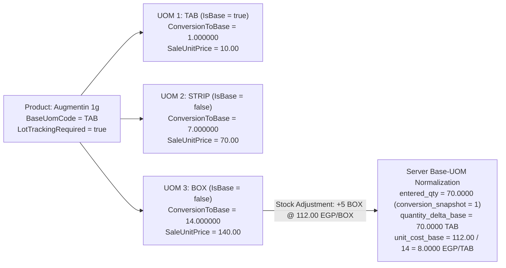

### العقود الحرجة بين Catalog (Dev 2) وInventory (Dev 3):
عشان موديول الكتالوج ميكسرش المخزون، ربطناهم بـ **واجهتين Cross-Module** (`src/PharmacyERP.Application/Common/Interfaces/CrossModule/`):

1. **`IProductInventoryUsageChecker`** (حماية التاريخ المخزني):
   - **المشكلة:** تخيّل منتج عليه رصيد 70 قرص في المخزون، وواحد راح عدّل `BaseUomCode` أو `ConversionToBase` أو غيّر `LotTrackingRequired` من `true` لـ `false`! الأرصدة القديمة كلها هتفسد!
   - **الحل:** قبل أي تعديل خطير على `BaseUomCode` أو `LotTrackingRequired` أو `ConversionToBase` أو `IsBase`، يستدعي `ProductService` / `ProductUomService` الواجهة `IProductInventoryUsageChecker.HasInventoryUsageAsync(...)` — ولو فيه أي رصيد أو حركة سابقة في المخزون **يرفض التعديل فوراً!**
   - *(ملاحظة أمان `A-07`)*: الـ Fallback الافتراضي `TemporaryProductInventoryUsageChecker` يرجع `true` (Fail-Closed) لو الـ Inventory implementation مش مسجل، لكن في الإنتاج `Infrastructure/DependencyInjection.cs` بيسجّل التنفيذ الحقيقي `ProductInventoryUsageChecker`.
2. **`INonLotBatchInitializer`** (التجهيز التلقائي لـ `NON-LOT`):
   - **المشكلة:** لو أنشأت منتج (زي ترمومتر أو شاش طبي) بـ `LotTrackingRequired = false` (سواء من الـ API العادية أو من الـ `CanonicalCatalogService` للـ AI)، مش محتاجين الموظف يكتب رقم تشغيلة كل مرة.
   - **الحل:** فوراً داخل نفس Transaction الإنشاء (أو عند تحويل منتج لـ `LotTrackingRequired = false`)، الكتالوج ينادي `INonLotBatchInitializer.EnsureNonLotBatchExistsAsync(...)` عشان ينشئ تشغيلة النظام الثابتة **`NON-LOT`** بمعرّف UUIDv5 حتمي!

### تفصيلة ذكية جداً في تبديل وحدة الأساس (`ChangeBaseUom`) وقواعد الـ Catalog:
- في `ProductUomConfiguration` يوجد Partial Unique Index يمنع وجود صفّين `is_base = true` لنفس المنتج في نفس اللحظة. لما بنبدّل وحدة الأساس (لو المنتج لسه ملوش استخدام مخزني)، EF Core لو بعت الـ 2 `UPDATE` في Batch واحد كان بيحصل Crash بنسبة 50% لو ترتيب الـ UUID الجديد أصغر من القديم (**Audit C-08**)!
  **الحل:** بنعمل Flush لفك `is_base = false` على الوحدة القديمة (`SaveChangesAsync`) أولاً داخل نفس الـ Transaction، ثم نفعّل `is_base = true` على الوحدة الجديدة!
- **توحيد سلوك الـ Catalog مع العقود (`07_` / `08_`):**
  - **`GET /api/v1/products/{id}/uoms`:** يبدأ افتراضياً بـ **`include_inactive=false`** (يرجع وحدات القياس النشطة فقط ما لم يُطلب `include_inactive=true`، ويرجع `ProductUomDto[]`).
  - **تصفير سعر البيع عند إيقاف البيع (`ProductUomService.UpdateProductUomAsync`):** لو بعتنا `is_sellable = false` في `PATCH` من غير `sale_unit_price`، السيرفر بيمسح أي سعر قديم ويخليه `null` تلقائياً عشان ميفضلش سعر بيع لوحدة غير قابلة للبيع!
  - **True Partial `PATCH` للتصنيفات (`ProductCategoryService.UpdateCategoryAsync`):** إرسال تعديل جزئي مثل `{"is_active": false}` بيحافظ على `name` و`description` و`parent_category_id` الحاليين ولا يمسح الأب أبداً.
  - **ترقيم الصفحات الموحّد (`Pagination`):** قوائم التصنيفات والمنتجات موحّدة على `page=1`, `page_size=25` (الحد الأقصى `200`، وأي قيمة خارج `1..200` أو `page < 1` ترجع `422 VALIDATION_ERROR` مع `error.details[].field` بـ `snake_case` مثل `page_size`, `parent_category_id`, `category_id`).

## 6.4 واجهات Canonical Catalog والذكاء الاصطناعي (`AI_ASSISTED`)
- `GET /api/v1/canonical/products`: واجهة قراءة بـ **Keyset Pagination** (Cursor-based) تستهلكها خدمة `AI Brain` لمزامنة الكتالوج بكفاءة بدون `OFFSET` بطيء (`limit` افتراضي `50` بحد أقصى `1000`، وعند `<= 0` يرجع للافتراضي `50`).
- `POST /api/v1/canonical/configuration/products` و`PUT /api/v1/canonical/configuration/reorder-rules`: واجهات تعديل مدعومة بالـ AI — كل تعديل منها يُسجَّل في `AUDIT_LOG` بـ **`AuditActorType.AI_ASSISTED`** مع **`source_prompt_id`** عشان يبقى معروف بدقة أي Prompt سبب التغيير ده! (ملاحظة: `POST .../configuration/products` يرجّع **`201 Created + Location`** مع `CreateProduct` أو `AddUom`، و**`200 OK`** مع `UpdateProduct`/`UpdateUom`/`DeactivateUom`).

## 6.5 خريطة Endpoints الخاصة بالـ Catalog (`16` Live Endpoints)

| Controller | المسار الأساسي | الـ Endpoints |
| :--- | :--- | :--- |
| `ProductCategoriesController` | `/api/v1/product-categories` | `GET ""` (`page=1, page_size=25`), `GET {id}`, `POST ""` (`Cloud`, `201`), `PATCH {id}` (`Cloud`, partial) |
| `ProductsController` | `/api/v1/products` | `GET ""` *(يدعم `search` بالاسم/SKU/Barcode + `category_id` + `include_inactive`)*, `GET {id}`, `POST ""` (`Cloud`, `201`), `PATCH {id}` (`Cloud`), `GET {id}/uoms` *(`include_inactive=false`)*, `POST {id}/uoms` (`Cloud`, `201`), `PATCH {id}/uoms/{uomId}` (`Cloud`) |
| `ReorderRulesController` | `/api/v1/branches/{branchId}/products/{productId}/reorder-rule` | `GET ""` (`Admin,Pharmacist,Cashier`), `PUT ""` (`Admin,Pharmacist`, `Cloud`) |
| `CanonicalCatalogController` | `/api/v1/canonical` | `GET products` (`Cloud`), `POST configuration/products` (`Cloud`, `201`/`200`), `PUT configuration/reorder-rules` (`Cloud`) |

---

# الفصل 7: الموديول الثالث — Inventory & Immutable Ledger (المخزون والدفتر المحاسبي)

## 7.1 الفلسفة الأساسية: ليه المخزون "دفتر محاسبي" مش مجرد `UPDATE stock = stock + 5`؟

لو عملت نظام صيدلية بيعدّل عمود `Quantity` وخلاص:
- لما يظهر عجز 50 علبة آخر الشهر، **محدش هيعرف مين سحبهم، إمتى، بأي تكلفة، ومن أنهي تشغيلة!**
- لو اتنين صيادلة عدّلوا نفس الدواء في نفس اللحظة، **الرصيد ممكن يبقى سالب أو يحصل Lost Update!**

عشان كده صمّمنا المخزون بـ **نموذج مزدوج (Ledger + Materialized Balance)**:
1. **الدفتر غير القابل للتعديل (`INVENTORY_TXN` + `INVENTORY_TXN_LINE`)**: ده "دفتر اليومية" — كل زيادة أو نقصان بتتسجّل كحركة `POSTED` لا يمكن تعديلها ولا حذفها أبداً!
2. **الرصيد اللحظي (`STOCK_BALANCE`)**: ده "ملخص الرصيد الحالي والتكلفة المتوسطة (`WAC`)" لكل `(LocationId, BatchId)` عشان القراءة والبيع يبقوا سريعين جداً، وبيتحدث **ذرياً (Atomically)** في نفس الـ Transaction مع الدفتر وتحت قفل `FOR UPDATE` + `row_version`!

## 7.2 الكيانات الأساسية (`inventory` Schema — 5 جداول)

| الجدول | الدور | تفصيلة هندسية حاسمة |
| :--- | :--- | :--- |
| `INVENTORY_LOCATION` | مناطق التخزين داخل الفرع (`SELLABLE`, `QUARANTINE`, `DAMAGED`, `SCRAP`) | يتم إنشاء المواقع الافتراضية تلقائياً عند إنشاء فرع جديد عبر `IBranchDefaultLocationSeeder`. |
| `INVENTORY_BATCH` | تشغيلة الدواء (`BatchNumber`, `ExpiresOn`, `QualityStatus`: `AVAILABLE`/`QUARANTINED`/`EXPIRED`/`RECALLED`) | الـ Primary Key (`batch_id`) ليس عشوائياً — بل **Deterministic UUIDv5**! وتقييم الصلاحية (`available_qty_base`) يعتمد على **`Organization.TimeZoneId`** لا `UTC`. |
| `STOCK_BALANCE` | الرصيد اللحظي (`OnHandQtyBase numeric(18,4)`, `AverageUnitCost numeric(18,4)`, `RowVersion`) | مفتاح مركّب `(OrganizationId, LocationId, BatchId)` + حماية مزدوجة: `FOR UPDATE` + `RowVersion` (`IsConcurrencyToken` ومرجَع في `StockBalanceDto.row_version`). |
| `INVENTORY_TXN` | رأس حركة المخزون (`TransactionNo`, `TransactionType`, `Status`: `DRAFT`/`POSTED`/`CANCELLED`, `ReversesInventoryTxnId`, `CreatedByEmployeeId`) | يحتوي بالفعل على أعمدة `sales_order_id` و`sales_return_id` (Nullable) جاهزة لـ Stage 2! |
| `INVENTORY_TXN_LINE` | سطور الحركة (`LocationId`, `ProductId`, `BatchId`, `ProductUomId`, `EnteredQty`, `ConversionSnapshot`, `QuantityDeltaBase`, `UnitCostBase`) | كل سطر محفوظ ومرجَع **مُطبَّع على وحدة الأساس (`Base UOM`)** (`conversion_snapshot = 1`) ومحصّن بـ PostgreSQL Trigger يمنع `INSERT`/`UPDATE`/`DELETE` لو الرأس `POSTED`! |

## 7.3 سر الـ `Deterministic UUIDv5` في `DeterministicBatchIdGenerator.cs`

**المشكلة:** لو فرع أو خدمة تانية استقبلت نفس الدواء بنفس رقم التشغيلة وتاريخ الصلاحية، إزاي نعرف إنهم نفس الـ `Batch` بالضبط من غير ما نعمل Query الأول ومن غير ما تتكرر الصفوف تحت التزامن؟

**الحل (`src/PharmacyERP.Domain/ValueObjects/DeterministicBatchIdGenerator.cs`):**
بنحسب الـ `batch_id` حتمياً بمعيار **RFC 4122 UUIDv5** (باستخدام DNS Namespace `6ba7b810-9dad-11d1-80b4-00c04fd430c8` + `SHA-1` مع تحويل Network Byte Order) على JSON قياسي بـ `snake_case`:
```json
{"organization_id":"...","product_id":"...","batch_number":"LOT-2026A","expires_on":"2026-12-31"}
```
- **ملاحظة حاسمة:** `batch_number` **حساس لحالة الأحرف (Case-Sensitive)** ولا يتم عمل `Trim` أو `ToUpper` له (احتراماً لمعايير تتبع الأدوية).
- بالنسبة للمنتجات ذات `LotTrackingRequired = false`، بنستخدم `GenerateNonLotBatchId(orgId, productId)` بقيمة ثابتة `"NON-LOT"` و`expires_on = null`.
- **الفايدة الجبارة:** لو طلبين جم في نفس الملي ثانية على نفس التشغيلة، الاتنين هيحسبوا **نفس الـ `batch_id` بالضبط**، فـ `INSERT ... ON CONFLICT (batch_id) DO NOTHING` هيوحّدهم بدون أي تكرار!

## 7.4 تشريح عملية `POST /api/v1/inventory/adjustments` خطوة بخطوة

دي أعقد وأقوى عملية كتابة في Stage 1 (`InventoryAdjustmentService.cs`). شوف الرحلة الكاملة اللي بتحصل داخل Transaction واحدة (مع Retry أوتوماتيكي حتى 3 مرات على أخطاء التزامن `DbUpdateConcurrencyException` / `40001` / `40P01`):

```mermaid
sequenceDiagram
    participant Client as Pharmacist / Admin (BranchLocal)
    participant Svc as InventoryAdjustmentService
    participant Idem as IdempotencyService
    participant DB as PostgreSQL (FORCE RLS + Triggers)
    participant Out as Outbox & Audit

    Client->>Svc: POST /api/v1/inventory/adjustments (Header or Body: Idempotency-Key)
    Note over Svc: 1. Validate Input + BranchLocal Mode + Tenant + EmployeeId + CanAccessBranch
    Note over Svc: (Permitted for BOTH Admin & Pharmacist incl. OPENING_BALANCE; Cashier -> 403)

    Svc->>DB: BEGIN + SELECT set_config('app.organization_id', @orgId, true)
    Svc->>Idem: CheckAsync (pg_advisory_xact_lock + SHA-256 CanonicalJsonHasher)
    alt Same Key + Same Payload
        Idem-->>Svc: IsReplay = true (Return Stored 201 Response + ROLLBACK!)
    else Same Key + Different Payload
        Idem-->>Svc: 409 IDEMPOTENCY_MISMATCH (+ ROLLBACK!)
    end

    Note over Svc,DB: 2. Batch Pre-fetch (Zero N+1 Queries!)
    Svc->>DB: Batch Fetch Locations, Products, ProductUoms & Active BaseUomIds
    Svc->>DB: Compute Deterministic BatchIds & Set-based INSERT ON CONFLICT DO NOTHING

    Note over Svc,DB: 3. Anti-Deadlock Deterministic Locking!
    Svc->>DB: INSERT STOCK_BALANCE (0,0) ON CONFLICT DO NOTHING
    Svc->>DB: SELECT ... FROM STOCK_BALANCE WHERE ... ORDER BY location_id ASC, batch_id ASC FOR UPDATE

    Note over Svc: 4. Base-UOM Ledger Normalization & WAC Math (Reject Negative -> 409 OUT_OF_STOCK)
    Note over Svc: (product_uom_id = baseUomId, conversion_snapshot = 1, entered_qty = abs(delta_base), unit_cost_base = enteredCost / factor)
    Note over Svc: (If REVERSAL: lines & reason_code optional; load POSTED txn, reject double-reversal, invert server-side!)

    Note over Svc,DB: 5. Two-Step Trigger-Safe Persistence (DRAFT -> POSTED)
    Svc->>DB: SaveChanges #1: INSERT INVENTORY_TXN (DRAFT) + LINES + UPDATE STOCK_BALANCE (row_version++)
    Svc->>Svc: inventoryTransaction.Post(now) -> Status = POSTED
    Svc->>Out: Enqueue OutboxEvent (locks OUTBOX_EVENT_CURSOR) + AuditLog + Persist IdempotencyRecord
    Svc->>DB: SaveChanges #2: UPDATE TXN -> POSTED + INSERT Outbox/Audit/Idempotency + COMMIT!
    Svc-->>Client: 201 Created + Location (InventoryTxnDto)
```

### 5 تفاصيل عبقرية لازم تفهمهم في العملية دي:

1. **ليه بنعمل `ORDER BY location_id ASC, batch_id ASC FOR UPDATE`؟ (منع الـ ABBA Deadlock!)**
   تخيّل Request 1 بيعدّل `[Batch A, Batch B]`، وRequest 2 في نفس اللحظة بيعدّل `[Batch B, Batch A]`.
   لو كل واحد قفل بالترتيب اللي جاي من العميل:
   - Request 1 يقفل `Batch A` ويستنى `Batch B`
   - Request 2 يقفل `Batch B` ويستنى `Batch A`
   ← **Deadlock (`40P01`) فوري!**
   بترتيب القفل حتمياً بـ `(LocationId, BatchId)`، دايماً الاتنين يطلبوا `Batch A` الأول ثم `Batch B` ← **صفر Deadlocks!**

2. **ليه بنعمل `SaveChangesAsync()` مرتين (`DRAFT` ثم `POSTED`)؟**
   بسبب Trigger الحماية `InventoryLedgerImmutabilitySql.cs`! الـ Trigger على `INVENTORY_TXN_LINE` فيه `BEFORE INSERT` بيسأل: "هل الـ `INVENTORY_TXN` الأب حالته `POSTED`؟ لو آه، ارفض الإضافة!".
   فلو حاولنا نحفظ الرأس `POSTED` والسطور مع بعض، الـ Trigger هيمنع إضافة السطور! عشان كده بنحفظ الرأس `DRAFT` + السطور في `SaveChanges #1`، وبعدين نحول الرأس لـ `POSTED` في `SaveChanges #2` **جوه نفس الـ Transaction** — فمحدش بره الـ Transaction بيشوفه `DRAFT` أبداً، وبمجرد الـ `COMMIT` بيتقفل للأبد!

3. **معادلات التحويل، التطبيع على وحدة الأساس (`Base-UOM Ledger Normalization`)، والتكلفة المتوسطة المرجّحة (`WAC`):**
   - الكمية بوحدة الأساس: $\text{QtyBase} = \text{Round}(\text{EnteredQty} \times \text{ConversionFactor},\; 4,\; \text{AwayFromZero})$
   - تكلفة وحدة الأساس: $\text{UnitCostBase} = \text{Round}(\text{UnitCostEntered} \div \text{ConversionFactor},\; 4,\; \text{AwayFromZero})$
   - **قاعدة التطبيع في الدفتر (Blueprint §8.9.12):** سواء الموظف أدخل التسوية بالـ `BOX` أو `STRIP`، كل سطر محفوظ ومرجَع في `INVENTORY_TXN_LINE` يتم تطبيعه تلقائياً إلى وحدة الأساس النشطة للمنتج (`product_uom_id = baseUomId`, `conversion_snapshot = 1`, `entered_qty = abs(quantity_delta_base)`, `unit_cost_base = UnitCostBase`) لتوحيد تقارير المحاسبة والـ `REVERSAL`.
   - متوسط التكلفة عند الإضافة (`IN`):
     $$\text{NewWAC} = \frac{(\text{OldQty} \times \text{OldWAC}) + (\text{AddedQty} \times \text{UnitCostBase})}{\text{OldQty} + \text{AddedQty}}$$
   - عند السحب (`OUT`): التكلفة المتوسطة لا تتغير، ويُرفض السحب بـ `409 OUT_OF_STOCK` إذا كانت الكمية المطلوبة أكبر من `OnHandQtyBase`.

4. **الـ `REVERSAL` الحقيقي و`OPENING_BALANCE`:**
   - **في `REVERSAL`:** العميل يكتفي بإرسال `branch_id`, `transaction_type: "REVERSAL"`, و`reverses_inventory_txn_id` (ويُسمح صراحةً بحذف `lines` و`reason_code` من الطلب!). السيرفر يحمّل الحركة الأصلية من الداتابيز، يتأكد إنها في نفس الفرع وحالتها `POSTED` وليست `REVERSAL` ولم تُعكس من قبل، ثم **يبني السطور المعكوسة تلقائياً** بنفس الـ `UnitCostBase` الأصلي!
   - **في `OPENING_BALANCE`:** مسموح لكلٍ من **`Admin` و`Pharmacist`** (وممنوع على `Cashier` بـ `403 FORBIDDEN`)، ويُشترط فيه ألا يكون للـ `(location, batch)` أي رصيد أو تاريخ حركات سابق (`409 INVALID_STATE_TRANSITION`).

5. **تقييم صلاحية الدواء بتوقيت المنظمة (`Organization.TimeZoneId`):**
   عند حساب `available_qty_base` في `InventoryQueryService` أو `available_quantity_base` في `CanonicalInventoryService`، يقرأ السيرفر `Organization.TimeZoneId` (مثل `"Africa/Cairo"`) ويستدعي `_dateTimeProvider.GetOrganizationBusinessDate(timeZoneId)` (ولا يرجع لـ `"UTC"` إلا لو المنطقة الزمنية غير مضبوطة) — عشان دواء ينتهي اليوم ميظهرش صالح في صيدلية توقيتها سبق UTC!

## 7.5 خريطة Endpoints الخاصة بالـ Inventory (`9` Live Endpoints)

| Controller | المسار الأساسي | الـ Endpoints والصلاحيات |
| :--- | :--- | :--- |
| `InventoryLocationsController` | `/api/v1/inventory/locations` | `GET ""` (`Admin,Pharmacist,Cashier`, `page=1, page_size=25`), `POST ""` (`Admin,Pharmacist`, `201`, `[AllowHeaderIdempotencyKey]`), `PATCH {id}` (`Admin,Pharmacist`, `[AllowHeaderIdempotencyKey]`) |
| `InventoryController` | `/api/v1/inventory` | `GET batches` (`[Authorize]`), `GET balances` (`[Authorize]`, **PagedResult** + `row_version`), `GET summary` (`[Authorize]`, `InventorySummaryDto`), `GET transactions` (**`Admin,Pharmacist` فقط** — يحمي التكلفة من `Cashier`), `POST adjustments` (`Admin,Pharmacist`, **`BranchLocal`-only**, `201 Created + Location`, `[AllowHeaderIdempotencyKey]`) |
| `CanonicalInventoryController` | `/api/v1/canonical/inventory` | `GET ""` (**`Admin,Pharmacist` فقط**, `Cloud`-only, بـ `snake_case`: `organization_id`, `branch_id`, `product_id`, `updated_since`, `cursor`, `limit`) |

---

# الفصل 8: الموديول الرابع — Integration & Reliability (العمود الفقري للموثوقية)

الموديول ده هو اللي بيحوّل النظام من "مشروع تخرج شغال على اللابتوب" لـ **نظام Enterprise يتحمل انقطاع الشبكة، تكرار الضغطات، ومراقبة التفتيش الدوائي**.

## 8.1 نظام منع التكرار (`IdempotencyService` + `CanonicalJsonHasher` + Header Protocol)

**المشكلة:** الكاشير أو الصيدلي ضغط "حفظ التسوية" ← السيرفر نفّذ الحركة وخصم 10 علب ← النت فصل قبل ما الرد يوصل للمتصفح ← المتصفح أعاد إرسال نفس الطلب تلقائياً! بدون Idempotency، المخزون هيتخصم مرتين (20 علبة)!

**الحل (`IdempotencyService.cs`, `CanonicalJsonHasher.cs`, `AllowHeaderIdempotencyKeyAttribute.cs`):**
- **طريقة الإرسال:** جميع الـ 17 Endpoint التي تحمل Request Body تقبل `Idempotency-Key` عبر **HTTP Header** أو عبر حقل `idempotency_key` الاختياري في الـ JSON Body (والأولوية دائماً للـ Header المجرّد من المسافات). أما العمليتان بدون Body (`POST /branches/{branchId}/enrollment-tokens` و`POST /users/{id}/revoke-sessions`) فتفرضان إرسال `Idempotency-Key` في الـ **Header فقط**. بينما `login`, `refresh`, `logout`, و`branch-enrollment` معفاة.
- **قواعد التحقق:** غياب المفتاح من الـ Header والـ Body معاً يرجّع **`400 MALFORMED_REQUEST`** (`field: "Idempotency-Key"`), وتجاوز طول **`100` حرف** يرجّع **`422 VALIDATION_ERROR`** (`field: "idempotency_key"`).
- **الحالة الخاصة بإنشاء منظمة جديدة (`POST /api/v1/organizations`):** لأن المنظمة لسه ملهاش `organization_id` عند الفحص، `OrganizationProvisioningService` بيستدعي `CheckGlobalAsync` تحت `AllowSystemBypass()` مع `AcquireGlobalLockAsync` (`pg_advisory_xact_lock`) قبل ما يبدّل إلى `SetTenant(...)` ويحفظ الرد!

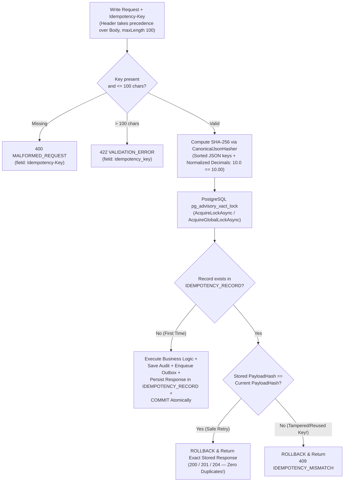

> **ليه `CanonicalJsonHasher` مهم جداً؟** لأن الـ Frontend ممكن يبعت `{"qty": 10.0, "a": 1}` وفي الإعادة يبعت `{"a": 1, "qty": 10.00}`. `CanonicalJsonHasher` بيرتّب مفاتيح الـ JSON أبجدياً وبيوحّد الأرقام العشرية (`10.0` و`10.00` يبقوا `10`) ويتجاهل الـ `null` قبل حساب `SHA-256` — عشان ميعملش `409` غلط على إعادة مشروعة!

## 8.2 نمط الصندوق الصادر الذري (`Transactional Outbox` + `OutboxPublisherWorker`)

**المشكلة:** بعد ما نحفظ حركة مخزون في PostgreSQL، محتاجين نبلغ الأنظمة التانية (أو المزامنة في Stage 2 / الـ AI Brain). لو عملنا `COMMIT` في الداتابيز وبعدين بعتنا للـ Message Broker وحصل Crash في النص → **الحدث ضاع للأبد!** ولو بعتنا للـ Broker قبل الـ `COMMIT` والداتابيز فشلت → **بعتنا حدث وهمي!**

**الحل (`OutboxService.cs`, `OutboxRepository.cs`, `OutboxPublisherWorker.cs`):**
1. **أثناء نفس الـ Transaction:** `OutboxService.EnqueueAsync(...)` بيقفل صف المنظمة في `OUTBOX_EVENT_CURSOR` بـ `FOR UPDATE`، يزوّد `last_event_sequence + 1` (تسلسل متصاعد بدون فجوات لكل منظمة!)، ويدرج الحدث في `OUTBOX_EVENT` داخل نفس الـ `COMMIT`!
2. **في الخلفية (`OutboxPublisherWorker`):** خدمة `BackgroundService` تشتغل كل **5 ثواني** (معطّلة أوتوماتيكياً في اختبارات `WebApplicationFactory` عبر `Outbox:WorkerEnabled = false`)، تسحب دفعات من **50 حدث** غير منشور تحت `AllowSystemBypass()` باستخدام:
   ```sql
   SELECT * FROM integration."OUTBOX_EVENT"
   WHERE published_at IS NULL AND attempt_count < 10
   ORDER BY organization_id ASC, event_sequence ASC
   LIMIT 50
   FOR UPDATE SKIP LOCKED
   ```
   *(ميزة `FOR UPDATE SKIP LOCKED`: لو شغلنا 5 سيرفرات API بالتوازي، كل سيرفر يسحب أحداث مختلفة بدون ما يعطّلوا بعض وبدون ما ينشروا نفس الحدث مرتين!)*
3. يتم تمرير كل حدث إلى `IOutboxEventDispatcher` (في Stage 1 هو `LoggingOutboxEventDispatcher`)، ولو نجح يتسجل `PublishedAt`، ولو فشل يزيد `AttemptCount` ويسجل سبب الفشل للمحاولة التالية.

## 8.3 سجل التدقيق المقاوم للعبث (`AUDIT_LOG`)
- كل عملية حساسة (دخول ناجح أو فاشل، تعديل مستخدم، تعديل منتج، تسوية مخزون، تعديل AI) تكتب صفاً في `integration."AUDIT_LOG"` يحتوي على: `OrganizationId`, `BranchId`, `ActorUserId`, `ActorType` (`USER`, `SYSTEM`, `AI_ASSISTED`), `SourcePromptId`, `Action`, `EntitySchema`, `EntityName`, `EntityId`, `BeforeData` (JSONB), `AfterData` (JSONB), `TraceId`, `OccurredAt`.
- محمي بطبقتين داخل PostgreSQL:
  1. **صلاحيات الدور:** `REVOKE ALL` + `GRANT SELECT, INSERT` فقط لـ `erp_app`.
  2. **Trigger `trg_audit_log_immutable`:** يرمي Exception فوراً عند أي محاولة `UPDATE` أو `DELETE`!

## 8.4 عقد الـ OpenAPI المصدّر وحماية العقود الآلية (`Swagger` + `ContractsArtifactSyncTests`)

عشان فريق الـ Frontend والـ AI Brain مياخدوش توثيق مكتوب بالإيد ممكن يقدَم، عملنا **عقد حي بيتولد ويتفحص أوتوماتيكياً من كود C# نفسه**:
1. **توليد Swagger الحي (`Api/DependencyInjection.cs`):**
   - مفعّل عليه `SupportNonNullableReferenceTypes()` و`UseAllOfToExtendReferenceSchemas()` ومخطط الأمان `Bearer` JWT.
   - **`IdempotencyKeyHeaderOperationFilter`:** يضيف Header `Idempotency-Key` (`maxLength: 100`) لكل العمليات المحمية بـ `[AllowHeaderIdempotencyKey]` أو Header-only، ويمسح متطلب `Bearer` من مسارات `[AllowAnonymous]`.
   - **`Stage1OpenApiDocumentFilter`:** يضيف مسار `GET /.well-known/jwks.json` ومخططاته (`JwksDocument`, `JwkKey`)، ويضمن تسجيل `ApiErrorEnvelopeDto`، ويجعل `idempotency_key` اختيارياً في Schema الـ Body لعمليات الـ Canonical.
2. **ملفات العقود المعتمدة في `apps/erp-backend/contracts/` (ومزامنتها مع `/contracts` المشترك):**
   - `openapi.v1.json`: مواصفة OpenAPI 3.0.4 كاملة تغطي **`48` Endpoint** (`47` Controller action + `/.well-known/jwks.json`) و**`76` Component Schema** بـ `snake_case` كامل.
   - `schemas/api-error-envelope.schema.json` و`schemas/canonical-capabilities.schema.json` و`contracts/README.md`.
3. **حارس منع الانحراف الآلي (`ContractsArtifactSyncTests.cs`):**
   اختبار تكامل يرفع الـ API ويقارن `/swagger/v1/swagger.json` حرفياً بـ `contracts/openapi.v1.json` (`JsonNode.DeepEquals`)، ويتحقق من وجود الـ `48` Endpoint ووجود Schema لكل رد غير `204` وكل الـ `8` String-Only Enums، ويتحقق من ردود `Cloud`/`BranchLocal` على `/api/v1/canonical/capabilities` وتطابق `ErrorCode` — لو أي مبرمج عدّل حقل أو Route من غير ما يحدّث `contracts/` الاختبار بيفشل فوراً!

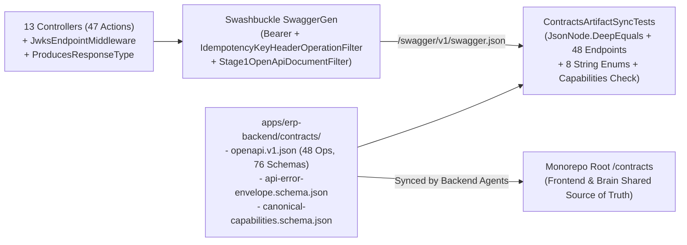

## 8.5 خريطة التكامل الكاملة بين الـ 4 موديولات (Cross-Module Wiring)

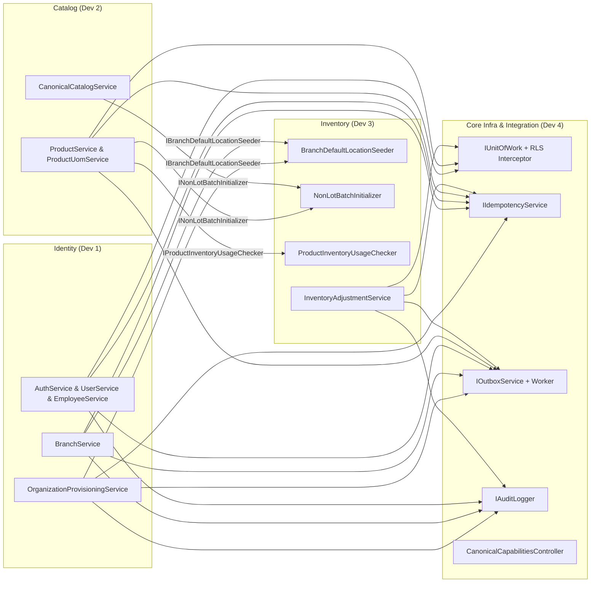

## 8.6 أدوات التطوير والتشغيل المحلي (Developer Experience Tooling)

عشان أي مطور يسحب الكود (`git pull`) ويبدأ شغل في دقيقتين بدون وجع دماغ:
1. **`setup-local-db.ps1`**: سكربت PowerShell بأمر واحد ينشئ `erp_db`، ينفّذ `provision_db_roles.sql` (`erp_migrator` + `erp_app`)، يطبّق الـ EF Migrations، يحفظ `ConnectionStrings:DefaultConnection` في `dotnet user-secrets` (بدل ما تتحط باسوردات في Git!)، ويضبط `ERP_IT_POSTGRES` للاختبارات.
2. **`DevDatabaseSeeder.cs` + `FRONTEND_TEST_DATA_GUIDE.md`**: عند التشغيل في وضع `Development` (لو `DevSeed:Enabled = true`)، يملأ الداتابيز تلقائياً بـ **3 صيدليات واقعية** بـ IDs ثابتة (حتمية) وبشكل Idempotent:
   - **`MEDCARE`** (3 فروع، 10 مستخدمين منهم واحد Inactive لاختبار `403`، 32 منتج، 77 وحدة قياس، 142 رصيد مخزني)
   - **`ALNOUR`** (فرعين، 3 مستخدمين، 16 منتج، 68 رصيد)
   - **`GREENLEAF`** (فرع واحد، مستخدمين، 11 منتج، 27 رصيد)
3. **`logs/dev-requests.log` + Workflow `/triage-api-logs`**: يلتقط كل أخطاء الـ Frontend أثناء التكامل ويسمح بفرزها وإصلاحها خطوة بخطوة مع اختبارات Regression.

---

# الفصل 9: الاختبارات، رحلة الـ Audit وتوحيد العقود، ونتائج الأداء (767 Tests & 100K/126K Benchmarks)

## 9.1 استراتيجية الاختبارات (`767 / 767 Passed` · `0 Error(s), 0 Warning(s)`)

قسمنا الاختبارات إلى مشروعين متكاملين:

| المشروع | العدد | المدة | ماذا يختبر بالضبط؟ |
| :--- | :---: | :---: | :--- |
| **`PharmacyERP.UnitTests`** | **590** | ~5 ثواني | قواعد الـ Domain والـ Invariants، دقة التحويلات والـ Base-UOM Normalization، كل فروع الـ Application Services (`400`, `401`, `403`, `404`, `409`, `422`, Rollback)، `Stage1ContractFixesUnitTests`، إعدادات الـ EF Core Models، الـ Middlewares، `CanonicalJsonHasher`، و`UnitOfWork`. |
| **`PharmacyERP.IntegrationTests`** | **177** | ~25 ثانية | اختبارات حقيقية على **PostgreSQL فعلي** عبر `WebApplicationFactory` و`ThrowawayPostgresDatabaseProvisioner`: عزل الـ `FORCE RLS`، Triggers الـ Immutability، التزامن الحقيقي على `STOCK_BALANCE`، تكرار واختلاف `Idempotency-Key`، `RuntimeMode`، RBAC، ومطابقة العقود (`Level1AApiContractTests`, `Level1BWireContractTests`, `Stage1FrontendContractFixesTests`, `ContractsArtifactSyncTests`). |

### إزاي `ThrowawayPostgresDatabaseProvisioner` بيشتغل من غير ما يبوّظ `erp_db` بتاعتك؟
1. يقرأ `ERP_IT_POSTGRES` وينشئ قاعدة بيانات مؤقتة معزولة تماماً لكل Fixture باسم `erp_*_it_<guid>`.
2. يطبّق الـ Schema + `RlsAndAuditProtectionSql` + `InventoryLedgerImmutabilitySql` + صلاحيات `erp_app`.
3. ينشئ مستخدم اختبار محدود الصلاحيات **`erp_it_app`** (`NOSUPERUSER NOBYPASSRLS`, عضو في `erp_app`) باستخدام `SemaphoreSlim` + `pg_advisory_lock` لمنع التصادم بين xUnit Fixtures المتوازية!
4. يشغّل الـ API داخل الاختبار متصلاً كـ `erp_it_app` مع تفعيل `DatabaseSecurityStartupCheck` و`FORCE RLS` الحقيقي!
5. بعد انتهاء الاختبارات، يمسح القاعدة المؤقتة بـ `DROP DATABASE ... WITH (FORCE)` بدون لمس `erp_db`!

---

## 9.2 قصة الـ Stage 1 Audit (أهم الأخطاء الحقيقية اللي اكتشفناها وصلّحناها — دروس ذهبية لـ Stage 2!)

بعد ما خلصنا كتابة كود الـ 4 موديولات، عملنا **مراجعة عميقة من 3 محاور** (`01_SECURITY_AUDIT.md`, `02_ARCHITECTURE_AUDIT.md`, `03_PERFORMANCE_AUDIT.md`). **الجدول ده كنز تعليمي — اقراه كويس عشان متكررش ولا غلطة منه في Stage 2!**

| الفئة | المشكلة الحقيقية اللي كانت موجودة قبل الـ Audit | إيه الكارثة اللي كانت هتحصل في الإنتاج؟ | إزاي صلّحناها؟ |
| :--- | :--- | :--- | :--- |
| **أمان (C-01)** | التطبيق كان بيتصل بـ PostgreSQL بمستخدم `postgres` Superuser وباسورد مكتوب في `appsettings.json`! | الـ Superuser بيتجاهل الـ RLS تماماً! يعني طبقة الـ RLS كلها كانت "ديكور" مش شغالة! | فصلنا `erp_migrator` و`erp_app` (`NOBYPASSRLS`) + `user-secrets` + `DatabaseSecurityStartupCheck`. |
| **أمان (C-03)** | `Branch Admin` (`ASSIGNED`) كان يقدر يعمل `PATCH /users/{hisId}` أو `password-reset` لصاحب الصيدلية! | تصعيد صلاحيات فوري (`Privilege Escalation`) والاستيلاء على المنظمة كلها بطلب واحد! | أنشأنا `IUserManagementAuthorizer` + سياسة `OrgAdminOnly` (`Admin` + `ALL`). |
| **أمان (H-05)** | توكن `BranchLocal` مدته 24 ساعة وملوش فحص إبطال (`Revocation`). | موظف اترفد الصبح يفضل يعدّل في المخزون لحد تاني يوم! | أضفنا `SecurityStamp` في DB والـ JWT + `UserSecurityStampValidator` بـ Cache 30 ثانية. |
| **معمارية/أداء (C-01)** | كتابة `FromSql(... FOR UPDATE)` مع EF Global Query Filter أو `.Include()`. | EF Core بيرفض التركيب فوق `FOR UPDATE` (Non-composable SQL) وكل عمليات القفل بتضرب Exception على PostgreSQL! | نستخدم `.IgnoreQueryFilters()` مع فلتر `organization_id` صريح + `ToListAsync()` ثم تحميل الـ Navigations منفصلاً. |
| **تزامن (C-02)** | `AuthService.RefreshAsync` كان بيقرأ التوكن بـ Tracking في Discovery Tx، ولما يدخل Write Tx كان EF بيرجع النسخة القديمة من `ChangeTracker`! | تجاوز اكتشاف سرقة الـ Refresh Token وإمكانية استخدام توكن تفعيل الفرع مرتين! | استبدال الاكتشاف بـ `AsNoTracking()` خفيف (`FindOrganizationIdByTokenHashAsync`) + `ChangeTracker.Clear()` في `RollbackTransactionAsync`. |
| **تزامن (C-04)** | ترتيب قفل المخزون كان بـ `(LocationId, ProductId)` بدل `(LocationId, BatchId)`. | **ABBA Deadlock (`40P01`)** لما طلبين يعدّلوا تشغيلتين لنفس المنتج بترتيب معكوس! | حساب `BatchId` أولاً ثم قفل set-based بـ `ORDER BY location_id ASC, batch_id ASC FOR UPDATE`. |
| **داتابيز (C-08)** | الـ Trigger بتاع `InventoryLedgerImmutabilitySql` كان بيرجع `RETURN NEW;` في `BEFORE DELETE` ومفيش `BEFORE INSERT` على السطور! | في PostgreSQL قيمة `NEW` في `DELETE` هي `NULL` — فكان بيلغي مسح الـ `DRAFT` بصمت، وبيسمح بإضافة سطور لـ `POSTED`! | `RETURN OLD;` عند `TG_OP = 'DELETE'` + إضافة `BEFORE INSERT` على `INVENTORY_TXN_LINE`. |
| **مخزون (C-10)** | في `InventoryAdjustmentService`: معاملات `IAuditLogger.LogAsync` كانت متلخبطة بالترتيب، و`UserId` كان بيتبعت مكان `EmployeeId`، ومعاملات `PagedResult` كانت مقلوبة! | كراش FK فوري على PostgreSQL + سجل Audit فاسد + أرقام `page`/`totalCount` مقلوبة للـ Frontend! | استخدام Named Parameters، تمرير `_currentUser.EmployeeId`، وتوحيد `PagedResult` و`ApiResultMapper`. |
| **أداء (C-11/H-01)** | استعلام الأرصدة كان بيعمل Cartesian Join على `ReorderRules` لكل الفروع بدون `AsSplitQuery()`، والتسوية كانت بتعمل `4×N` استعلامات جوه الـ `foreach`! | انفجار في الرام (`800,000` صف!) وتجميد المخزون أثناء الجرد! | `.AsNoTracking()` + `.AsSplitQuery()` + Batch Pre-fetch قبل الـ Loop + SQL `unnest(...)`. |
| **إلغاء (H-07)** | `RollbackTransactionAsync(ct)` كان بياخد نفس الـ `CancellationToken` الملغي! | لما العميل يقفل المتصفح، الـ `ROLLBACK` نفسه بيتلغي ويسيب Transaction معلّقة! | تمرير `CancellationToken.None` دايماً داخل `RollbackTransactionAsync`. |

### رحلة توحيد العقود الثلاثية ومحاذاة الـ Frontend (`07_`, `08_`, `10_`, `11_`)
بعد استقرار النواة الأمنية، أجرينا مراجعة شاملة لعقود الـ API والـ DTOs بين 3 مصادر: **`ERP-Backend-Blueprint-v1.1.md`**، الكود الفعلي للباك إند (`07_` و`08_`)، وعقد الـ Frontend (`Fronted_contracts/` — تقرير **`10_THREE_WAY_CONTRACT_AUDIT_FRONTED_VS_BACKEND_VS_BLUEPRINT.md`**) التي أظهرت أن الباك إند كان أقرب للـ Blueprint بنسبة **`90.2%`** مقابل **`77.2%`** للـ Frontend، مع رصد فجوات حقيقية في الطرفين تم حسمها عبر **موجات الإصلاح الممنهجة والقرارات الملزمة الـ 6 (`11_STAGE1_CONTRACT_ALIGNMENT_DECISIONS.md`)**:

1. **الموجات الأولى (`Level 1A` -> `Level 1B` -> `Level 2` -> `Pre-OpenAPI Polish` -> `Contract Export`):**
   - توحيد تغليف أخطاء `401`/`403` (`ApiErrorAuthorizationMiddlewareResultHandler` + `JwtBearerEvents`)، فصل `400 MALFORMED_REQUEST` عن `422 VALIDATION_ERROR`، إرجاع `201 Created + Location` في الـ 11 عملية إنشاء، تحويل الـ Wire Format عالمياً إلى `snake_case` مع String-Only Enums (`allowIntegerValues: false`) وتطبيع `error.details[].field` إلى `snake_case`، تفعيل `Idempotency-Key` في الـ 4 خدمات Identity، وإتاحة True Partial `PATCH`، وقراءة `initial_sync_cursor` الحقيقي من `OUTBOX_EVENT_CURSOR`، وتصحيح `Organization.TimeZoneId`، وفتح `OPENING_BALANCE` للصيدلي، وتسهيل `REVERSAL` بدون `lines`/`reason_code`.
2. **حزمة المحاذاة النهائية وقرارات الفريق الـ 6 (`D-01` إلى `D-06` في `11_`):**
   - **`D-01` (الأرقام):** اعتماد JSON `number` الأصلي للكميات والأسعار والضرائب بدل الـ Strings.
   - **`D-02` (الترقيم):** اعتماد Offset Pagination الموحّد (`page=1, page_size=25`, `1..200`, `PagedResult<T>`) مع بقاء `GET /products/{id}/uoms` كمصفوفة `ProductUomDto[]` (`include_inactive=false`).
   - **`D-03` (أرصدة المخزون):** تغليف `GET /api/v1/inventory/balances` داخل `PagedResult<StockBalanceDto>` وإضافة `row_version` على `StockBalanceDto`.
   - **`D-04` و`D-05` (هوية الدخول):** إضافة `token_type`, `issuer`, `audience`, `key_id` على `LoginResponse`، وإضافة `runtime_mode` على `CurrentUserDto` في كلٍ من `LoginResponse.user` و`GET /api/v1/auth/me` المسطّح.
   - **`D-06` (تشديد الـ RBAC والـ Scopes):** قصر `GET /api/v1/inventory/transactions` و`GET /api/v1/canonical/inventory` على `Admin,Pharmacist` (حماية تكلفة الجملة من `Cashier`)، وقصر `GET /api/v1/employees*` على `AdminOnly`، وإبقاء `GET /api/v1/branches*` على `[Authorize]` مقيّداً بـ `AuthorizedBranchIds`، وإزالة أي scopes غير موثّقة من `Admin` وقصر `Pharmacist` على `sales:read` فقط (بدون صلاحية كتابة المبيعات)، مع إضافة الحقول التكميلية (`created_at`/`updated_at`، `last_login_at`/`lockout_end`/`access_failed_count`، `enrollment_setup_state`) وتوليد `contracts/openapi.v1.json` النهائي (**48 Endpoint / 76 Schema**) المحمي بـ `ContractsArtifactSyncTests`.

---

## 9.3 نتائج اختبارات الأداء والإنتاج تحت الضغط (`05_` الأولي + `09_` المحاكاة الإنتاجية 100K)

تم إخضاع Stage 1 لاختبارين متكاملين ومستقلين: **اختبار السعة الأولي (`05_`)** لقياس الحدود القصوى لكل Endpoint على حدة، ثم **المحاكاة الإنتاجية الشاملة بعد كل تعديلات العقود (`09_`)** على سيرفرين حقيقيين متزامنين (`Cloud` + `BranchLocal`):

### أ) اختبار السعة الأولي لكل Profile (`05_STAGE1_PERFORMANCE_AND_CAPACITY_REPORT.md` — `126,645` طلب)

تم اختبار نسخة `Release` بـ **`126,645` طلب HTTP حي** على PostgreSQL مع تفعيل `FORCE RLS` على الـ 20 جدول حتى **100 مستخدم متزامن (VUs)**:

| السيناريو | الـ Endpoint | أقصى Throughput (RPS) | متوسط الاستجابة (`p50`) | نسبة الأخطاء | الملاحظة الهندسية |
| :--- | :--- | :---: | :---: | :---: | :--- |
| **فحص الجلسة** | `GET /api/v1/auth/me` | **1,575.7 RPS** | `5.5 ms` (10 VU) | **0.0%** | بفضل `SecurityStamp` Cache (30s TTL) |
| **مسح الباركود** | `GET /api/v1/products?search=...` | **969.9 RPS** | `23.4 ms` (10 VU) | **0.0%** | *(توصية مستقبلية: endpoint مطابقة تامة + `pg_trgm` عند +20K SKU)* |
| **تصفح الكتالوج** | `GET /api/v1/products?page=1&page_size=20` | **818.3 RPS** | `12.6 ms` (10 VU) | **0.0%** | `.AsNoTracking()` + Indexes |
| **أرصدة الفرع** | `GET /api/v1/inventory/balances` | **536.1 RPS** | `20.8 ms` (10 VU) | **0.0%** | `.AsSplitQuery()` منع انفجار الـ Joins |
| **تغذية الـ AI** | `GET /api/v1/canonical/inventory` | **411.8 RPS** | `27.6 ms` (10 VU) | **0.0%** | متكامل مع `FORCE RLS` |
| **تسويات متوازية (3 صيدليات)** | `POST /api/v1/inventory/adjustments` | **190.7 TPS** | `57.1 ms` (10 VU) | **0.0%** | ACID كامل (Ledger + Stock + Outbox + Audit + Idempotency) |
| **ضغط Hot-SKU (100 VU على نفس التشغيلة!)** | `POST /api/v1/inventory/adjustments` | **53.5 TPS** | `210.3 ms` (10 VU) | **0.0%** | **صفر Deadlocks** — الرصيد: `360 + 2,173 = 2,533.0000` (دقة **100%**) |
| **زحمة تغيير الشفت** | `POST /api/v1/auth/login` | **27.4 RPS** (~1,644/دقيقة) | `285.8 ms` (10 VU) | **0.0%** | محصّن عمداً بـ PBKDF2 100k — 500 صيدلي يدخلوا في ~18 ثانية |

**السعة السحابية المقدّرة من `05_` (بهامش أمان 3× للذروة):**
- **Tier 1 MVP (`2 vCPU` API + `2 vCPU` DB):** يتحمل **250 – 350 صيدلية نشطة متزامنة**.
- **Tier 2 Production (`4 vCPU` API + `4 vCPU` DB):** يتحمل **650 – 850 صيدلية نشطة متزامنة**.
- **Tier 3 High-Scale (`2× 4 vCPU` API + `8 vCPU` DB + PgBouncer):** يتحمل **1,400 – 1,800+ صيدلية نشطة متزامنة** *(جاهز لـ PgBouncer فوراً بسبب `set_config(..., true)`، مع استبدال `JwksKeyProvider` بمفتاح RSA دائم قبل التوزيع على أكثر من Node)*.

### ب) المحاكاة الإنتاجية الحديثة Dual-Host بعد توحيد العقود (`09_STAGE1_100K_PRODUCTION_BENCHMARK_REPORT.md` — `100,170+` طلب)

بعد إتمام جميع إصلاحات العقود والـ RBAC، شغّلنا محاكاة إنتاجية كاملة (`Release`, `ASPNETCORE_ENVIRONMENT=Production`, `Outbox:WorkerEnabled=true`) على **سيرفرين Kestrel حقيقيين معاً (`Cloud` + `BranchLocal`)** متصلين بـ PostgreSQL 18.6 مع `erp_it_app` و`FORCE RLS` و`DevDatabaseSeeder`:

1. **المرحلة 1 (مصفوفة E2E الكاملة):** **`90 / 90` Assertions PASSED** في **`7.92` ثانية** عبر كل موديولات Stage 1 (Auth/JWKS، تفعيل الفروع بـ `initial_sync_cursor > 0`، Partial PATCH، تصفير `sale_unit_price`، `OPENING_BALANCE` لـ Admin وPharmacist، تطبيع Base-UOM، `REVERSAL` بدون `lines`/`reason_code`، و`Idempotency-Key` في Header فقط).
2. **المرحلة 2 (عاصفة `100,000` طلب متزامن عبر `48` عميل افتراضي في `369.66` ثانية = `270.52` RPS مختلط مستمر):**
   - **زمن الاستجابة الإجمالي:** `Min = 0.19 ms` · `Avg = 176.69 ms` · **`p50 = 40.25 ms`** · `p95 = 776.35 ms` · `p99 = 3,122.81 ms` · `Max = 8,730.73 ms`.
   - **أصفار حاسمة:** **`0` أخطاء `HTTP 500` (`0.00%`)** و**`0` أكواد حالة غير متوقعة** عبر كل الـ `100,000` طلب (`79,000` `200`, `10,000` `201`, `1,143` `400`, `1,000` `401`, `1,500` `403`, `1,500` `404`, `3,000` `409`, `2,857` `422`).
   - **معدلات `p50` لكل فئة أحمال:**

| الفئة | الحصة | الطلبات | `p50` | `p95` | `p99` |
| :--- | :---: | :---: | :---: | :---: | :---: |
| **`ReadIdentityAndAuth`** (`/branches`, `/users`, `/auth/me`) | 15% | 15,000 | **19.01 ms** | 86.93 ms | 154.02 ms |
| **`ReadCatalogAndUoms`** (`/products`, barcode search, `/uoms`) | 22% | 22,000 | **31.72 ms** | 112.45 ms | 187.51 ms |
| **`ReadCanonicalAndJwks`** (`/canonical/*`, `/.well-known/jwks.json`) | 12% | 12,000 | **52.07 ms** | 199.93 ms | 275.25 ms |
| **`ReadInventoryQueries`** (`/balances`, `/summary`, `/batches`, `/transactions`, `/locations`) | 26% | 26,000 | **53.19 ms** | 194.57 ms | 290.13 ms |
| **`WriteIdempotencyReplay`** (`3,000` طلب متوازي على `200` مفتاح) | 3% | 3,000 | **56.97 ms** | 1,243.04 ms | 2,049.30 ms |
| **`WriteMasterDataPatchPut`** (`PATCH` متزامن + `PUT` reorder-rule) | 4% | 4,000 | **93.17 ms** | 265.74 ms | 445.12 ms |
| **`WriteInventoryContention`** (Hot-SKU `IN`/`OUT`/`REVERSAL` على نفس التشغيلة) | 7% | 7,000 | **628.62 ms** | 3,941.12 ms | 5,888.84 ms |
| **`AdversarialOutOfStock`** (سحب تعجيزي `999,999` -> `409 OUT_OF_STOCK`) | 2% | 2,000 | **1,454.93 ms** | 4,550.00 ms | 6,270.76 ms |
| **`AdversarialMalformedAndValidation`** (`400` + `422`) | 4% | 4,000 | **2.35 ms** | 32.31 ms | 77.67 ms |
| **`AdversarialAuthzRlsRuntime`** (`401` + `403` + `404`) | 4% | 4,000 | **2.16 ms** | 56.38 ms | 103.70 ms |
| **`WriteIdempotencyMismatch`** (`409 IDEMPOTENCY_MISMATCH`) | 1% | 1,000 | **40.09 ms** | 105.08 ms | 189.74 ms |

3. **المرحلة 3 (تدقيق سلامة الداتابيز والمحاسبة بعد العاصفة):**
   - **صفر أرصدة سالبة (`0 / 240`)** و**صفر فروقات دفترية (`0 / 240`)** بين `STOCK_BALANCE.on_hand_qty_base` ومجموع `POSTED INVENTORY_TXN_LINE.quantity_delta_base` عبر **`7,311` حركة `POSTED`** (`7,543` سطر)، مع وصول أسخن صف إلى **`row_version = 4,941`** بدون أي Deadlock!
   - **`3,000` إعادة متزامنة على `200` مفتاح:** نفّذت **مرة واحدة فقط لكل مفتاح** (`0` تباين، `0` تكرار عبر `11,319` صف في `IDEMPOTENCY_RECORD`)، وسُجّل **`11,320` حدث Outbox** (`7,228` نُشرت حياً أثناء العاصفة بـ **`0` فجوات تسلسل**) و**`11,361` صف `AUDIT_LOG`**.
   - **3 ملاحظات سعة رُصدت لـ Stage 2/3:** اصطفاف طلبات `OUT_OF_STOCK` التعجيزية خلف قفل `FOR UPDATE` (`p50 = 1.45s`)، تسلسل `OUTBOX_EVENT_CURSOR` داخل نفس المنظمة في ذروة الكتابة المتزامنة، وذيل `p95` عند سباق أول وصول لمفتاح `Idempotency-Key` جديد.

---

# الفصل 10: الجسر إلى المرحلة الثانية — إزاي Stage 1 بتخدم Stage 2؟

كل حجر اتبنى في Stage 1 كان متصمّم عشان **Stage 2 (البيع والكاشير POS، الفواتير، المرتجعات، والمزامنة الأوفلاين)** تركّب فوقه بسلاسة وبدون إعادة اختراع العجلة:

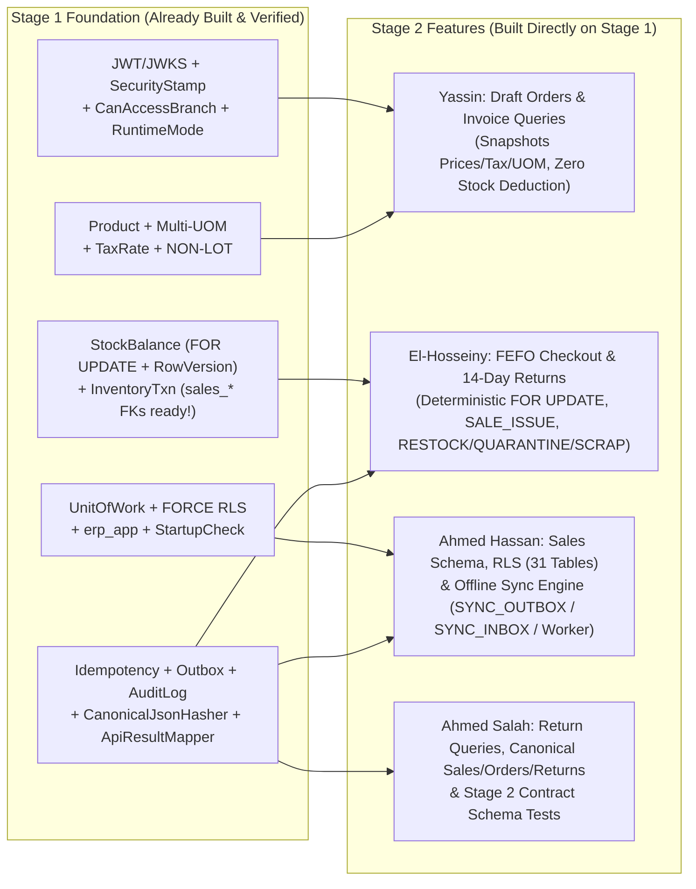

### 4 تطويرات معمارية جديدة دخلت Stage 2 لمنع أي تعارض بين المطورين الأربعة (`docs/stage2-tasks/00-STAGE2-EXECUTION-MAP.md`):
1. **فرع تكامل مخصص (`stage2-dev`):** فرع `main` يفضل مجمّد ومستقر على Stage 1 عشان فريق الـ Frontend يكمل شغله، وكل PRs المرحلة التانية تروح لـ `stage2-dev` فقط، وتندمج على `main` مرة واحدة في نهاية Wave 4.
2. **Wave 1 Foundation أولاً (`Ahmed Hassan`: `AH-01`..`AH-07`):** ينشئ الكيانات، الـ Configurations، الـ Migration الموحّدة، الـ RLS على الـ 31 جدول، و`ISyncOutboxWriter` الأول عشان يفتح **Wave 2** للتلات مطورين التانيين بالتوازي بدون أي تعارض!
3. **4 ملفات Modular DI مستقلة** تحت `Extensions/` (`SalesDraftDependencyInjection`, `SalesCheckoutAndReturnsDependencyInjection`, `SyncDependencyInjection`, `CanonicalStage2DependencyInjection`) — فمحدش بيعدّل في `DependencyInjection.cs` الجذري تاني!
4. **Partial Controllers مع `[FromServices]`:** بدلاً من تزاحم مطورين على نفس ملف الـ Controller والـ Constructor، كل مطور ليه ملف Partial خاص بيه (مثلاً `SalesOrdersController.Draft.cs` لـ Yassin و`SalesOrdersController.Checkout.cs` لـ El-Hosseiny)!

---

# الفصل 11: آلية عمل الـ AI وأفضل طريقة لإدارة هذا المشروع بالـ AI

الجزء ده لا يقل أهمية عن الكود نفسه! الفرق بين فريق "بيعمل Vibe Coding بالـ AI وبيطلع كود مكسّر مليان Conflicts ومحدش فاهمه" وبين فريق **بيستخدم الـ AI كـ Engineering Multiplier حقيقي** هو **البنية الحاكمة (AI Control Architecture)** اللي اتبنت داخل مجلد `apps/erp-backend/.agent/`.

## 11.1 كيف يعمل الـ AI داخل هذا المشروع؟ (المعمارية ثلاثية الطبقات `.agent/`)

إحنا مبنسيبش الـ AI "يفتي" من دماغه! الـ AI هنا محكوم بـ **3 طبقات متكاملة** موجودة فعلياً داخل المشروع:

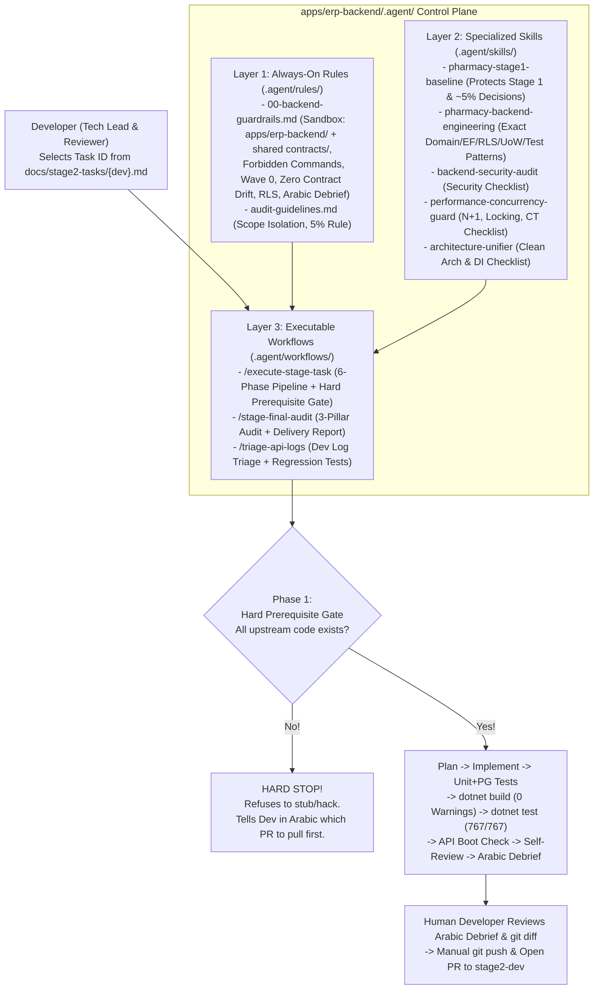

### شرح دور كل طبقة في `.agent/`:

1. **الطبقة الأولى — القواعد الدائمة (`Rules` في `.agent/rules/`):**
   - **`00-backend-guardrails.md` (الدستور الدائم):** يتفعّل أوتوماتيكياً مع كل محادثة. بيمنع الـ AI من:
     - لمس أي ملف بره `apps/erp-backend/` **ومجلد `contracts/` المشترك في جذر المستودع** (المسموح لقراءة العقود ومواءمتها ومزامنتها فقط)، مع عزل صارم عن `apps/erp-frontend/` و`apps/brain/` وبقية ملفات الجذر (`00-router.md`, `MEMORY.md`, CI/infra).
     - تشغيل أي أمر تدميري (`git push`, `reset --hard`, `rm -rf`, `DROP DATABASE`, طباعة باسوردات)، مع قصر أوامر الـ Terminal داخل `apps/erp-backend/` (تستهدف `apps/erp-backend/` أو `contracts/` المشترك فقط).
     - لمس `Program.cs` أو `PharmacyDbContext.cs` أو كسر عقود الـ API.
     - نسيان الشرح بالعربي في نهاية كل مهمة (**Mandatory Arabic Post-Task Debrief** عشان المطور يتعلم ويفهم مش ينسخ وخلاص!).
2. **الطبقة الثانية — المهارات المتخصصة (`Skills` في `.agent/skills/`):**
   - **`pharmacy-stage1-baseline`:** بتعرّف الـ AI إيه اللي اتعمل في Stage 1 وإيه قرارات المطورين المعتمدة (~5% Rule) عشان ميكسرهاش أو يرجّعها لورا.
   - **`pharmacy-backend-engineering`:** بتدّي الـ AI "الكتالوج القياسي" لكتابة أي كيان، EF Configuration، دقة الأرقام (`18,4` / `18,2` / `18,6` / `9,4`)، `IUnitOfWork` Read/Write Transactions، واختبارات PostgreSQL بـ `erp_it_app`.
   - **مهارات الـ Audit الثلاثة (`backend-security-audit`, `performance-concurrency-guard`, `architecture-unifier`):** قوائم فحص صارمة بتحوّل الـ AI لمراجع أمني ومعماري قبل أي Merge!
3. **الطبقة الثالثة — خطوط الإنتاج الآلية (`Workflows` في `.agent/workflows/`):**
   - **`/execute-stage-task`:** خط إنتاج من **6 مراحل إجبارية** — أهمهم **Phase 1 (Hard Prerequisite Gate)** اللي بتفحص الملفات فعلياً وتوقف الشغل فوراً لو فيه PR بتاع زميلك لسه متسحبش بدل ما الـ AI يألف Mock أو يبوّظ المشروع!
   - **`/stage-final-audit`:** مراجعة ختامية شاملة بـ 3 محاور في نهاية المرحلة وتوليد تقرير تسليم لكل مطور تحت `docs/stage2-reports/`.
   - **`/triage-api-logs`:** تحليل أخطاء `logs/dev-requests.log` وتصنيفها لـ "Bug في الباك إند (نصلحه + نكتب Regression Test)" أو "حماية مقصودة (نكتب ملاحظة للـ Frontend بدون إضعاف الأمان!)".

---

## 11.2 المنهجية الذهبية لإدارة المشروع بالـ AI (قواعد الفريق الذهبية!)

عشان الفريق كله يستفيد أقصى استفادة **ويتطور فعلياً كمهندسين برمجيات** مش مجرد "مشغّلين شات"، التزموا بالـ **7 قواعد الذهبية** دي:

### 1. قاعدة "المحادثة الواحدة = المهمة الواحدة" (Context Hygiene)
- **افتح New Chat لكل Task ID جديد** (مثلاً محادثة لـ `EH-03`، ولما تخلص وتعمل PR افتح محادثة جديدة لـ `EH-04`).
- **ليه؟** كل ما المحادثة بتطول، الـ Context بيتزحم بملفات قديمة وتركيز الـ AI بيقل وممكن يخلط متطلبات مهمة قديمة بمهمة جديدة.

### 2. قاعدة "Spec-Driven, Never Vibe-Driven"
- متقولش للـ AI: *"اعملي شاشة مبيعات وخصم مخزون"* وتسيبه يخمّن أسماء الأعمدة والـ Routes!
- دايماً اربطه بالـ **Task Spec** والـ **Workflow**:
  ```text
  /execute-stage-task نفذ المهمة EH-03 من ملف docs/stage2-tasks/el-hosseiny.md
  ```
- ليه؟ لأن ملفات `docs/stage2-tasks/` متصمّمة بدقة متناهية بأسماء الكلاسات والملفات والـ Prerequisites والـ Edge Cases.

### 3. أنت "Tech Lead ومراجع الكود" — مش متفرج! (Human-in-the-Loop)
عشان تطلع من المشروع ده مهندس تقيل بجد:
1. **اقرأ الشرح العربي (Arabic Debrief)** اللي الـ AI بيكتبه في آخر كل مهمة.
2. **افتح `git diff`** وراجع الملفات اللي اتعدّلت بنفسك — لو شفت سطر مش فاهمه، اسأل الـ AI فوراً: *"اشرحلي السطر ده في `StockBalanceRepository.cs` ليه استخدمت `unnest` و`FOR UPDATE` هنا وإيه اللي هيحصل لو شيلناهم؟"*
3. **شغّل `dotnet test` بنفسك** وتأكد إن `0 Warnings`, `0 Failed`, `0 Skipped` قبل ما تعمل `git push` وتفتح PR!

### 4. قاعدة عدم إضعاف الأمان لتسكيت الأخطاء (Never Weaken Guardrails)
- لو طلعلك خطأ `403 FORBIDDEN_BRANCH` أو `404` من `RuntimeModeGuardMiddleware` أو فشل `DatabaseSecurityStartupCheck` أو `TenantRlsConnectionInterceptor`:
  - **ممنوع تماماً** تقول للـ AI *"اقفل الـ RLS"* أو *"شيل فحص الصلاحية عشان الاختبار يعدّي"*!
  - اسأله: *"ليه الحارس ده رفض الطلب؟ وهل ده Bug في الكود ولا إعداد ناقص في الـ Request / الـ RuntimeMode؟"*

### 5. كيف تتجنب الـ Merge Conflicts تماماً مع الـ AI؟
- قبل ما تبدأ أي مهمة، نفّذ بنفسك:
  ```powershell
  git fetch origin
  git switch stage2-dev
  git pull --ff-only origin stage2-dev
  git switch -c stage2/<dev>/<task-id>-<slug>
  ```
- التزم بترتيب الـ **Waves** في `00-STAGE2-EXECUTION-MAP.md`. لو الـ AI وقف عند **Phase 1 (Hard Prerequisite Gate)** وقالك "مهمة `AH-06` لسه مش مدمجة"، **اسمع كلامه** واستنى زميلك يدمجها — أوعى تقوله "اعملها إنت مؤقتاً"!

### 6. برومتات عملية جاهزة تقدر تستخدمها طول المشروع

| الموقف | البرومت المثالي |
| :--- | :--- |
| **تنفيذ مهمة من الخطة** | `/execute-stage-task نفذ المهمة <TASK-ID> من ملف docs/stage2-tasks/<your-file>.md` |
| **فهم كود معقد قبل اعتماد الـ PR** | `اشرحلي بالتفصيل وبشكل مبسط مع رسمة Mermaid إزاي <ClassName> بيشتغل، وإيه المشكلة اللي بيحلها، وإيه الـ Edge Cases اللي مغطيها.` |
| **فحص أخطاء تشغيل الـ Frontend** | `/triage-api-logs` |
| **تحليل اختبار فاشل (Test Failure)** | `الاختبار <TestName> فشل بالخطأ التالي: <الخطأ>. حدد السبب الجذري الأول بدون تعديل الكود واشرحلي هل الخطأ في الكود الإنتاجي ولا في الـ Test Setup، وبعد موافقتي نصلحه.` |
| **مراجعة سريعة قبل فتح الـ PR** | `اعمل قراءة فقط (Read-Only Review) على git diff في الفرع الحالي باستخدام مهارات backend-security-audit و performance-concurrency-guard و architecture-unifier وقولي لو فيه أي ملاحظة قبل ما أعمل push.` |
| **المراجعة النهائية للمرحلة** | `/stage-final-audit نفذ المهمة <TASK-ID> من ملف docs/stage2-tasks/<your-file>.md وأنشئ تقرير المراجعة النهائي في docs/stage2-reports/` |

### 7. أشهر 7 أخطاء ممكن الـ AI يقع فيها (وكيف تحميك منظومتنا منها!)

| # | غلطة AI شائعة في المشاريع العادية | كيف تمنعها منظومة `.agent/` في مشروعنا؟ |
| :---: | :--- | :--- |
| **1** | يضيف `AddScoped` أو `DbSet` جوه `Program.cs` و`PharmacyDbContext.cs` ويعمل Merge Conflict | ممنوع صراحة في `00-backend-guardrails.md` + استخدام Partial Classes وModular DI. |
| **2** | يكتب استعلام قراءة `GET` من غير `IUnitOfWork.BeginTransactionAsync()` | `TenantRlsConnectionInterceptor` يكسره فوراً في Integration Tests على PostgreSQL! |
| **3** | يكتب اختبارات `UseInMemoryDatabase` فقط وتمر بينما PostgreSQL يضرب | `pharmacy-backend-engineering` يفرض `ThrowawayPostgresDatabaseProvisioner` كـ `erp_it_app` مع `FORCE RLS`! |
| **4** | يبني Mock أو Stub لشغل زميل لسه متدمجش | `Phase 1 — Hard Prerequisite Gate` في `/execute-stage-task` توقفه فوراً! |
| **5** | يستخدم `DateTime.UtcNow` مباشرة أو يقارن صلاحية الدواء بـ UTC بدل توقيت الصيدلية | القواعد تفرض `IDateTimeProvider` و`GetOrganizationBusinessDate(org.TimeZoneId)`. |
| **6** | يرمي `Exception` عشوائية أو يغيّر أسماء حقول الـ DTO ويكسر الـ Frontend | قاعدة **Zero Contract Drift** + `Result<T>` + `ApiResultMapper` + اختبارات العقود (`Contract Schema Tests`). |
| **7** | يدخل في شغل Stage 3 (المشتريات والموردين) أثناء Stage 2 | قاعدة **Scope Isolation** تفرض حدوداً قاطعة لكل مرحلة. |

---

## قائمة المراجعة الشخصية قبل كل Pull Request (Developer Pre-PR Checklist)

قبل ما تعمل `git push` وتفتح PR على `stage2-dev`، راجع الـ 6 نقاط دي في دقيقة واحدة:
- [ ] أنا على فرع باسم `stage2/<dev>/<task-id>-<slug>` متفرّع من أحدث `stage2-dev` (وليس `main`).
- [ ] راجعت `git status` و`git diff`: لا يوجد أي تعديل بره `apps/erp-backend/` (أو `contracts/` المشترك عند مزامنة العقود) ولا لمس لـ `Program.cs` أو `PharmacyDbContext.cs` أو ملفات زميل آخر.
- [ ] قرأت الشرح العربي وفهمت **ليه** كل تغيير اتعمل (لو فيه حاجة مش واضحة سألت الـ AI يشرحها).
- [ ] `dotnet build PharmacyERP.sln --no-restore` نجح بـ **`0 Error(s), 0 Warning(s)`**.
- [ ] `dotnet test PharmacyERP.sln --no-restore` نجح بـ **`100% Passed, 0 Failed, 0 Skipped`** (بما في ذلك اختبارات PostgreSQL الحقيقية و`ContractsArtifactSyncTests`).
- [ ] لا توجد أي باسوردات أو Connection Strings أو مفاتيح سرية داخل الملفات المعدّلة.

---

> **الخلاصة:** المرحلة الأولى (`Stage 1`) لم تكن مجرد "بداية مشروع" — بل بنت **قاعدة خرسانية مسلّحة** (Multi-Tenancy بـ 5 طبقات دفاع، Dual Runtime، `48` Endpoint موثّق في `openapi.v1.json` مع `76` Schema، Ledger غير قابل للتلاعب، Idempotency + Outbox + Audit، **`767` اختبار حقيقي ناجح بنسبة 100%**، وأداء مثبت بـ **`126,645` طلب سعة** ثم **`100,170+` طلب محاكاة إنتاجية Dual-Host** بدون أي `HTTP 500`). بفهمك الكامل لهذا الدليل، وبالتزامك بـ Workflows الـ AI في `.agent/`، أنت والفريق جاهزون تماماً لاكتساح **Stage 2** بثقة واحترافية!
