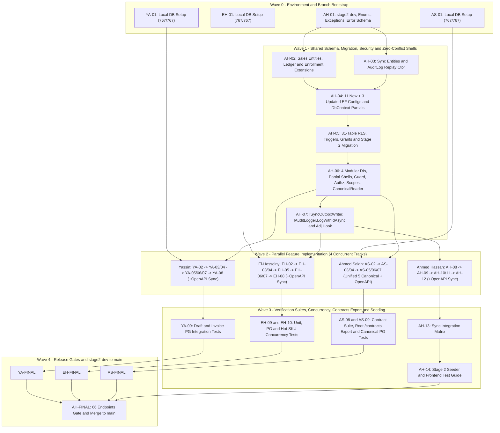

# PharmacyERP — Stage 2 Master Execution Map & Reconciliation Plan

| Field | Value |
| :--- | :--- |
| **Document ID** | `00-STAGE2-EXECUTION-MAP.md` |
| **Stage Scope** | **Stage 2 ONLY** — Cashier POS Sales, Invoicing, Cash Payments, Returns/Refunds, Offline Sync Engine, Stage 2 Canonical Read APIs, & Stage 1 Canonical Unification (`API-DIFF-011`/`T-03`, `API-DIFF-012`, `DTO-DIFF-034`) (**ZERO Stage 3 Purchasing Scope**) |
| **Authoritative Specs** | `_audit_docs/01_master_spec/ERP-Backend-Blueprint-v1.1.md` (Sections 4, 6, 8 [§8.2, §8.5, §8.6, §8.9], 9, and 10 — frozen reference-only) · `_audit_docs/04_audit_reports/11_STAGE1_CONTRACT_ALIGNMENT_DECISIONS.md` · `contracts/README.md` |
| **Verified Stage 1 Baseline** | **`767 / 767`** tests passing (`590` Unit + `177` Integration), **`48` live HTTP endpoints** (`47` controller actions across `13` controllers + `GET /.well-known/jwks.json`), **`76` OpenAPI schemas**, `0 Error(s), 0 Warning(s)`, `20` tenant-bound RLS tables across `4` schemas (`identity`, `catalog`, `inventory`, `integration`), `2` unified EF Core migrations, live `contracts/openapi.v1.json` guarded by `ContractsArtifactSyncTests` |
| **Post-Stage 2 Target** | **`66` live HTTP endpoints** (`48` Stage 1 + `18` new Stage 2 endpoints + updated `/api/v1/canonical/capabilities`), **`31` tenant-bound RLS tables** across `5` schemas (`+ sales`), synchronized `apps/erp-backend/contracts/` and shared repo-root `contracts/` |
| **Integration Branch** | `stage2-dev` (`main` stays frozen on verified Stage 1 for ongoing frontend integration) |
| **Team Roster** | `Ahmed Hassan` (`AH-01`..`AH-14`, `AH-FINAL`) · `El-Hosseiny` (`EH-01`..`EH-10`, `EH-FINAL`) · `Yassin` (`YA-01`..`YA-09`, `YA-FINAL`) · `Ahmed Salah` (`AS-01`..`AS-09`, `AS-FINAL`) |
| **Per-File Diff Checklist** | [01-STAGE2-PLAN-AUDIT-DIFF.md](./01-STAGE2-PLAN-AUDIT-DIFF.md) (exact line-by-line reconciliation checklist for updating `ahmed-hassan.md`, `el-hosseiny.md`, `yassin.md`, and `ahmed-salah.md`) |

---

## 1. Stage 1 As-Built Reconciliation Summary (Live Ground Truth on Disk)

Direct inspection of `apps/erp-backend/src/`, `apps/erp-backend/tests/`, `apps/erp-backend/contracts/openapi.v1.json`, `contracts/README.md`, `07_STAGE1_API_CONTRACT_DIFF_REPORT.md`, `08_STAGE1_DTO_WIRE_CONTRACT_DIFF_REPORT.md`, and `11_STAGE1_CONTRACT_ALIGNMENT_DECISIONS.md` confirmed the exact live Stage 1 state and required Stage 2 deltas:

| Stage 1 Component | Verified Live As-Built State (`767/767`, `48` Endpoints, `76` Schemas) | Stage 2 Action Required |
| :--- | :--- | :--- |
| **Wave 0 Root Files** (`src/PharmacyERP.Api/Program.cs`, `src/PharmacyERP.Infrastructure/Persistence/Database/PharmacyDbContext.cs`) | Untouched & clean. `PharmacyDbContext` dynamically applies `ApplyConfigurationsFromAssembly`, tenant `OrganizationId` global query filter, and `DeleteBehavior.Restrict`. | Keep both files **100% untouched**. Add Stage 2 `DbSet<T>` properties strictly in `PharmacyDbContext.Sales.cs` and `PharmacyDbContext.Integration.cs`. |
| **Global Wire Format & OpenAPI Pipeline** (`Api/DependencyInjection.cs`, `ApiResultMapper.cs`, `AllowHeaderIdempotencyKeyAttribute.cs`, `IdempotencyKeyHeaderOperationFilter.cs`, `Stage1OpenApiDocumentFilter.cs`, `ApiErrorAuthorizationMiddlewareResultHandler.cs`, `ContractsArtifactSyncTests.cs`) | Shared `DependencyInjection.ApiJsonSerializerOptions` enforces global **`JsonNamingPolicy.SnakeCaseLower`** + **`JsonStringEnumConverter(namingPolicy: null, allowIntegerValues: false)`** across all controllers, middlewares, and auth handlers (`401`/`403` return `ApiErrorEnvelopeDto`). `InvalidModelStateResponseFactory` distinguishes `400 MALFORMED_REQUEST` (broken JSON/empty body) vs `422 VALIDATION_ERROR` (type/enum/field errors with `snake_case` `field` paths). All 11 resource-creation `POST` endpoints return `201 Created` + `Location` via `ApiResultMapper.ToCreatedResult`. All mutating DTOs expose optional `string? IdempotencyKey = null` + `[AllowHeaderIdempotencyKey]` (trimmed header takes precedence; blank in both header & body -> `400` via `ApiResultMapper.ToMissingIdempotencyKeyResult`; `> 100` -> `422`). All 47 controller actions carry complete `[ProducesResponseType]` annotations verified byte/tree-equal against `contracts/openapi.v1.json` by `ContractsArtifactSyncTests`. | Preserve 100% wire continuity on every Stage 2 endpoint: strict `snake_case` JSON, `[FromQuery(Name = "snake_case")]`, `snake_case` `ApiErrorDetailDto.Field`, native JSON numbers for decimals (`D-01`), string-only enums, optional `string? IdempotencyKey = null` + `[AllowHeaderIdempotencyKey]` + `ToMissingIdempotencyKeyResult` (`400`), `201 Created` + `Location` on `POST /api/v1/sales-orders` and `POST /api/v1/sales-returns`, complete `[ProducesResponseType]` on every action, and incremental `contracts/openapi.v1.json` + `ContractsArtifactSyncTests` updates in every PR adding/changing endpoints, schemas, or error codes. |
| **Auth, JWT Claims, Scopes, RBAC & Enrollment** (`JwtTokenGenerator.cs`, `AuthService.cs`, `CurrentUser.cs`, `AuthorizationPoliciesExtensions.cs`, `BranchService.cs`, `BranchEnrollment.cs`, `OrganizationDtos.cs`, `AuthDtos.cs`, `IOrganizationRepository.cs`) | RS256 JWT emits `roles` & `scopes` as JSON string arrays (`Admin`: `["user:admin","inventory:read","inventory:write","sales:read","sales:write"]`; `Pharmacist`: `["inventory:read","inventory:write","sales:read"]`; `Cashier`: `["inventory:read","sales:read","sales:write"]`). `LoginResponse` includes `token_type`, `issuer`, `audience`, `key_id`; `CurrentUserDto` includes real `username` and `runtime_mode`. RBAC hardened per `D-06`: `GET /employees*` is `AdminOnly`, `GET /inventory/transactions` and `GET /canonical/inventory` are `Admin,Pharmacist`. `IOrganizationRepository.GetByIdAsync` already exists (resolving `Organization.TimeZoneId` & `BaseCurrency`). **Critical Stage 2 findings:** (1) `BranchService.RedeemEnrollmentAsync` generates random `runtime_credential` without persisting its hash on `BranchEnrollment`; (2) Stage 2 scopes (`return:read`, `return:write`, `sync:retry`) are not yet emitted by `JwtTokenGenerator`/`AuthService`; (3) `JwtBearerEvents.OnTokenValidated` only exempts `PlatformProvisioner` (not `CanonicalReader` service tokens), and `CurrentUser.CanAccessBranch` checks `ALL` only for `Admin`. | In `AH-02`/`AH-04`/`AH-05`/`AH-09`: add nullable `runtime_credential_hash bytea` (unique partial index) & `runtime_credential_expires_at timestamptz` to `identity."BRANCH_ENROLLMENT"` and persist `SHA256(credential)` on redeem so `IBranchSyncAuthenticator` verifies real enrolled branch credentials. In `AH-06`: add Stage 2 Blueprint §8.5 scopes (`return:read`, `return:write` for `Admin`/`Pharmacist`/`Cashier`; `sync:retry` for `Admin + ALL` on `Cloud`), add named policies (`PosCashierOrAdmin`, `SalesReadAccess`, `SalesReturnWriteAccess`, `SyncAdminOnly`, `CanonicalRead`), validate `.NET`-issued read-only `CanonicalReader` service tokens in `OnTokenValidated`, and allow `CanonicalReader + ALL` in `CurrentUser.CanAccessBranch`. |
| **Runtime Mode Guard** (`RuntimeModeGuardMiddleware.cs`) | Phantom `/opening-balances` & `/transfers` paths are already removed. `IsBranchLocalOnlyMutation` blocks `/api/v1/inventory/adjustments` on `Cloud` (`404 NOT_FOUND`). `IsCloudOnlyEndpoint` blocks `/api/v1/organizations`, `/api/v1/canonical/` (except `/capabilities`), `/api/v1/branch-enrollment`, and writes on `/product-categories`, `/products`, `*/reorder-rule`, `/branches`, `/users`, `/employees` on `BranchLocal` (`404 NOT_FOUND`). | In `AH-06`: preserve all existing Stage 1 paths; add `/api/v1/sales-orders` and `/api/v1/sales-returns` mutations to `IsBranchLocalOnlyMutation` (`404` on `Cloud`) and `/api/v1/sync` (all verbs) to `IsCloudOnlyEndpoint` (`404` on `BranchLocal`). |
| **Inventory Ledger, Balances, UOM & Audit** (`InventoryTxn.cs`, `InventoryTxnLine.cs`, `InventoryTxnConfiguration.cs`, `InventoryTxnLineConfiguration.cs`, `InventoryAdjustmentService.cs`, `StockBalanceRepository.cs`, `IProductUomRepository.cs`, `IAuditLogger.cs`, `AuditLog.cs`) | `InventoryTxn`/`InventoryTxnLine` already have nullable `sales_order_id`, `sales_return_id`, `sales_order_line_id`, `sales_return_line_id` columns, `SALE_ISSUE`/`SALES_RETURN_IN`/`SCRAP_OUT` enum values & sign checks, and `(organization_id, inventory_txn_id, branch_id)` AK. `InventoryAdjustmentService` normalizes all ledger lines to base UOM (`conversion_snapshot = 1`) using `IProductUomRepository.GetActiveBaseUomsByProductIdsAsync` (already exists!) and has a 14-param constructor. `GET /inventory/balances` returns `PagedResult<StockBalanceDto>` with `row_version` (`page=1, page_size=25, 1..200`); `GET /inventory/summary` is live. `StockBalanceRepository` uses set-based `INSERT ... ON CONFLICT DO NOTHING` + `ORDER BY location_id ASC, batch_id ASC FOR UPDATE OF sb`. **Critical Stage 2 finding:** `IAuditLogger.LogAsync` returns `Task` and generates `AuditLogId` internally, preventing sync emitters from capturing the exact `audit_log_id` for `SyncAuditFactDto`. | In `AH-02`: add optional trailing `Guid? inventoryTxnId = null` to `InventoryTxn.CreateDraft`/`CreatePosted`, optional `Guid? inventoryTxnLineId = null` to `InventoryTxnLine.Create`, and `InventoryTxn.AddLine(...)` overload accepting `salesOrderLineId`/`salesReturnLineId`/`inventoryTxnLineId`. In `AH-03`/`AH-07`: add optional `Guid? auditLogId = null` to `AuditLog` ctor and a non-breaking second method `Task<Guid> LogWithIdAsync(...)` on `IAuditLogger` (keeping `LogAsync` untouched so all 590 Stage 1 unit tests stay green!). In `AH-04`/`AH-05`: add composite Sales FKs, partial unique indexes (`SALE_ISSUE`, `SALES_RETURN_IN`, `SCRAP_OUT`), source-link `CHECK`, and `DEFERRABLE INITIALLY DEFERRED` source-line ownership triggers. In `AH-07`: append optional param #15 `ISyncOutboxWriter? syncOutboxWriter = null` to `InventoryAdjustmentService`. Reuse existing `IProductUomRepository.GetActiveBaseUomsByProductIdsAsync` and `IOrganizationRepository.GetByIdAsync` in Sales services. |
| **PostgreSQL RLS & Role Grants** (`RlsAndAuditProtectionSql.cs`, `DatabaseRoleSecuritySql.cs`, `provision_db_roles.sql`) | `20` tenant tables enforced with `ENABLE` + `FORCE ROW LEVEL SECURITY`. `TableRlsStatusCheckSql` checks `('identity', 'catalog', 'inventory', 'integration')`; `GenerateAppRoleGrantsSql()` grants `integration` tables individually by name (`AUDIT_LOG` `SELECT, INSERT` only). | Add `'sales'` schema to `TableRlsStatusCheckSql`, `GenerateRoleProvisioningTemplateSql()`, `provision_db_roles.sql`, and `GenerateAppRoleGrantsSql()`. Grant `erp_app` `SELECT, INSERT, UPDATE, DELETE` on `integration."SYNC_OUTBOX"`, `integration."SYNC_INBOX"`, and `integration."SYNC_BRANCH_CURSOR"` (preserving `SELECT, INSERT` only on `integration."AUDIT_LOG"`). Register all `11` new tables (`31` total) in `RlsAndAuditProtectionSql`. |
| **Cross-Module Interfaces** (`INonLotBatchInitializer`, `IProductInventoryUsageChecker`) | Active implementations registered in `Infrastructure/DependencyInjection.cs` alongside legacy `*2` aliases. | Reference **only** active `INonLotBatchInitializer` and `IProductInventoryUsageChecker` in Stage 2; ignore unused `*2.cs` interfaces. |
| **Canonical APIs & Deferred Stage 1 Unification** (`CanonicalCapabilitiesService.cs`, `CanonicalCapabilitiesController.cs`, `CanonicalCatalogController.cs`, `CanonicalCatalogService.cs`, `CanonicalInventoryController.cs`, `CanonicalInventoryService.cs`, `CanonicalCatalogConfigurationDtos.cs`) | `CanonicalCapabilitiesController` is `[AllowAnonymous]` (Public). `CanonicalCapabilitiesService` ALREADY checks `isCloud = _runtimeModeProvider.CurrentMode == ErpRuntimeMode.Cloud`, returning `Stage: 1`, `SupportedReads: ["products", "inventory"]`, `SupportedWrites: ["configuration.products", "configuration.reorder-rules"]` on `Cloud` and `[]`/`[]` on `BranchLocal`! `contracts/schemas/canonical-capabilities.schema.json` enforces `"stage": { "const": 1 }`. **Deferred Stage 1 Brain items (from `11_STAGE1_CONTRACT_ALIGNMENT_DECISIONS.md` §3.3):** `API-DIFF-011`/`T-03` (divergent cursors on `/canonical/products` & `/canonical/inventory`), `API-DIFF-012` (read-only `.NET` Service Token), and `DTO-DIFF-034` (`CanonicalWriteResultDto.status` `"APPLIED"` -> `"succeeded"`). | **Folded directly into `Ahmed Salah`'s track (`AS-05`..`AS-08`)** + Wave 1 `AH-06` policy/auth foundation: (1) unify ALL 5 canonical read endpoints (`/products`, `/inventory`, `/sales`, `/orders`, `/returns`) onto ONE shared commit-ordered `OUTBOX_EVENT.event_sequence` opaque string cursor (`CanonicalOutboxCursor`) + `PagedResult<T>` (`cursor` as `string?` on `/canonical/inventory` too); (2) apply `[Authorize(Policy = "CanonicalRead")]` (allowing `Admin`, `Pharmacist`, and read-only `.NET` `CanonicalReader` service tokens) across all 5 canonical reads while denying service tokens on all writes; (3) align `CanonicalWriteResultDto.status` to `"succeeded"` per Blueprint §2.7; (4) update `CanonicalCapabilitiesService` to `Stage: 2`, `SupportedReads: isCloud ? ["products","inventory","sales","orders","returns"] : []`, `SupportedWrites: isCloud ? ["configuration.products","configuration.reorder-rules"] : []` (preserving `BranchLocal` empty arrays!) and update `canonical-capabilities.schema.json` (`const: 2`) + `ContractsArtifactSyncTests`. |
| **Local Dev & Test Harness** (`setup-local-db.ps1`, `DevDatabaseSeeder.cs`, `FRONTEND_TEST_DATA_GUIDE.md`, `ThrowawayPostgresDatabaseProvisioner`) | Automated local DB/role/migration/user-secrets script; 3 seeded tenants (`MEDCARE`, `ALNOUR`, `GREENLEAF`); `FRONTEND_TEST_DATA_GUIDE.md` already migrated to live `snake_case` & `404`/`403` runtime rules; `erp_it_app` throwaway DB fixture with `FORCE RLS`. | Extend `ThrowawayPostgresDatabaseProvisioner` with Stage 2 triggers & grants (`AH-05`); extend `DevDatabaseSeeder` & `FRONTEND_TEST_DATA_GUIDE.md` with Stage 2 `snake_case` POS sales, invoices, payments, returns, and sync cursors (`AH-14`). |

---

## 2. Git Branching, PR & Contract-First Protocol (`stage2-dev`)

To keep `main` 100% stable on verified Stage 1 (`767/767`, `48` endpoints) while `apps/erp-frontend` continues Stage 1 integration, all Stage 2 development flows strictly through the dedicated long-lived integration branch **`stage2-dev`**:

```text
main (FROZEN on verified Stage 1 — 767/767 tests passing, 48 live endpoints, 76 schemas)
  │
  └──► stage2-dev  ◄── Wave 0/1 foundation PRs (AH-01..AH-07)
         ├──► stage2/ahmed-hassan/ah-08-sync-dtos-and-repositories ──► PR into stage2-dev
         ├──► stage2/el-hosseiny/eh-03-fefo-allocation             ──► PR into stage2-dev
         ├──► stage2/yassin/ya-03-sales-order-draft-repository     ──► PR into stage2-dev
         └──► stage2/ahmed-salah/as-05-canonical-stage2-repository ──► PR into stage2-dev
         │
         ▼  (Only after ALL Stage 2 Release Gates + Root /contracts Export pass in Wave 4)
main ◄── PR: stage2-dev -> main (Stage 2 Release — 66 live endpoints, 31 RLS tables)
```

### Mandatory Branching, PR & Contract-Sync Rules
1. **Branch Naming Convention:** `stage2/<dev>/<task-id>-<slug>`
   - `<dev>` values: `ahmed-hassan`, `el-hosseiny`, `yassin`, `ahmed-salah`
   - Examples: `stage2/ahmed-hassan/ah-05-stage2-migration-and-security`, `stage2/el-hosseiny/eh-05-pos-checkout-service`, `stage2/yassin/ya-05-sales-order-draft-write-service`, `stage2/ahmed-salah/as-07-canonical-controller-and-capabilities`.
2. **Base & Target Branch:** Always branch off the latest `stage2-dev` and open PRs **into `stage2-dev`** — **never** into `main`.
3. **Strict Monorepo Boundary (aligned with `00-backend-guardrails.md` §1.1):**
   - Every PR edits files strictly inside `apps/erp-backend/` **and** (when exporting synchronized Stage 2 OpenAPI/JSON schemas in Wave 3/4) the shared monorepo-root `contracts/` directory.
   - **NEVER** modify `apps/erp-frontend/`, `apps/brain/`, CI/infra root files, or frozen `ERP-Backend-Blueprint-v1.1.md`.
4. **Incremental Contract-First & `ContractsArtifactSyncTests` PR Gate (NON-NEGOTIABLE):**
   - Because `ContractsArtifactSyncTests` runs inside `dotnet test PharmacyERP.sln` on every PR and asserts exact semantic equality with `contracts/openapi.v1.json`, `contracts/schemas/api-error-envelope.schema.json`, and `contracts/schemas/canonical-capabilities.schema.json`:
     - **Any PR that adds an `ErrorCode`** (`AH-01`: `SYNC_CURSOR_EXPIRED`) MUST update `apps/erp-backend/contracts/schemas/api-error-envelope.schema.json` in the same PR.
     - **Any PR that adds or alters controllers, routes, DTOs, enums, or `/canonical/capabilities`** (`YA-08`, `EH-08`, `AS-04`, `AS-07`, `AH-12`) MUST in that same PR:
       1. Annotate every action with complete `[ProducesResponseType]` attributes (success + all `ApiErrorEnvelopeDto` errors).
       2. Update `ExpectedLiveEndpoints` (and Stage 2 enum / capabilities assertions where applicable) in `tests/PharmacyERP.IntegrationTests/Api/ContractsArtifactSyncTests.cs`.
       3. Regenerate `apps/erp-backend/contracts/openapi.v1.json` by running:
          ```powershell
          $env:UPDATE_OPENAPI_SNAPSHOT="true"
          dotnet test tests/PharmacyERP.IntegrationTests/PharmacyERP.IntegrationTests.csproj --filter ContractsArtifactSyncTests
          Remove-Item Env:UPDATE_OPENAPI_SNAPSHOT
          ```
       4. Update `apps/erp-backend/contracts/README.md` (and `contracts/schemas/canonical-capabilities.schema.json` in `AS-07`).
     - **Wave 3/4 Root `/contracts/` Export (`AS-08` & `AH-FINAL`):** Once all 66 endpoints are live on `stage2-dev`, export and mirror the finalized Stage 2 OpenAPI (`openapi.v1.json`) and JSON Schemas (`api-error-envelope.schema.json`, `canonical-capabilities.schema.json`, and Stage 2 canonical/sync schemas) into both `apps/erp-backend/contracts/` and the shared repo-root `contracts/` directory.
5. **PR Entry Gate (Per Task PR):**
   - `dotnet build PharmacyERP.sln --no-restore` succeeds with **`0 Error(s), 0 Warning(s)`**.
   - `dotnet test PharmacyERP.sln --no-restore` passes with **`0 Failed, 0 Skipped`** (all `767` Stage 1 tests + all new Stage 2 tests green, including `ContractsArtifactSyncTests`).
   - No edits to `Program.cs`, `PharmacyDbContext.cs`, or another developer's owned files.
6. **Safe Local Branch Sync Flow (run from `apps/erp-backend/`):**
   ```powershell
   git fetch origin
   git switch stage2-dev
   git pull --ff-only origin stage2-dev
   git switch -c stage2/<dev>/<task-id>-<slug>
   ```
   *(Never use `git push --force`, `git reset --hard`, or `git clean -fdx`.)*
7. **Final Promotion to `main`:** Executed once at the end of Wave 4 (`AH-FINAL`) only after `EH-FINAL`, `YA-FINAL`, `AS-FINAL`, and `AH-FINAL` sign off every Stage 2 Release Gate.

---

## 3. Zero-Conflict Architecture & Locked Wire-Format Standards

Stage 2 is structurally partitioned so all four developers work concurrently across Waves 2–3 with **zero overlapping file edits**, **zero merge conflicts**, and **zero cross-blocking**.

### 3.1 Modular DI Extensions (Wired Once in Wave 1 by `Ahmed Hassan`)
`src/PharmacyERP.Api/Program.cs` stays untouched. In `AH-06`, `Ahmed Hassan` creates **4 modular DI extension files** (with matching Application and Infrastructure registration methods) and wires them **once** into `src/PharmacyERP.Application/DependencyInjection.cs` and `src/PharmacyERP.Infrastructure/DependencyInjection.cs`. After `AH-06` merges into `stage2-dev`, no developer ever edits the root Application/Infrastructure `DependencyInjection.cs` files again:

| Modular DI File Pair (Application + Infrastructure) | Owner | Services & Repositories Registered |
| :--- | :--- | :--- |
| `SalesDraftDependencyInjection.cs` | **Yassin** | `ISalesOrderDraftRepository`, `ISalesInvoiceQueryRepository`, `ISalesOrderDraftService`, `ISalesInvoiceQueryService` |
| `SalesCheckoutAndReturnsDependencyInjection.cs` | **El-Hosseiny** | `IFefoAllocationRepository`, `ISalesCheckoutRepository`, `ISalesReturnWriteRepository`, `IFefoAllocationService`, `ISalesCheckoutService`, `ISalesReturnService` |
| `SyncDependencyInjection.cs` | **Ahmed Hassan** | `ISyncOutboxRepository`, `ISyncInboxRepository`, `ISyncBranchCursorRepository`, `ISyncSnapshotRepository`, `ISyncOutboxWriter`, `IBranchSyncAuthenticator`, `ISyncOperationApplier`, `ISyncPushService`, `ISyncRetryService`, `ISyncPullService`, `ICloudSyncHttpClient`, `BranchSyncBackgroundWorker` |
| `CanonicalStage2DependencyInjection.cs` | **Ahmed Salah** | `ISalesReturnQueryRepository`, `ICanonicalStage2Repository`, `ISalesReturnQueryService`, `ICanonicalStage2Service`, `ICanonicalServiceTokenGenerator` |

*Placement (under `Extensions/` to prevent C# `CS0101` namespace/class collisions with root `DependencyInjection` classes):*
- Application extensions: `src/PharmacyERP.Application/Extensions/<Name>.cs`
- Infrastructure extensions: `src/PharmacyERP.Infrastructure/Extensions/<Name>.cs`

### 3.2 Partial Controller Strategy (Zero Controller File Overlap)
In `AH-06`, `Ahmed Hassan` creates minimal `[ApiController]` partial shells with route attributes and zero constructor dependencies (each developer injects only their own services + `ICurrentUser` via `[FromServices]` on action parameters). Every action MUST carry complete `[ProducesResponseType]` attributes, `[FromQuery(Name = "snake_case")]` parameters, and `[AllowHeaderIdempotencyKey]` on mutating business endpoints:

| Controller & Partial Files | Base Route | File Owner | Endpoints Hosted |
| :--- | :--- | :--- | :--- |
| `SalesOrdersController.cs` *(minimal `partial class` shell)* | `/api/v1/sales-orders` | **Ahmed Hassan** (`AH-06`) | Shell only (`[ApiController]`, `[Route("api/v1/sales-orders")]`, `[Authorize]`) |
| `SalesOrdersController.Draft.cs` | `/api/v1/sales-orders` | **Yassin** (`YA-08`) | `POST ""` (`201`), `GET ""` (`200`), `GET "{id:guid}"` (`200`), `PUT "{id:guid}/lines"` (`200`), `POST "{id:guid}/cancel"` (`200`) |
| `SalesOrdersController.Checkout.cs` | `/api/v1/sales-orders` | **El-Hosseiny** (`EH-08`) | `POST "{id:guid}/complete"` (`200`) |
| `SalesInvoicesController.cs` | `/api/v1/sales-invoices` | **Yassin** (`YA-08`) | `GET ""` (`200`), `GET "{id:guid}"` (`200`) |
| `SalesReturnsController.cs` *(minimal `partial class` shell)* | `/api/v1/sales-returns` | **Ahmed Hassan** (`AH-06`) | Shell only (`[ApiController]`, `[Route("api/v1/sales-returns")]`, `[Authorize]`) |
| `SalesReturnsController.Write.cs` | `/api/v1/sales-returns` | **El-Hosseiny** (`EH-08`) | `POST ""` (`201`) |
| `SalesReturnsController.Read.cs` | `/api/v1/sales-returns` | **Ahmed Salah** (`AS-04`) | `GET ""` (`200`), `GET "{id:guid}"` (`200`) |
| `SyncController.cs` | `/api/v1/sync` | **Ahmed Hassan** (`AH-12`) | `POST "operations"` (`200`, `[AllowAnonymous]` + `X-Branch-Enrollment-Token`), `POST "operations/{operationId:guid}/retry"` (`200`, `SyncAdminOnly`), `GET "bootstrap"` (`200`, `[AllowAnonymous]` + `X-Branch-Enrollment-Token`), `GET "changes"` (`200`, `[AllowAnonymous]` + `X-Branch-Enrollment-Token`) |
| `CanonicalSalesController.cs` | `/api/v1/canonical` | **Ahmed Salah** (`AS-07`) | `GET "sales"` (`200`), `GET "orders"` (`200`), `GET "returns"` (`200`) — all `[Authorize(Policy = "CanonicalRead")]` |
| `CanonicalCatalogController.cs` & `CanonicalInventoryController.cs` *(Stage 1 unified)* | `/api/v1/canonical` | **Ahmed Salah** (`AS-07`) | Updated to `[Authorize(Policy = "CanonicalRead")]`, unified `OUTBOX_EVENT.event_sequence` `string? cursor` + `PagedResult<T>`, and `CanonicalWriteResultDto.status = "succeeded"` |
| `CanonicalCapabilitiesController.cs` *(existing)* + `CanonicalCapabilitiesService.cs` | `/api/v1/canonical/capabilities` | **Ahmed Salah** (`AS-07`) | `GET ""` (`[AllowAnonymous]`; service updated to `Stage: 2`, `isCloud ? 5 reads / 2 writes : [] / []`) |

### 3.3 Separated Read/Draft vs. Transactional Write Repositories
Each repository interface and implementation has a single explicit owner and strict query/lock responsibility:

| Owner | Repository Interfaces & Implementations | Responsibility & Query Hygiene |
| :--- | :--- | :--- |
| **Yassin** | `ISalesOrderDraftRepository` (`SalesOrderDraftRepository`), `ISalesInvoiceQueryRepository` (`SalesInvoiceQueryRepository`) | Draft order creation/line replacement/cancellation + `AsNoTracking()` paginated list/detail queries (`page=1, page_size=25, 1..200`) for `SALES_ORDER` and `SALES_INVOICE`. Never mutates stock balances or issued invoices. |
| **El-Hosseiny** | `IFefoAllocationRepository` (`FefoAllocationRepository`), `ISalesCheckoutRepository` (`SalesCheckoutRepository`), `ISalesReturnWriteRepository` (`SalesReturnWriteRepository`) | Pessimistic `SELECT ... FOR UPDATE` FEFO batch/balance locking (`ORDER BY location_id ASC, batch_id ASC`), atomic checkout aggregate persistence (`SALES_INVOICE`, `SALES_INVOICE_LINE`, `SALES_PAYMENT`, `INVENTORY_TXN`), and return allocation trace + write persistence (`SALES_RETURN`, `SALES_RETURN_LINE`, `SALES_REFUND`, `INVENTORY_TXN`). Reuses Stage 1 `IOrganizationRepository.GetByIdAsync` and `IProductUomRepository.GetActiveBaseUomsByProductIdsAsync`. |
| **Ahmed Salah** | `ISalesReturnQueryRepository` (`SalesReturnQueryRepository`), `ICanonicalStage2Repository` (`CanonicalStage2Repository`) | Strictly `AsNoTracking()` / `AsSplitQuery()` read-only queries for returns search/detail (`page=1, page_size=25, 1..200`) and unified commit-ordered `OUTBOX_EVENT.event_sequence` cursor-paginated Canonical feeds across ALL 5 collections (`products`, `inventory`, `sales`, `orders`, `returns`). |
| **Ahmed Hassan** | `ISyncOutboxRepository`, `ISyncInboxRepository`, `ISyncBranchCursorRepository`, `ISyncSnapshotRepository`, `ISyncOutboxWriter` | Transactional `SYNC_BRANCH_CURSOR` row-locked sequence allocation, `SYNC_OUTBOX` write/ack, `SYNC_INBOX` deduplication/conflict retention, enrolled-branch `runtime_credential_hash` lookup, and Cloud bootstrap/delta snapshots. |

### 3.4 Shared DTO & Namespace Partitioning (Zero Cross-Developer Compile Dependency)
To prevent file collisions and Wave 2 cross-blocking inside `src/PharmacyERP.Application/Features/Sales/DTOs/`:
- **Yassin** owns `SalesOrderDraftDtos.cs` and `SalesInvoiceDtos.cs` (`SalesInvoiceDto` is used solely by `GET /api/v1/sales-invoices/{id}`).
- **El-Hosseiny** owns `SalesCheckoutDtos.cs` (`CompleteSalesOrderResultDto`, `CompletedSaleLineDto`, `SalesPaymentDto` — 100% self-contained with **zero** compile-time dependency on `YA-02`'s `SalesInvoiceDto`) and `SalesReturnWriteDtos.cs` (`CreateSalesReturnRequest`, `SalesReturnDto` returned by `POST /api/v1/sales-returns`).
- **Ahmed Salah** owns `SalesReturnQueryDtos.cs` (`SalesReturnSummaryDto`, `SalesReturnDetailDto` returned by `GET /api/v1/sales-returns*`) and `Features/Integration/DTOs/` (`CanonicalSaleDto.cs`, `CanonicalSalesOrderDto.cs`, `CanonicalSaleReturnDto.cs`) plus `Features/Integration/Utilities/CanonicalOutboxCursor.cs`.
- **Ahmed Hassan** owns `Features/Sync/DTOs/SyncDtos.cs` and `Features/Sync/Contracts/SyncPayloads.cs` (created in Wave 1 `AH-07` so `El-Hosseiny` has zero Wave 2 dependency on `AH-08`!).

### 3.5 Locked Stage 2 Wire-Format, Idempotency & Pagination Invariants
1. **Strict `snake_case` Everywhere:** Global `JsonNamingPolicy.SnakeCaseLower` applies to every JSON request/response; every `[FromQuery]` parameter MUST declare `[FromQuery(Name = "snake_case")]`; every `ApiErrorDetailDto.Field` MUST emit wire `snake_case` paths (`cash_tendered_amount`, `lines[0].entered_qty`, `lines[0].invoice_line_id`, `lines[0].quantity_base`, `lines[0].quantity`, `idempotency_key`, `page_size`, `from_date`, `to_date`, `since_cursor`).
2. **Decimals & Enums:** Native JSON numbers for all money/quantity/tax/cost/conversion fields (`D-01`); exact case-sensitive string-only enums (`allowIntegerValues: false`, integer enum payloads -> `422 VALIDATION_ERROR`).
3. **Mutating Business Endpoints (`[AllowHeaderIdempotencyKey]`):**
   - `CreateSalesOrderRequest`, `ReplaceSalesOrderLinesRequest`, `CancelSalesOrderRequest`, `CompleteSalesOrderRequest`, and `CreateSalesReturnRequest` MUST declare `string? IdempotencyKey = null` as an **optional trailing parameter**.
   - Controller resolves `effectiveKey = !string.IsNullOrWhiteSpace(headerKey) ? headerKey.Trim() : request.IdempotencyKey?.Trim() ?? string.Empty;` (trimmed HTTP header takes precedence over body, matching all 17 Stage 1 body-bearing mutating endpoints).
   - Blank in both header & body -> **`400 MALFORMED_REQUEST`** via `ApiResultMapper.ToMissingIdempotencyKeyResult(this, currentUser.TraceId)`.
   - Length `> 100` -> **`422 VALIDATION_ERROR`** (`field: "idempotency_key"`).
   - Different payload hash for same key -> **`409 IDEMPOTENCY_MISMATCH`**.
4. **HTTP Status Codes:**
   - `POST /api/v1/sales-orders` -> **`201 Created`** + `Location: /api/v1/sales-orders/{sales_order_id}` via `ApiResultMapper.ToCreatedResult`.
   - `POST /api/v1/sales-returns` -> **`201 Created`** + `Location: /api/v1/sales-returns/{return_id}` via `ApiResultMapper.ToCreatedResult`.
   - `PUT /api/v1/sales-orders/{id}/lines`, `POST /api/v1/sales-orders/{id}/complete`, `POST /api/v1/sales-orders/{id}/cancel`, `POST /api/v1/sync/operations`, `POST /api/v1/sync/operations/{operationId}/retry` -> **`200 OK`**.
   - `ErrorCode.SYNC_CURSOR_EXPIRED` -> **`409 Conflict`**.
5. **Uniform Pagination Rules:**
   - **Standard ERP Lists (`GET /api/v1/sales-orders`, `/sales-invoices`, `/sales-returns`):** `page = 1`, `page_size = 25`, valid bounds `page >= 1` and `1 <= page_size <= 200`; out-of-range returns **`422 VALIDATION_ERROR`** (`field: "page"` / `"page_size"`), matching Stage 1 `D-02` & `API-DIFF-022`.
   - **Canonical Feeds (ALL 5 unified endpoints: `/products`, `/inventory`, `/sales`, `/orders`, `/returns`):** opaque Base64Url JSON `string? cursor` (`m: "ks"` -> `m: "seq"` backed by `OUTBOX_EVENT.event_sequence`), `limit` default `100` (clamped `1..1000`, `<= 0` falls back to `100`), malformed `cursor` -> `422 VALIDATION_ERROR` (`field: "cursor"`), uniform envelope `PagedResult<T>` (`items`, `page`, `page_size`, `total_count`, `next_cursor`).
   - **Sync Pull Changes (`GET /api/v1/sync/changes`):** `since_cursor` (`string?`, malformed -> `422`), `limit` default `100` (clamped `1..200`), expired cursor -> `409 SYNC_CURSOR_EXPIRED`.

---

## 4. Wave-by-Wave Dependency Graph (`Wave 0` → `Wave 4`)



### Wave Transition Gate Criteria
- **Wave 0 → Wave 1:** `stage2-dev` created from verified Stage 1 `main`; every teammate has run `setup-local-db.ps1` and verified **`767 / 767`** Stage 1 tests (`590` Unit + `177` Integration) pass locally with `0 Error(s), 0 Warning(s)`.
- **Wave 1 → Wave 2 (Unblock Milestone):** `AH-01` through `AH-07` merged into `stage2-dev`; `api-error-envelope.schema.json` includes `SYNC_CURSOR_EXPIRED`; single cumulative Stage 2 EF Core migration (`Stage2SalesAndOfflineSync`) applies cleanly to empty and Stage 1 databases; all `31` tables pass `DatabaseSecurityStartupCheck` (`FORCE RLS` + `erp_app` grants); 4 modular DI files, partial controller shells, Stage 2 JWT scopes + `CanonicalRead` / `SyncAdminOnly` policies, `CanonicalReader` token validation, `IAuditLogger.LogWithIdAsync`, `ISyncOutboxWriter`, and `SyncPayloads.cs` are live in `stage2-dev`.
- **Wave 2 → Wave 3:** All **`66` live endpoints** (`48` Stage 1 + `18` new Stage 2 + updated `/canonical/capabilities`) compile cleanly with `0` warnings, carry full `[ProducesResponseType]` coverage, pass `ContractsArtifactSyncTests` with synchronized `apps/erp-backend/contracts/openapi.v1.json`, and pass all 5 unified Canonical feed checks (`API-DIFF-011`, `API-DIFF-012`, `DTO-DIFF-034`).
- **Wave 3 → Wave 4:** All unit, PostgreSQL integration, multi-threaded FEFO concurrency, offline sync resilience, Canonical unification, and DTO/Enum contract schema suites pass with `0 Failed, 0 Skipped`; `apps/erp-backend/contracts/` and shared repo-root `contracts/` are 100% synchronized (`66` live endpoints); `DevDatabaseSeeder` seeds Stage 2 data idempotently and `FRONTEND_TEST_DATA_GUIDE.md` is updated in `snake_case`.
- **Wave 4 → Release (`main`):** All 4 `*-FINAL` checklists signed off; full `dotnet build` (`0 Error(s), 0 Warning(s)`) + `dotnet test` (`100% Passed, 0 Failed, 0 Skipped`) verified on `stage2-dev`; PR `stage2-dev -> main` approved and merged.

---

## 5. Task Ownership Matrix

### 5.1 Ahmed Hassan (`AH-01`..`AH-14`, `AH-FINAL`)

| Task ID | Wave | Title & Exact Deliverables | Dependencies |
| :--- | :---: | :--- | :--- |
| **`AH-01`** | 0 | **`stage2-dev` Bootstrap, Stage 2 Enums, Exceptions & Error Schema Sync:** Create `stage2-dev` from verified Stage 1 `main` (`767/767`). Add 12 Stage 2 enums in `PharmacyERP.Domain/Enums/` (`OrderChannel`, `SalesOrderStatus`, `SalesInvoiceStatus`, `SalesPaymentStatus`, `PaymentMethod`, `SalesReturnStatus`, `SalesRefundStatus`, `ReturnDisposition`, `SyncOperationType`, `SyncProcessingStatus`, `SyncResultCode`, `SyncDeliveryOutcome`), append `ErrorCode.SYNC_CURSOR_EXPIRED`, add `SalesDomainException` / `SyncDomainException`, and **add `"SYNC_CURSOR_EXPIRED"` to `apps/erp-backend/contracts/schemas/api-error-envelope.schema.json`** so `ContractsArtifactSyncTests` stays 100% green. | Stage 1 `main` |
| **`AH-02`** | 1 | **Stage 2 Sales Domain Entities, Ledger Extensions & Enrollment Credential Support:** Implement 8 persistence-ignorant entities under `Domain/Entities/Sales/` (`SalesOrder`, `SalesOrderLine`, `SalesInvoice`, `SalesInvoiceLine`, `SalesPayment`, `SalesReturn`, `SalesReturnLine`, `SalesRefund`) with explicit-ID factory overloads for Sync replay. Extend `InventoryTxn.CreateDraft`/`CreatePosted` with optional `Guid? inventoryTxnId = null`, `InventoryTxnLine.Create` with optional `Guid? inventoryTxnLineId = null`, and add `InventoryTxn.AddLine(...)` overload accepting `salesOrderLineId`/`salesReturnLineId`/`inventoryTxnLineId`. Add nullable `RuntimeCredentialHash` (`byte[]?`) & `RuntimeCredentialExpiresAt` (`DateTimeOffset?`) + backwards-compatible `Redeem(now, runtimeCredentialHash, runtimeCredentialExpiresAt)` overload on `BranchEnrollment`. | `AH-01` |
| **`AH-03`** | 1 | **Stage 2 Sync Domain Entities & `AuditLog` Replay Constructor:** Implement `SyncOutbox`, `SyncInbox` (immutable `result_code` after first terminal outcome; `CONFLICT -> RECEIVED -> APPLIED` retry), and `SyncBranchCursor` under `Domain/Entities/Integration/`. Add optional trailing `Guid? auditLogId = null` to `AuditLog` constructor for exact branch-to-cloud audit replay. | `AH-01` |
| **`AH-04`** | 1 | **EF Core Configurations (`11` New + `3` Updated) & `PharmacyDbContext` Partials:** Create 11 `IEntityTypeConfiguration<T>` files (`Configurations/Sales/*` [8] & `Configurations/Integration/Sync*` [3]), update `InventoryTxnConfiguration` & `InventoryTxnLineConfiguration` (composite Sales FKs, partial unique indexes for `SALE_ISSUE`/`SALES_RETURN_IN`/`SCRAP_OUT`, source-link `CHECK` constraints) and `BranchEnrollmentConfiguration` (`runtime_credential_hash` bytea + unique partial index `WHERE runtime_credential_hash IS NOT NULL`, `runtime_credential_expires_at` timestamptz). Add `PharmacyDbContext.Sales.cs` and Sync `DbSet<T>`s to `PharmacyDbContext.Integration.cs`. Keep `PharmacyDbContext.cs` untouched. | `AH-02`, `AH-03` |
| **`AH-05`** | 1 | **RLS (`31` Tables), Immutability & Deferred Triggers, Grants & Stage 2 Migration:** Update `RlsAndAuditProtectionSql` (`31` tables), `DatabaseRoleSecuritySql` + `provision_db_roles.sql` (`sales` schema + `SYNC_*` grants; `AUDIT_LOG` `SELECT, INSERT` only), create `SalesImmutabilityAndSourceConstraintSql` (immutability triggers on `SALES_INVOICE` [non-settlement cols], `SALES_INVOICE_LINE`, `SALES_PAYMENT`, `SALES_REFUND`, posted `SALES_RETURN`/`SALES_RETURN_LINE`, `SYNC_INBOX.result_code`, plus `DEFERRABLE INITIALLY DEFERRED` source-line ownership triggers on `INVENTORY_TXN_LINE`), generate single cumulative migration `Stage2SalesAndOfflineSync`, and update `ThrowawayPostgresDatabaseProvisioner`. | `AH-04` |
| **`AH-06`** | 1 | **Zero-Conflict Scaffolding, Runtime Mode Guard, Authz Policies, Stage 2 Scopes & `CanonicalReader` Validation:** Create & wire the 4 modular DI extension file pairs; create `partial class SalesOrdersController` & `SalesReturnsController` shells; update `RuntimeModeGuardMiddleware` (keeping live Stage 1 paths without dead `/opening-balances`/`/transfers`, adding `/sales-orders` & `/sales-returns` mutations on `Cloud` and `/sync` on `BranchLocal`); add `PosCashierOrAdmin`, `SalesReadAccess`, `SalesReturnWriteAccess`, `SyncAdminOnly`, and **`CanonicalRead`** (`Admin`, `Pharmacist`, or `CanonicalReader` service principal) in `AuthorizationPoliciesExtensions`; update `JwtBearerEvents.OnTokenValidated` in `Api/DependencyInjection.cs` to validate short-lived `.NET`-issued `CanonicalReader` read-only service tokens (`token_type == "service"`, `roles == ["CanonicalReader"]`, `scopes` contains `"canonical:read"`, non-empty `organization_id`); allow `CanonicalReader + ALL` in `CurrentUser.CanAccessBranch`; emit Stage 2 Blueprint §8.5 scopes (`return:read`, `return:write`, and `sync:retry` for `Admin + ALL` on `Cloud`) in `JwtTokenGenerator` & `AuthService` (updating Stage 1 scope tests); map `ErrorCode.SYNC_CURSOR_EXPIRED -> 409` in `ApiResultMapper`. | `AH-05` |
| **`AH-07`** | 1 | **`ISyncOutboxWriter`, `IAuditLogger.LogWithIdAsync`, `SyncPayloads.cs` & Stage 1 Adjustment Hook:** Add non-breaking `Task<Guid> LogWithIdAsync(...)` to `IAuditLogger`/`AuditLogger` (preserving existing `LogAsync` for all 590 Stage 1 unit tests); implement `ISyncBranchCursorRepository` & transactional `ISyncOutboxWriter` (`SyncAuditFactDto` with exact `AuditLogId`, `BeforeData`, `AfterData`); create `SyncPayloads.cs` (`v1` payloads for `COMPLETE_SALES_ORDER`, `POST_SALES_RETURN`, `POST_INVENTORY_ADJUSTMENT`); wire `POST_INVENTORY_ADJUSTMENT` into `InventoryAdjustmentService` via optional param #15 `ISyncOutboxWriter? syncOutboxWriter = null`. | `AH-06` |
| **`AH-08`** | 2 | **Sync DTOs, Validators & Sync Repositories:** Implement `SyncDtos.cs` (strict `snake_case` wire properties), `SyncValidators.cs` (`snake_case` `ApiErrorDetailDto.Field`), `ISyncOutboxRepository`, `ISyncInboxRepository`, and `ISyncSnapshotRepository` (including `FindActiveEnrollmentByCredentialHashAsync` against `BRANCH_ENROLLMENT.runtime_credential_hash`). | `AH-07` |
| **`AH-09`** | 2 | **Cloud Sync Push Ingestion, Enrolled-Branch Auth & Conflict Engine (`POST /api/v1/sync/operations`):** Persist `SHA256(credential)` & `expiry` in `BranchService.RedeemEnrollmentAsync`; implement `IBranchSyncAuthenticator` verifying `X-Branch-Enrollment-Token` against `BRANCH_ENROLLMENT.runtime_credential_hash` (active branch, redeemed, non-expired); implement `ISyncOperationApplier` & `ISyncPushService` (contiguous `branch_sequence`, `payload_version`, `CanonicalJsonHasher` SHA-256 verification, exact fact replay including `AuditLog` with original `audit_log_id`, `SYNC_INBOX` deduplication, head-of-line conflict blocking). | `AH-08` |
| **`AH-10`** | 2 | **Cloud Sync Conflict Retry Service (`POST /api/v1/sync/operations/{operationId}/retry`):** Implement `ISyncRetryService` (`SyncAdminOnly` + `reason` `3..500` chars, blocked queue head check `last_applied_sequence + 1`, exact immutable payload hash re-verification, `CONFLICT -> RECEIVED -> APPLIED` preserving immutable first `result_code`, audited retry). | `AH-09` |
| **`AH-11`** | 2 | **Cloud Sync Pull Feeds (`GET /api/v1/sync/bootstrap` & `GET /api/v1/sync/changes`):** Implement `ISyncPullService` deriving tenant/branch strictly from enrolled branch credentials (`bootstrap` excludes stock projections/opening balances; `changes` uses commit-ordered `OUTBOX_EVENT.event_sequence`, opaque `next_cursor`, `limit` `1..200`, `409 SYNC_CURSOR_EXPIRED`). | `AH-08` |
| **`AH-12`** | 2 | **`SyncController`, `BranchSyncBackgroundWorker`, DI Wiring & Incremental OpenAPI Sync:** Implement `SyncController` (all 4 sync routes with `[ProducesResponseType]`, `[FromQuery(Name = "snake_case")]` [`branch_id`, `since_cursor`, `limit`], `[AllowAnonymous]` + `[FromHeader(Name = "X-Branch-Enrollment-Token")]` on branch-credential routes, `[Authorize(Policy = "SyncAdminOnly")]` on retry); implement `ICloudSyncHttpClient` & `BranchSyncBackgroundWorker` (`BranchLocal`-only, gated by `Sync:WorkerEnabled`); register in `SyncDependencyInjection.cs`; **update `contracts/openapi.v1.json`, `ContractsArtifactSyncTests`, and `contracts/README.md`**. | `AH-09`, `AH-10`, `AH-11` |
| **`AH-13`** | 3 | **Sync Engine Unit & PostgreSQL Integration Test Matrix:** Full Blueprint §10.1 sync verification (duplicate delivery, reversed order, gap detection, crash-before-ack replay, hash mismatch, recoverable vs irreparable conflict retry, delayed/overlapping transaction feed ordering, page-boundary replay, deactivation/tombstone delivery, `SYNC_CURSOR_EXPIRED`, pooled-connection RLS isolation). | `AH-12` |
| **`AH-14`** | 3 | **Stage 2 `DevDatabaseSeeder` & `FRONTEND_TEST_DATA_GUIDE.md` Update:** Extend idempotent `DevDatabaseSeeder` with deterministic Stage 2 POS orders, invoices, cash payments, partial/full returns (`RESTOCK`/`QUARANTINE`/`SCRAP`), cash refunds, linked `SALE_ISSUE`/`SALES_RETURN_IN`/`SCRAP_OUT` ledger txns, and `SYNC_BRANCH_CURSOR` rows. Append Stage 2 `snake_case` testing section to `FRONTEND_TEST_DATA_GUIDE.md`. | `AH-12`, `EH-08`, `YA-08`, `AS-07` |
| **`AH-FINAL`** | 4 | **Stage 2 Master Release Gate & `stage2-dev -> main` Verification:** Execute full `dotnet build` (`0 Errors, 0 Warnings`), full `dotnet test` (`100% Passed, 0 Skipped`), empty-DB + Stage 1-upgrade migration verification, `31/31` RLS check, `66`-endpoint Swagger + `ContractsArtifactSyncTests` + repo-root `contracts/` parity verification, zero Stage 3 artifacts check, and prepare final `stage2-dev -> main` release PR. | `AH-13`, `AH-14`, `EH-FINAL`, `YA-FINAL`, `AS-FINAL` |

### 5.2 El-Hosseiny (`EH-01`..`EH-10`, `EH-FINAL`)

| Task ID | Wave | Title & Exact Deliverables | Dependencies |
| :--- | :---: | :--- | :--- |
| **`EH-01`** | 0 | **Local DB & Environment Setup:** Run `setup-local-db.ps1`, switch to `stage2-dev`, and confirm `dotnet test PharmacyERP.sln` passes **`767 / 767`** baseline tests (`590` Unit + `177` Integration) locally. | `AH-01` |
| **`EH-02`** | 2 | **Checkout & Return Write DTOs + Validators:** Implement self-contained `SalesCheckoutDtos.cs` (`CompleteSalesOrderRequest` with optional `string? IdempotencyKey = null`, `CompleteSalesOrderResultDto`, `CompletedSaleLineDto`, `SalesPaymentDto`), `SalesReturnWriteDtos.cs` (`CreateSalesReturnRequest` with optional `string? IdempotencyKey = null`, `SalesReturnLineRequest`, `SalesReturnDto`, `SalesReturnLineDto`, `SalesRefundDto`), and validators emitting strict **`snake_case`** `ApiErrorDetailDto.Field` paths (`idempotency_key`, `cash_tendered_amount`, `method`, `note`, `invoice_id`, `reason_code`, `refund_method`, `lines[i].invoice_line_id`, `lines[i].quantity_base`, `lines[i].disposition`). | `AH-06`, `EH-01` |
| **`EH-03`** | 2 | **FEFO Allocation Repository & Service (`IFefoAllocationRepository`, `IFefoAllocationService`):** Query and pessimistically lock (`ORDER BY sb.location_id ASC, sb.batch_id ASC FOR UPDATE OF sb`) eligible sellable `STOCK_BALANCE` rows using `b.expires_on IS NULL OR b.expires_on > organizationBusinessDate` (matching `InventoryBatch.IsEligibleForSale`). Allocate in strict FEFO order (`ExpiresOn ASC`, `BatchId ASC`, `LocationId ASC`, `NULL`/`NON-LOT` last). On shortage, return `409 OUT_OF_STOCK` with `snake_case` `ApiErrorDetailDto` (`lines[i].quantity`) for every affected line. | `AH-06`, `EH-02` |
| **`EH-04`** | 2 | **Checkout & Return Write Repositories (`ISalesCheckoutRepository`, `ISalesReturnWriteRepository`):** Implement transactional EF repositories for `FOR UPDATE` order/invoice header locks, checkout/return persistence, original `SALE_ISSUE` ledger allocation traces, cumulative prior posted return totals, approver lookup, and default branch location resolution. Reuse Stage 1 `IOrganizationRepository.GetByIdAsync` and `IProductUomRepository.GetActiveBaseUomsByProductIdsAsync` directly (zero duplicated SQL). | `AH-06`, `EH-02` |
| **`EH-05`** | 2 | **Atomic POS Checkout Service (`ISalesCheckoutService` — `POST /api/v1/sales-orders/{id}/complete`):** Validate `BranchLocal`, tenant, branch scope, `Cashier`/`Admin`, `DRAFT` status, non-empty lines, and idempotency inside `IUnitOfWork` (`sales.orders.complete`, 3-attempt concurrency retry). Recompute totals from order snapshots, enforce full `CASH` payment (`cash_tendered_amount >= grand_total`, `422` `field: "cash_tendered_amount"` on shortfall), execute FEFO + base-UOM `SALE_ISSUE` ledger (`conversion_snapshot = 1`, `sales_order_line_id`), compute weighted `unit_cost_snapshot`, issue `SALES_INVOICE` + `SALES_PAYMENT`, complete order, persist `DRAFT -> SaveChanges -> Post`, log via `IAuditLogger.LogWithIdAsync` (capturing exact `audit_log_id`), enqueue `IOutboxService` + `ISyncOutboxWriter` (`COMPLETE_SALES_ORDER`), and persist idempotency atomically. | `AH-07`, `EH-03`, `EH-04` |
| **`EH-06`** | 2 | **Sales Return Policy & Allocation/Refund Calculator (`ISalesReturnService` — Part 1):** Implement `SalesReturnPolicyEvaluator` (invoice branch check, 14-day window in `Organization.TimeZoneId`, distinct active `Admin`/`Pharmacist` approver policy with `snake_case` `field: "approved_by_employee_id"`) and `SalesReturnAllocationAndRefundCalculator` (server-derived `SALE_ISSUE` batch splits, over-return check with `field: "lines[i].quantity_base"`, §8.9.12 proportional refund with cent-residual on final unit, server-selected destinations). | `AH-07`, `EH-04` |
| **`EH-07`** | 2 | **Atomic Sales Returns & Refunds (`ISalesReturnService` — Part 2, `POST /api/v1/sales-returns`):** Inside one `IUnitOfWork` transaction (`sales.returns.post`, 3-attempt concurrency retry): lock `SALES_INVOICE`, evaluate policy & splits, acquire destination `(LocationId, BatchId)` locks in deterministic batch order, post `SALES_RETURN_IN` (+qty, original sale `UnitCostBase`) and optional atomic `SCRAP_OUT` (-qty, ending `SCRAP` balance `0`, same `idempotency_key` distinct by `transaction_type`), persist `SALES_RETURN`/`SALES_RETURN_LINE`/`SALES_REFUND`, update `SALES_INVOICE` settlement projection, log via `IAuditLogger.LogWithIdAsync`, enqueue `IOutboxService` + `ISyncOutboxWriter` (`POST_SALES_RETURN`), and persist idempotency atomically. | `EH-06` |
| **`EH-08`** | 2 | **Partial Write Controllers, DI Wiring & Incremental OpenAPI Sync:** Implement `SalesOrdersController.Checkout.cs` (`POST /api/v1/sales-orders/{id}/complete` -> `200 OK`) and `SalesReturnsController.Write.cs` (`POST /api/v1/sales-returns` -> `201 Created` + `Location`) using `[FromServices]`, `[AllowHeaderIdempotencyKey]` (trimmed header precedence + `ApiResultMapper.ToMissingIdempotencyKeyResult` `400` if blank), full `[ProducesResponseType]` attributes, and `ApiResultMapper`. Register in `SalesCheckoutAndReturnsDependencyInjection.cs` and **update `contracts/openapi.v1.json`, `ContractsArtifactSyncTests`, and `contracts/README.md`**. | `EH-05`, `EH-07` |
| **`EH-09`** | 3 | **Checkout, FEFO & Returns Unit Tests:** Comprehensive xUnit tests covering FEFO ordering, Org TZ expiry, `409 OUT_OF_STOCK` `lines[i].quantity` details, full-cash & change math, 14-day TZ boundary, distinct approver, `RESTOCK`/`QUARANTINE`/`SCRAP` dual-txn math, and §8.9.12 partial-refund cent-residual edge cases. | `EH-08` |
| **`EH-10`** | 3 | **PostgreSQL Integration & Multi-Threaded Concurrency Tests:** Real PostgreSQL (`erp_it_app`, `FORCE RLS`) tests verifying atomic checkout, 15-way parallel hot-SKU concurrency (10 succeed / 5 `409 OUT_OF_STOCK`, 0 oversell), `201 Created` + `Location` on returns, `SCRAP` dual-txn zero balance, concurrent returns serialization, `400` missing `Idempotency-Key` / `409 IDEMPOTENCY_MISMATCH`, `Cloud` (`404`), and cross-tenant RLS (`404`). | `EH-09` |
| **`EH-FINAL`** | 4 | **Final Verification & Wave 4 Sign-Off:** Run `/stage-final-audit`, generate `docs/stage2-reports/el-hosseiny-stage2-report.md`, confirm `0` warnings and `100%` passing tests, and approve `stage2-dev` readiness. | `EH-10` |

### 5.3 Yassin (`YA-01`..`YA-09`, `YA-FINAL`)

| Task ID | Wave | Title & Exact Deliverables | Dependencies |
| :--- | :---: | :--- | :--- |
| **`YA-01`** | 0 | **Local DB & Environment Setup:** Run `setup-local-db.ps1`, switch to `stage2-dev`, and confirm `dotnet test PharmacyERP.sln` passes **`767 / 767`** baseline tests (`590` Unit + `177` Integration) locally. | `AH-01` |
| **`YA-02`** | 2 | **Sales Order Draft & Invoice DTOs + Validators:** Implement `SalesOrderDraftDtos.cs` (all mutating requests with optional trailing `string? IdempotencyKey = null`; query filters defaulting to `Page = 1, PageSize = 25`), `SalesInvoiceDtos.cs`, and `SalesOrderValidators.cs` validating `page >= 1`, `1 <= page_size <= 200`, `from_date <= to_date`, and emitting strict **`snake_case`** `ApiErrorDetailDto.Field` paths (`branch_id`, `idempotency_key`, `lines[i].product_id`, `lines[i].product_uom_id`, `lines[i].entered_qty`, `reason`, `from_date`, `to_date`, `page`, `page_size`). | `AH-06`, `YA-01` |
| **`YA-03`** | 2 | **Sales Order Draft Repository (`ISalesOrderDraftRepository`):** Implement `SalesOrderDraftRepository` supporting draft insert, `FOR UPDATE` load-with-lines for replace/cancel, `AsNoTracking()` + `AsSplitQuery()` detail (preserving historical inactive products/UOMs/employees), and paginated search (`page=1, page_size=25, max 200`). Reuse Stage 1 `IOrganizationRepository.GetByIdAsync` for `BaseCurrency`. | `AH-06`, `YA-02` |
| **`YA-04`** | 2 | **Sales Invoice Query Repository (`ISalesInvoiceQueryRepository`):** Implement strictly read-only `AsNoTracking()` + `AsSplitQuery()` `SalesInvoiceQueryRepository` supporting paginated invoice search (`page=1, page_size=25, max 200`, deterministic `IssuedAt DESC, InvoiceId DESC`) and full invoice detail (zero N+1, preserving inactive products/UOMs/employees). | `AH-06`, `YA-02` |
| **`YA-05`** | 2 | **Draft Order Create & Replace Lines (`ISalesOrderDraftService` — Part 1):** Implement `POST /api/v1/sales-orders` and `PUT /api/v1/sales-orders/{id}/lines` on `BranchLocal` inside `IUnitOfWork` write transactions (`sales.orders.create` / `sales.orders.replace-lines`) with `IIdempotencyService`, `IAuditLogger`, server-authoritative `PRODUCT_UOM.sale_unit_price` & `PRODUCT.tax_rate`, zero stock mutation/reservation, and `409 INVALID_STATE_TRANSITION` on non-`DRAFT` orders. | `YA-03` |
| **`YA-06`** | 2 | **Draft Order Cancel & Order Queries (`ISalesOrderDraftService` — Part 2):** Implement `POST /api/v1/sales-orders/{id}/cancel` (`DRAFT -> CANCELLED` only, idempotent, audited, zero stock reversal) and `GET /api/v1/sales-orders` / `GET /api/v1/sales-orders/{id}` validating `page >= 1` & `1 <= page_size <= 200` (`422`), `from_date <= to_date` (`422`), branch access (`403 FORBIDDEN_BRANCH`), and explicit `IUnitOfWork` read transactions (`RollbackTransactionAsync(CancellationToken.None)`). | `YA-05` |
| **`YA-07`** | 2 | **Sales Invoice Query Service (`ISalesInvoiceQueryService`):** Implement `GET /api/v1/sales-invoices` and `GET /api/v1/sales-invoices/{id}` validating pagination (`page >= 1`, `1 <= page_size <= 200` -> `422`), date range (`422`), branch access (`403 FORBIDDEN_BRANCH`), and explicit `IUnitOfWork` read transactions. | `YA-04` |
| **`YA-08`** | 2 | **Controllers, DI Wiring & Incremental OpenAPI Sync:** Implement `SalesOrdersController.Draft.cs` (`POST ""` -> `201 Created` + `Location`, `GET ""`, `GET "{id:guid}"`, `PUT "{id:guid}/lines"`, `POST "{id:guid}/cancel"`) and `SalesInvoicesController.cs` (`GET ""`, `GET "{id:guid}"`) with `[FromQuery(Name = "snake_case")]` (`branch_id`, `status`, `from_date`, `to_date`, `invoice_no`, `payment_status`, `page = 1`, `page_size = 25`), `[AllowHeaderIdempotencyKey]` (trimmed header precedence + `ToMissingIdempotencyKeyResult` `400`), and complete `[ProducesResponseType]` attributes. Register in `SalesDraftDependencyInjection.cs` and **update `contracts/openapi.v1.json`, `ContractsArtifactSyncTests`, and `contracts/README.md`**. | `YA-06`, `YA-07` |
| **`YA-09`** | 3 | **Draft Orders & Invoice Queries Unit & PostgreSQL Integration Tests:** Cover server-authoritative math (`MidpointRounding.AwayFromZero`), `201 Created` + `Location`, `400` missing `Idempotency-Key`, `409 IDEMPOTENCY_MISMATCH` / `INVALID_STATE_TRANSITION`, `422` invalid `page`/`page_size` (`0`, `201`), `snake_case` query params & JSON, `Cloud` vs `BranchLocal` guard, `Pharmacist` read-only vs `Cashier` write, branch scope, and PostgreSQL `FORCE RLS` isolation. | `YA-08` |
| **`YA-FINAL`** | 4 | **Final Verification & Wave 4 Sign-Off:** Run `/stage-final-audit`, generate `docs/stage2-reports/yassin-stage2-report.md`, confirm `0` warnings and `100%` passing tests, and approve `stage2-dev` readiness. | `YA-09` |

### 5.4 Ahmed Salah (`AS-01`..`AS-09`, `AS-FINAL`) — Includes Stage 1 Canonical Unification & Root `/contracts/` Export

| Task ID | Wave | Title & Exact Deliverables | Dependencies |
| :--- | :---: | :--- | :--- |
| **`AS-01`** | 0 | **Local DB & Environment Setup:** Run `setup-local-db.ps1`, switch to `stage2-dev`, and confirm `dotnet test PharmacyERP.sln` passes **`767 / 767`** baseline tests (`590` Unit + `177` Integration) locally. | `AH-01` |
| **`AS-02`** | 2 | **Return Read DTOs, Stage 2 Canonical DTOs & Shared `CanonicalOutboxCursor`:** Implement `SalesReturnQueryDtos.cs` (`SalesReturnQueryFilter` defaulting to `Page = 1, PageSize = 25`), `CanonicalSaleDto.cs`, `CanonicalSalesOrderDto.cs`, `CanonicalSaleReturnDto.cs` (strict `snake_case` via global `SnakeCaseLower`, `schema`/`version`, zero PII/customer/delivery/reservation/terminal fields), and shared `CanonicalOutboxCursor` Base64Url codec (`m: "ks"` -> `m: "seq"` backed by `OUTBOX_EVENT.event_sequence`) reused across ALL 5 Canonical read feeds. | `AH-06`, `AS-01` |
| **`AS-03`** | 2 | **Sales Return Query Repository (`ISalesReturnQueryRepository`):** Implement `AsNoTracking()` + `AsSplitQuery()` `SalesReturnQueryRepository` supporting paginated search (`page=1, page_size=25, max 200`, filters `branch_id`, `invoice_id`, `from_date`, `to_date`) and full detail lookup including `SALES_RETURN_LINE`s, `SALES_REFUND`s, linked `INVENTORY_TXN`s (`SALES_RETURN_IN`/`SCRAP_OUT`), and deactivated product/employee/location names. | `AH-06`, `AS-02` |
| **`AS-04`** | 2 | **Sales Return Query Service, `SalesReturnsController.Read.cs` & Incremental OpenAPI Sync:** Implement `ISalesReturnQueryService` (`page >= 1`, `1 <= page_size <= 200` -> `422`, `from_date <= to_date` -> `422`, `403 FORBIDDEN_BRANCH`, explicit `IUnitOfWork` read transaction) and `SalesReturnsController.Read.cs` (`[FromQuery(Name = "snake_case")]`, complete `[ProducesResponseType]` attributes). Register return-query components in `CanonicalStage2DependencyInjection.cs` and **update `contracts/openapi.v1.json`, `ContractsArtifactSyncTests`, and `contracts/README.md`**. | `AS-03` |
| **`AS-05`** | 2 | **Unified Canonical Read Repository (`ICanonicalStage2Repository` + Stage 1 `API-DIFF-011`/`T-03` Cursor Unification):** Implement `CanonicalStage2Repository` (`AsNoTracking` + `AsSplitQuery`, `limit` default `100`, clamped `1..1000`) serving `sales`, `orders`, and `returns` via `CanonicalOutboxCursor` (`m: "ks"` keyset scan handing off to no-loss `OUTBOX_EVENT.event_sequence` `m: "seq"`). Add matching `OUTBOX_EVENT.event_sequence` cursor support for Stage 1 `/canonical/products` and `/canonical/inventory` so **all 5 canonical read collections share ONE identical cursor protocol and `PagedResult<T>` envelope**. | `AH-06`, `AS-02` |
| **`AS-06`** | 2 | **Stage 2 Canonical Read Service, `CanonicalServiceTokenGenerator` & Stage 1 Canonical Alignment (`API-DIFF-011`, `API-DIFF-012`, `DTO-DIFF-034`):** Implement `ICanonicalStage2Service` (read-only, Cloud-only, exact `organization_id` check -> `403`, branch validation + `CanAccessBranch`, `CanonicalRead` roles including `CanonicalReader`); implement `ICanonicalServiceTokenGenerator` (short-lived RS256 `.NET` read-only service token issuer using `JwksKeyProvider` with `token_type: "service"`, `roles: ["CanonicalReader"]`, `scopes: ["canonical:read"]`); update Stage 1 `CanonicalCatalogService` (unified `OUTBOX_EVENT.event_sequence` cursor returning `PagedResult<CanonicalProductDto>`, permit `CanonicalReader` on reads only, and align **`CanonicalWriteResultDto.status` -> `"succeeded"`** per Blueprint §2.7 / `DTO-DIFF-034`) and Stage 1 `CanonicalInventoryService` (switch `cursor` from `long?` to `string?` `CanonicalOutboxCursor`, permit `CanonicalReader` on reads). | `AS-05` |
| **`AS-07`** | 2 | **`CanonicalSalesController`, Stage 1 Canonical Controllers Unification, `CanonicalCapabilitiesService` Update, DI Wiring & OpenAPI Sync:** Implement `CanonicalSalesController` (`GET /api/v1/canonical/sales`, `/orders`, `/returns`, `[Authorize(Policy = "CanonicalRead")]`, `snake_case` `[FromQuery]`, complete `[ProducesResponseType]`, zero write actions); update `CanonicalCatalogController.GetProductsFeed` & `CanonicalInventoryController.GetCanonicalInventory` to `[Authorize(Policy = "CanonicalRead")]` and `string? cursor` (`PagedResult<CanonicalProductDto>` / `PagedResult<CanonicalInventoryItemDto>`); update `CanonicalCapabilitiesService` to `Stage: 2`, `SupportedReads: isCloud ? ["products","inventory","sales","orders","returns"] : []`, `SupportedWrites: isCloud ? ["configuration.products","configuration.reorder-rules"] : []` (preserving `BranchLocal` empty arrays!); register in `CanonicalStage2DependencyInjection.cs`; **update `contracts/schemas/canonical-capabilities.schema.json` (`const: 2`), `contracts/openapi.v1.json`, `ContractsArtifactSyncTests`, `contracts/README.md`, and affected Stage 1 tests**. | `AS-04`, `AS-06` |
| **`AS-08`** | 3 | **Stage 2 Contract Schema Suite & Shared Repo-Root `/contracts/` Export:** Create `tests/PharmacyERP.UnitTests/Contracts/Stage2ContractSchemaTests.cs` using live **`DependencyInjection.ApiJsonSerializerOptions` (`SnakeCaseLower` + `allowIntegerValues: false`)** validating all Stage 2 Sales/Sync/Canonical DTOs, native JSON decimals, string-only enums, optional `idempotency_key`, zero PII/customer/delivery/reservation/terminal fields, and `"succeeded"` canonical write outcome. Export & mirror finalized Stage 2 `openapi.v1.json` (`66` live endpoints) + JSON schemas into both `apps/erp-backend/contracts/` and the shared monorepo-root `contracts/` directory. | `AS-07`, `YA-08`, `EH-08`, `AH-12` |
| **`AS-09`** | 3 | **Return Queries & Unified 5-Feed Canonical PostgreSQL Integration Suite:** Verify `GET /api/v1/sales-returns`, `GET /api/v1/sales-returns/{id}`, ALL 5 canonical reads (`/products`, `/inventory`, `/sales`, `/orders`, `/returns`), and `/capabilities`: `CanonicalReader` read-only service token accepted (`200`) on all 5 reads and denied (`403`) on all canonical/ERP writes; unified `OUTBOX_EVENT.event_sequence` cursor across all 5 feeds; `"succeeded"` on canonical config writes; `403 FORBIDDEN` on `organization_id` mismatch; `403 FORBIDDEN_BRANCH`; `BranchLocal` `404` on canonical feeds vs `200` empty-array `/capabilities`; pooled-connection `FORCE RLS` isolation. | `AS-07` |
| **`AS-FINAL`** | 4 | **Final Verification & Wave 4 Sign-Off:** Run `/stage-final-audit`, generate `docs/stage2-reports/ahmed-salah-stage2-report.md`, confirm `0` warnings, `100%` passing tests, and complete `apps/erp-backend/contracts/` + repo-root `contracts/` parity, and approve `stage2-dev` readiness. | `AS-08`, `AS-09` |

---

## 6. 100% Stage 2 Coverage Audit Matrix (Blueprint Reconciliation)

### 6.1 Stage 2 Database Schema Coverage (`11` New Tables + `3` Extended Tables = `31` Total Tenant RLS Tables)

| # | Schema.Table | Action | Key Constraints, Alternate Keys, Indexes & Triggers | Owner & Tasks |
| :---: | :--- | :---: | :--- | :--- |
| 1 | `sales."SALES_ORDER"` | **New** | PK `sales_order_id`; AK `(organization_id, sales_order_id)`, `(organization_id, branch_id, sales_order_id)`; UK `(organization_id, branch_id, order_no)`, `(organization_id, branch_id, idempotency_key)`; CHECK `channel = 'POS'`, `order_status IN ('DRAFT','COMPLETED','CANCELLED')`; FKs to `BRANCH`, `EMPLOYEE(org, emp)`; RLS + `erp_app` grants. | Ahmed Hassan (`AH-02`, `AH-04`, `AH-05`) |
| 2 | `sales."SALES_ORDER_LINE"` | **New** | PK `order_line_id`; AK `(organization_id, order_line_id, product_id)` (supports `INVENTORY_TXN_LINE` source FK); numeric `(18,4)`/`(18,6)`/`(18,2)`/`(9,4)`; FKs to `SALES_ORDER`, `PRODUCT`, `PRODUCT_UOM(org, product, uom)`; RLS. | Ahmed Hassan (`AH-02`, `AH-04`, `AH-05`) |
| 3 | `sales."SALES_INVOICE"` | **New** | PK `invoice_id`; AK `(organization_id, branch_id, invoice_id)`, `(organization_id, invoice_id)`; UK `(organization_id, branch_id, invoice_no)`, `(organization_id, sales_order_id)`; CHECK `status = 'ISSUED'`, `payment_status IN ('PAID','PARTIALLY_REFUNDED','REFUNDED')`, `refunded_amount <= paid_amount`; immutability trigger protecting all non-settlement columns + `DELETE`; RLS. | Ahmed Hassan (`AH-02`, `AH-04`, `AH-05`) |
| 4 | `sales."SALES_INVOICE_LINE"` | **New** | PK `invoice_line_id`; AK `(organization_id, invoice_id, invoice_line_id, product_id)` (supports `SALES_RETURN_LINE` FK); `line_total = net_amount + tax_amount`; `unit_cost_snapshot numeric(18,4)`; strict immutability trigger (`BEFORE UPDATE OR DELETE`); RLS. | Ahmed Hassan (`AH-02`, `AH-04`, `AH-05`) |
| 5 | `sales."SALES_PAYMENT"` | **New** | PK `payment_id`; UK `(organization_id, branch_id, idempotency_key)`; CHECK `method = 'CASH'`, `amount_due > 0`, `cash_tendered_amount >= amount_due`, `change_amount = cash_tendered_amount - amount_due`; composite FK `(org, branch, invoice)` -> `SALES_INVOICE`; org-scoped `EMPLOYEE` FK; immutability trigger; RLS. | Ahmed Hassan (`AH-02`, `AH-04`, `AH-05`) |
| 6 | `sales."SALES_RETURN"` | **New** | PK `return_id`; AK `(organization_id, return_id, branch_id, invoice_id)`, `(organization_id, branch_id, return_id)`; UK `(organization_id, branch_id, return_no)`, `(organization_id, branch_id, idempotency_key)`; CHECK `status IN ('DRAFT','POSTED','CANCELLED')`, `refund_status IN ('NOT_REFUNDED','PARTIALLY_REFUNDED','REFUNDED')`, `approved_by_employee_id IS NULL OR approved_by_employee_id <> received_by_employee_id`; composite FK `(org, branch, invoice)` -> `SALES_INVOICE`; org-scoped receiver & nullable approver `EMPLOYEE` FKs; posted immutability trigger; RLS. | Ahmed Hassan (`AH-02`, `AH-04`, `AH-05`) |
| 7 | `sales."SALES_RETURN_LINE"` | **New** | PK `return_line_id`; AK `(organization_id, return_line_id, branch_id, product_id, batch_id, destination_location_id)` (exact ledger-line FK target); CHECK `disposition IN ('RESTOCK','QUARANTINE','SCRAP')`, `quantity_base > 0`, `refund_amount >= 0`; composite FKs to `SALES_RETURN(org, return, branch, invoice)`, `SALES_INVOICE_LINE(org, invoice, invoice_line, product)`, `INVENTORY_BATCH(org, product, batch)`, `INVENTORY_LOCATION(org, branch, location)`; RLS. | Ahmed Hassan (`AH-02`, `AH-04`, `AH-05`) |
| 8 | `sales."SALES_REFUND"` | **New** | PK `refund_id`; UK `(organization_id, branch_id, idempotency_key)`; CHECK `method = 'CASH'`, `amount > 0`; composite FK `(org, sales_return, branch, invoice)` -> `SALES_RETURN`; org-scoped `EMPLOYEE` FK; immutability trigger; RLS. | Ahmed Hassan (`AH-02`, `AH-04`, `AH-05`) |
| 9 | `integration."SYNC_OUTBOX"` | **New** | PK `operation_id`; UK `(organization_id, branch_id, branch_sequence)`; CHECK `operation_type` closed MVP set (6 values), `retry_count >= 0`, `payload_version > 0`; `payload_hash char(64)`, `payload jsonb`, `last_error varchar(500)`; pending index `(organization_id, branch_id, branch_sequence) WHERE synced_at IS NULL`; RLS + explicit `erp_app` grants. | Ahmed Hassan (`AH-03`, `AH-04`, `AH-05`) |
| 10 | `integration."SYNC_INBOX"` | **New** | PK `operation_id`; UK `(organization_id, branch_id, branch_sequence)`; CHECK `processing_status IN ('RECEIVED','APPLIED','CONFLICT','FAILED')`, `result_code IS NULL OR result_code IN ('APPLIED','CONFLICT','FAILED')` + `result_code` immutability trigger once non-null; `payload jsonb NOT NULL`, `payload_hash char(64)`; RLS + explicit `erp_app` grants. | Ahmed Hassan (`AH-03`, `AH-04`, `AH-05`) |
| 11 | `integration."SYNC_BRANCH_CURSOR"` | **New** | Composite PK `(organization_id, branch_id)`; `last_issued_sequence bigint DEFAULT 0`, `last_applied_sequence bigint DEFAULT 0`, `last_applied_cloud_cursor varchar(500) DEFAULT ''`; FK `(org, branch)` -> `BRANCH`; RLS + explicit `erp_app` grants. | Ahmed Hassan (`AH-03`, `AH-04`, `AH-05`) |
| 12 | `inventory."INVENTORY_TXN"` | **Extended** | Stage 2 composite FKs `(org, branch, sales_order_id) -> SALES_ORDER` & `(org, branch, sales_return_id) -> SALES_RETURN`; partial unique indexes `(org, sales_order_id) WHERE transaction_type = 'SALE_ISSUE'`, `(org, sales_return_id) WHERE transaction_type = 'SALES_RETURN_IN'`, `(org, sales_return_id) WHERE transaction_type = 'SCRAP_OUT'`; `CK_INVENTORY_TXN_source_links` enforcing type-to-FK exclusivity. | Ahmed Hassan (`AH-02`, `AH-04`, `AH-05`) |
| 13 | `inventory."INVENTORY_TXN_LINE"` | **Extended** | Stage 2 composite FKs `(org, sales_order_line_id, product_id) -> SALES_ORDER_LINE` & `(org, sales_return_line_id, branch_id, product_id, batch_id, location_id) -> SALES_RETURN_LINE`; `CK_INVENTORY_TXN_LINE_single_source_line`; **deferred `CONSTRAINT TRIGGER`** (`DEFERRABLE INITIALLY DEFERRED`) verifying `sales_order_line_id` belongs to parent `INVENTORY_TXN.sales_order_id` and `sales_return_line_id` belongs to parent `INVENTORY_TXN.sales_return_id`. | Ahmed Hassan (`AH-02`, `AH-04`, `AH-05`) |
| 14 | `identity."BRANCH_ENROLLMENT"` | **Extended** | Additive nullable `runtime_credential_hash bytea` (unique partial index `WHERE runtime_credential_hash IS NOT NULL`) and `runtime_credential_expires_at timestamptz` so `BranchService.RedeemEnrollmentAsync` persists the issued branch credential hash for `IBranchSyncAuthenticator`. | Ahmed Hassan (`AH-02`, `AH-04`, `AH-09`) |

### 6.2 All 19 Stage 2 API Routes Coverage Matrix (`18` New + `1` Updated `/capabilities` = `66` Total Live Endpoints)

| # | HTTP Verb & Route | Runtime | Success | Idempotency | Auth / Policy / Roles | Controller & File | Owner & Tasks |
| :---: | :--- | :---: | :---: | :---: | :--- | :--- | :--- |
| 1 | `POST /api/v1/sales-orders` | **BranchLocal** (`404` Cloud) | **`201 Created`** + `Location` | Header/Body (`[AllowHeaderIdempotencyKey]`) | `PosCashierOrAdmin` (`Cashier`, `Admin`) + branch scope | `SalesOrdersController.Draft.cs` | **Yassin** (`YA-05`, `YA-08`) |
| 2 | `GET /api/v1/sales-orders` | Both | `200` `PagedResult<SalesOrderSummaryDto>` | Read-only | `SalesReadAccess` (`Admin`, `Pharmacist`, `Cashier`) + branch | `SalesOrdersController.Draft.cs` | **Yassin** (`YA-06`, `YA-08`) |
| 3 | `GET /api/v1/sales-orders/{id}` | Both | `200` `SalesOrderDto` | Read-only | `SalesReadAccess` + branch | `SalesOrdersController.Draft.cs` | **Yassin** (`YA-06`, `YA-08`) |
| 4 | `PUT /api/v1/sales-orders/{id}/lines` | **BranchLocal** (`404` Cloud) | `200` `SalesOrderDto` | Header/Body (`[AllowHeaderIdempotencyKey]`) | `PosCashierOrAdmin` + branch | `SalesOrdersController.Draft.cs` | **Yassin** (`YA-05`, `YA-08`) |
| 5 | `POST /api/v1/sales-orders/{id}/complete` | **BranchLocal** (`404` Cloud) | `200` `CompleteSalesOrderResultDto` | Header/Body (`[AllowHeaderIdempotencyKey]`) | `PosCashierOrAdmin` + branch | `SalesOrdersController.Checkout.cs` | **El-Hosseiny** (`EH-05`, `EH-08`) |
| 6 | `POST /api/v1/sales-orders/{id}/cancel` | **BranchLocal** (`404` Cloud) | `200` `SalesOrderDto` | Header/Body (`[AllowHeaderIdempotencyKey]`) | `PosCashierOrAdmin` + branch | `SalesOrdersController.Draft.cs` | **Yassin** (`YA-06`, `YA-08`) |
| 7 | `GET /api/v1/sales-invoices` | Both | `200` `PagedResult<SalesInvoiceSummaryDto>` | Read-only | `SalesReadAccess` + branch | `SalesInvoicesController.cs` | **Yassin** (`YA-07`, `YA-08`) |
| 8 | `GET /api/v1/sales-invoices/{id}` | Both | `200` `SalesInvoiceDto` | Read-only | `SalesReadAccess` + branch | `SalesInvoicesController.cs` | **Yassin** (`YA-07`, `YA-08`) |
| 9 | `POST /api/v1/sales-returns` | **BranchLocal** (`404` Cloud) | **`201 Created`** + `Location` | Header/Body (`[AllowHeaderIdempotencyKey]`) | `SalesReturnWriteAccess` (`Cashier`, `Pharmacist`, `Admin`) + branch + distinct approver | `SalesReturnsController.Write.cs` | **El-Hosseiny** (`EH-06`, `EH-07`, `EH-08`) |
| 10 | `GET /api/v1/sales-returns` | Both | `200` `PagedResult<SalesReturnSummaryDto>` | Read-only | `SalesReadAccess` + branch | `SalesReturnsController.Read.cs` | **Ahmed Salah** (`AS-04`) |
| 11 | `GET /api/v1/sales-returns/{id}` | Both | `200` `SalesReturnDetailDto` | Read-only | `SalesReadAccess` + branch | `SalesReturnsController.Read.cs` | **Ahmed Salah** (`AS-04`) |
| 12 | `POST /api/v1/sync/operations` | **Cloud** (`404` BranchLocal) | `200` `SyncOperationBatchResponse` | Per `operation_id` (`SYNC_INBOX`) | `[AllowAnonymous]` + `X-Branch-Enrollment-Token` (`IBranchSyncAuthenticator`) | `SyncController.cs` | **Ahmed Hassan** (`AH-09`, `AH-12`) |
| 13 | `POST /api/v1/sync/operations/{operationId}/retry` | **Cloud** (`404` BranchLocal) | `200` `SyncOperationResultDto` | State-gated + audited | `SyncAdminOnly` (`Admin` + `sync:retry` scope) + branch | `SyncController.cs` | **Ahmed Hassan** (`AH-10`, `AH-12`) |
| 14 | `GET /api/v1/sync/bootstrap` | **Cloud** (`404` BranchLocal) | `200` `SyncBootstrapResponse` | Read-only | `[AllowAnonymous]` + `X-Branch-Enrollment-Token` | `SyncController.cs` | **Ahmed Hassan** (`AH-11`, `AH-12`) |
| 15 | `GET /api/v1/sync/changes` | **Cloud** (`404` BranchLocal) | `200` `SyncChangesResponse` | Idempotent cursor replay | `[AllowAnonymous]` + `X-Branch-Enrollment-Token` | `SyncController.cs` | **Ahmed Hassan** (`AH-11`, `AH-12`) |
| 16 | `GET /api/v1/canonical/sales` | **Cloud** (`404` BranchLocal) | `200` `PagedResult<CanonicalSaleDto>` | Read-only | `CanonicalRead` (`Admin`, `Pharmacist`, `CanonicalReader`) + branch | `CanonicalSalesController.cs` | **Ahmed Salah** (`AS-06`, `AS-07`) |
| 17 | `GET /api/v1/canonical/orders` | **Cloud** (`404` BranchLocal) | `200` `PagedResult<CanonicalSalesOrderDto>` | Read-only | `CanonicalRead` + branch | `CanonicalSalesController.cs` | **Ahmed Salah** (`AS-06`, `AS-07`) |
| 18 | `GET /api/v1/canonical/returns` | **Cloud** (`404` BranchLocal) | `200` `PagedResult<CanonicalSaleReturnDto>` | Read-only | `CanonicalRead` + branch | `CanonicalSalesController.cs` | **Ahmed Salah** (`AS-06`, `AS-07`) |
| 19 *(Updated)* | `GET /api/v1/canonical/capabilities` | Both | `200` `CanonicalCapabilitiesDto` | Read-only | Public (`[AllowAnonymous]`) — `Cloud`: `5` reads / `2` writes; `BranchLocal`: `0` / `0` | `CanonicalCapabilitiesController.cs` (`CanonicalCapabilitiesService.cs`) | **Ahmed Salah** (`AS-07`) |

*(Plus Stage 1 Canonical Unification updates in `AS-05`..`AS-07` on existing Stage 1 endpoints: `GET /api/v1/canonical/products`, `GET /api/v1/canonical/inventory`, `POST /api/v1/canonical/configuration/products`, and `PUT /api/v1/canonical/configuration/reorder-rules`.)*

### 6.3 Business Invariants & Stage 2 Release Gates Coverage Matrix

| Blueprint Ref | Invariant / Release Gate Requirement | Owner & Implementing Task(s) | Verification Task(s) |
| :--- | :--- | :--- | :--- |
| **§6.1 / §6.4 / §10.4** | Cashier draft order does **not** reserve or decrement stock; cancelling a draft produces zero invoice/payment/stock movement. | Yassin (`YA-05`, `YA-06`) | `YA-09`, `YA-FINAL` |
| **§8.9.9** | Authoritative POS pricing & tax: loaded strictly from `PRODUCT_UOM.sale_unit_price` (`is_sellable=true`) and `PRODUCT.tax_rate`; line `net = round(qty*price - discount, 2)`, `tax = round(net*rate, 2)`, `line_total = net + tax` (`MidpointRounding.AwayFromZero`). | Yassin (`YA-02`, `YA-05`) | `YA-09`, `AS-08` |
| **§6.4 / §8.9.3** | FEFO allocation orders eligible sellable non-expired batches (`expires_on > orgBusinessDate`) by `expires_on ASC, batch_id ASC, location_id ASC` (`NULL`/NON-LOT last) using `Organization.TimeZoneId`, pessimistic `ORDER BY location_id ASC, batch_id ASC FOR UPDATE`, returning `409 OUT_OF_STOCK` with `lines[i].quantity` details on shortage. | El-Hosseiny (`EH-03`) | `EH-09`, `EH-10` |
| **§6.4 / §8.9.9 / §8.9.12** | Atomic checkout (`complete`): full `CASH` payment (`tendered >= due`, exact `change`), one `SALES_INVOICE` (`ISSUED`/`PAID`), one `SALES_PAYMENT`, one `SALE_ISSUE` `INVENTORY_TXN` + base-UOM lines (`conversion_snapshot = 1`), weighted `unit_cost_snapshot`, audit (`LogWithIdAsync`), outbox, `SYNC_OUTBOX`, and idempotency in one DB transaction. | El-Hosseiny (`EH-05`), Ahmed Hassan (`AH-07`) | `EH-09`, `EH-10` |
| **§6.4 / §8.9.9 / §9.1** | Sales return policy: same invoice branch, within **14 days** in `Organization.TimeZoneId`, distinct active `Admin`/`Pharmacist` approver when supplied (cashier cannot self-approve), server-derived original `SALE_ISSUE` batch/location allocations, no over-return. | El-Hosseiny (`EH-04`, `EH-06`) | `EH-09`, `EH-10` |
| **§6.4 / §8.9.3 / §8.9.12** | Return dispositions & refund math: server-selected destinations; `RESTOCK` uses original sale cost; `QUARANTINE` non-sellable; `SCRAP` dual `SALES_RETURN_IN` + `SCRAP_OUT` atomically (ending balance `0`, same idempotency key distinct by `transaction_type`); partial refund proportional to tax-inclusive `line_total` with cent-residual assigned on final returned unit. | El-Hosseiny (`EH-07`), Ahmed Hassan (`AH-05`) | `EH-09`, `EH-10` |
| **§6.4 / §8.9.9** | Issued `SALES_INVOICE` (immutable except settlement projection `paid_amount`/`refunded_amount`/`payment_status`), `SALES_INVOICE_LINE`, `SALES_PAYMENT`, `SALES_REFUND`, and posted `SALES_RETURN` protected by PostgreSQL immutability triggers. | Ahmed Hassan (`AH-05`) | `EH-10`, `AH-FINAL` |
| **§8.9.9** | Deferred PostgreSQL `CONSTRAINT TRIGGER` enforces `INVENTORY_TXN_LINE` source-line ownership matches parent `INVENTORY_TXN` (`sales_order_id`/`sales_return_id`). | Ahmed Hassan (`AH-05`) | `EH-10`, `AH-FINAL` |
| **§4.2 / §4.3 / §8.9.2 / §8.9.11** | Offline Sync Engine: local business write + `SYNC_OUTBOX` + row-locked `SYNC_BRANCH_CURSOR` commit atomically (`COMPLETE_SALES_ORDER`, `POST_SALES_RETURN`, `POST_INVENTORY_ADJUSTMENT`); Cloud authenticates `BRANCH_ENROLLMENT.runtime_credential_hash`, applies exact posted facts + exact `audit_log_id` rows in contiguous `branch_sequence` order without recalculating FEFO; conflicts block queue head without advancing cursor; authorized `sync:retry` reprocesses exact immutable `SYNC_INBOX` payload while preserving first `result_code`. | Ahmed Hassan (`AH-07`..`AH-12`) | `AH-13`, `AH-FINAL` |
| **§4.3 / §4.4 / §8.9.2** | Cloud-to-Branch pull feeds: `bootstrap` delivers reference/catalog/price/tax/authorized-branch-identity data without stock projections; `changes` uses commit-ordered `OUTBOX_EVENT.event_sequence` opaque cursor and returns `409 SYNC_CURSOR_EXPIRED` when expired. | Ahmed Hassan (`AH-11`, `AH-12`) | `AH-13`, `AH-FINAL` |
| **§2.7 / §6.6 / §8.2 / §8.5 / §9.2** | Unified Canonical API: all 5 read feeds (`/products`, `/inventory`, `/sales`, `/orders`, `/returns`) are `Cloud`-only, non-PII, use `CanonicalRead` policy (supporting read-only `.NET` `CanonicalReader` service tokens), share ONE `OUTBOX_EVENT.event_sequence` opaque string cursor + `PagedResult<T>`, canonical config writes return `status: "succeeded"`, and `/capabilities` reports Stage 2 reads on `Cloud` and `[]`/`[]` on `BranchLocal` with zero Stage 2 writes. | Ahmed Hassan (`AH-06`), Ahmed Salah (`AS-02`, `AS-05`..`AS-07`) | `AS-08`, `AS-09`, `AS-FINAL` |
| **§8.6 / §8.9.9 / §8.9.13 / §10.1** | Wire-format & Contract-First Gate: global `snake_case`, native JSON decimals, string-only enums, `[ProducesResponseType]` on all `66` live endpoints, `ContractsArtifactSyncTests` 100% green at every commit, finalized Stage 2 OpenAPI & JSON schemas exported to both `apps/erp-backend/contracts/` and shared repo-root `contracts/`. | All 4 Developers (`AH-01`, `YA-08`, `EH-08`, `AS-04`, `AS-07`, `AS-08`, `AH-12`) | `ContractsArtifactSyncTests`, `AS-08`, `AH-FINAL` |
| **§9.1 / §10.1 / §10.4** | Least-privilege `erp_app` + `FORCE ROW LEVEL SECURITY` on all `31/31` tenant tables; `0` compiler warnings; `100%` passing Unit, Integration, Concurrency, Sync, and Contract Schema tests; empty-DB & incremental Stage 1->Stage 2 migration verification. | All 4 Developers (`AH-05`, `AH-13`, `EH-10`, `YA-09`, `AS-08`, `AS-09`) | `AH-FINAL`, `EH-FINAL`, `YA-FINAL`, `AS-FINAL` |

### 6.4 Explicit Zero Stage 3 Scope Confirmation
The following Stage 3 artifacts are **explicitly excluded** from Stage 2 and must **not** be created, migrated, or exposed during Stage 2:
- **Zero Purchasing Schema/Entities/Migrations:** No `purchasing` schema and no `SUPPLIER`, `PURCHASE_ORDER`, `PURCHASE_ORDER_LINE`, `SUPPLIER_PAYMENT`, `VENDOR_RETURN`, or `VENDOR_RETURN_LINE` entities, configurations, or FKs.
- **Zero Purchasing Endpoints or Canonical PO Writes:** No `/api/v1/suppliers`, `/api/v1/purchase-orders`, `/api/v1/vendor-returns`, `/api/v1/canonical/suppliers`, `/api/v1/canonical/purchase-orders`, or `POST /api/v1/canonical/purchase-orders/drafts`.
- **Zero Purchasing Sync Handlers:** `SyncOutbox` supports the Blueprint closed `operation_type` schema vocabulary, while Stage 2 implements emitters and Cloud appliers **exclusively** for `COMPLETE_SALES_ORDER`, `POST_SALES_RETURN`, and `POST_INVENTORY_ADJUSTMENT`.
- **Zero Out-of-MVP Entities:** No `CUSTOMER`, `POS_TERMINAL`, e-commerce, delivery, stock reservation, partial/credit sale payment, or supplier credit accounting tables or fields.
