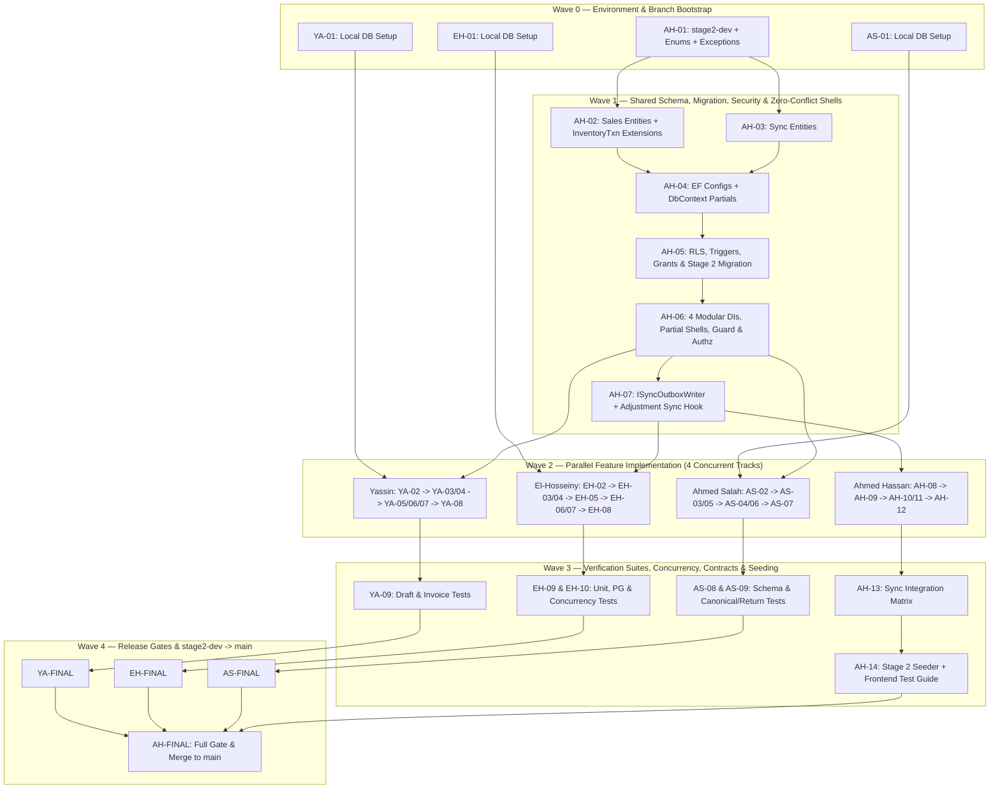

# PharmacyERP — Stage 2 Master Execution Map & Reconciliation Plan

| Field | Value |
| :--- | :--- |
| **Document ID** | `00-STAGE2-EXECUTION-MAP.md` |
| **Stage Scope** | **Stage 2 ONLY** — Cashier POS Sales, Invoicing, Cash Payments, Returns/Refunds, Offline Sync Engine, & Stage 2 Canonical Read APIs (**ZERO Stage 3 Purchasing Scope**) |
| **Authoritative Spec** | `_audit_docs/01_master_spec/ERP-Backend-Blueprint-v1.1.md` (Sections 4, 6, 8 [§8.2, §8.6, §8.9], 9, and 10 — frozen reference-only) |
| **Verified Stage 1 Baseline** | `724 / 724` tests passing (`563` Unit + `161` Integration), `0 Error(s), 0 Warning(s)`, `20` tenant-bound RLS tables across `4` schemas (`identity`, `catalog`, `inventory`, `integration`), `2` unified EF Core migrations |
| **Integration Branch** | `stage2-dev` (`main` stays frozen on verified Stage 1 for ongoing frontend integration) |
| **Team Roster** | `Ahmed Hassan` (`AH-01`..`AH-14`, `AH-FINAL`) · `El-Hosseiny` (`EH-01`..`EH-10`, `EH-FINAL`) · `Yassin` (`YA-01`..`YA-09`, `YA-FINAL`) · `Ahmed Salah` (`AS-01`..`AS-09`, `AS-FINAL`) |

---

## 1. Stage 1 As-Built Reconciliation Summary (Ground Truth)

Before launching Stage 2, targeted read-only inspection of `apps/erp-backend/src/`, `_audit_docs/04_audit_reports/04_FINAL_VERIFICATION_REPORT.md`, and `05_STAGE1_PERFORMANCE_AND_CAPACITY_REPORT.md` confirmed the following baseline facts and Stage 2 deltas:

| Stage 1 Component | Verified As-Built State | Stage 2 Action Required |
| :--- | :--- | :--- |
| **Wave 0 Root Files** (`src/PharmacyERP.Api/Program.cs`, `src/PharmacyERP.Infrastructure/Persistence/Database/PharmacyDbContext.cs`) | Untouched & clean. `PharmacyDbContext` dynamically applies `ApplyConfigurationsFromAssembly`, tenant `OrganizationId` query filter, and `DeleteBehavior.Restrict`. | Keep both files **100% untouched**. Add Stage 2 `DbSet<T>` properties in `PharmacyDbContext.Sales.cs` and `PharmacyDbContext.Integration.cs`. |
| **Inventory Ledger Entities** (`InventoryTxn`, `InventoryTxnLine`, & EF Configs) | Already include nullable `sales_order_id`, `sales_return_id`, `sales_order_line_id`, `sales_return_line_id` columns, `SALE_ISSUE`/`SALES_RETURN_IN`/`SCRAP_OUT` enum values & sign checks, and `(organization_id, inventory_txn_id, branch_id)` AK. | Add composite source FKs to `SALES_ORDER`/`SALES_RETURN` & `SALES_ORDER_LINE`/`SALES_RETURN_LINE`, partial unique indexes (`SALE_ISSUE`, `SALES_RETURN_IN`, `SCRAP_OUT`), source-link `CHECK` constraint, `InventoryTxn.AddLine(...)` overload accepting source line IDs, and PostgreSQL `DEFERRABLE INITIALLY DEFERRED` source-line ownership constraint triggers. |
| **PostgreSQL RLS & Role Grants** (`RlsAndAuditProtectionSql.cs`, `DatabaseRoleSecuritySql.cs`, `provision_db_roles.sql`) | `20` tenant tables enforced with `ENABLE` + `FORCE ROW LEVEL SECURITY`. **Critical finding:** `TableRlsStatusCheckSql` checks only `('identity', 'catalog', 'inventory', 'integration')`, and `GenerateAppRoleGrantsSql()` grants `integration` tables individually by name. | Add `'sales'` schema to `TableRlsStatusCheckSql`, `GenerateRoleProvisioningTemplateSql()`, `provision_db_roles.sql`, and `GenerateAppRoleGrantsSql()`. Explicitly grant `erp_app` `SELECT, INSERT, UPDATE, DELETE` on `integration."SYNC_OUTBOX"`, `integration."SYNC_INBOX"`, and `integration."SYNC_BRANCH_CURSOR"` (preserving `SELECT, INSERT` only on `integration."AUDIT_LOG"`). Register all `11` new tables (`31` total) in `RlsAndAuditProtectionSql`. |
| **Cross-Module Interfaces** (`INonLotBatchInitializer`, `IProductInventoryUsageChecker`) | Active implementations registered in `Infrastructure/DependencyInjection.cs` alongside legacy `*2` aliases. | Reference **only** active `INonLotBatchInitializer` and `IProductInventoryUsageChecker` in Stage 2; ignore unused `*2.cs` interfaces. |
| **Inventory Adjustment Service** (`InventoryAdjustmentService.cs`) | Enqueues `inventory.adjustment.posted` to `integration.OUTBOX_EVENT`, uses ordered `StockBalanceRepository.GetOrCreateForUpdateBatchAsync`, `IIdempotencyService`, `IAuditLogger`, and 3-attempt transient concurrency retry. | Inject `ISyncOutboxWriter?` (optional parameter to preserve existing Stage 1 unit tests) so `BranchLocal` commits `POST_INVENTORY_ADJUSTMENT` to `integration.SYNC_OUTBOX` atomically inside the same `IUnitOfWork` transaction. |
| **Stock Locking & Concurrency** (`StockBalanceRepository.cs`) | Uses set-based `INSERT ... ON CONFLICT DO NOTHING` + deterministic `ORDER BY location_id ASC, batch_id ASC FOR UPDATE OF sb` + `row_version` concurrency token (`100%` exact accuracy under 100-VU hot-SKU load). | Reuse deterministic `FOR UPDATE` locking for FEFO sales checkout and return stock-in; always acquire locks in strict deterministic order (`(location_id, batch_id)` for stock rows) to eliminate PostgreSQL `40P01` deadlocks. |
| **HTTP Edge, Errors & Idempotency** (`RuntimeModeGuardMiddleware.cs`, `ApiResultMapper.cs`, `AllowHeaderIdempotencyKeyAttribute.cs`, `AuthorizationPoliciesExtensions.cs`, `CanonicalJsonHasher.cs`, `ErrorCode.cs`) | Unified `ApiErrorEnvelopeDto`, `[AllowHeaderIdempotencyKey]`, `JsonStringEnumConverter`, `CanonicalJsonHasher` (sorted keys + normalized decimal scale), `AdminOnly`/`OrgAdminOnly`/`PlatformProvisionerOnly`. | Add `ErrorCode.SYNC_CURSOR_EXPIRED` (mapped to `409` in `ApiResultMapper`), extend `RuntimeModeGuardMiddleware` for Stage 2 `Cloud`/`BranchLocal` boundaries, and add `SyncAdminOnly` + Sales role policies in `AuthorizationPoliciesExtensions`. |
| **Canonical Capabilities** (`CanonicalCapabilitiesService.cs`) | Returns `Stage: 1`, `SupportedReads: ["products", "inventory"]`, `SupportedWrites: ["configuration.products", "configuration.reorder-rules"]`. | Update to `Stage: 2`, `SupportedReads: ["products", "inventory", "sales", "orders", "returns"]`, and keep `SupportedWrites` unchanged (**zero Stage 2 canonical writes**). |
| **Local Dev & Test Harness** (`setup-local-db.ps1`, `DevDatabaseSeeder.cs`, `FRONTEND_TEST_DATA_GUIDE.md`, `ThrowawayPostgresDatabaseProvisioner`) | Automated local DB/role/migration/user-secrets script; 3 seeded tenants (`MEDCARE`, `ALNOUR`, `GREENLEAF`); `erp_it_app` throwaway DB fixture with `FORCE RLS`. | Extend `ThrowawayPostgresDatabaseProvisioner` with Stage 2 triggers & grants; extend `DevDatabaseSeeder` & `FRONTEND_TEST_DATA_GUIDE.md` with Stage 2 POS sales, invoices, payments, returns, and sync cursors. |

---

## 2. Git Branching & PR Protocol (`stage2-dev`)

To keep `main` 100% stable on verified Stage 1 while `apps/erp-frontend` continues Stage 1 integration, all Stage 2 development flows strictly through a dedicated long-lived integration branch **`stage2-dev`**:

```text
main (FROZEN on verified Stage 1 — 724/724 tests passing)
  │
  └──► stage2-dev  ◄── Wave 0/1 foundation PRs (AH-01..AH-06)
         ├──► stage2/ahmed-hassan/ah-07-sync-outbox-writer   ──► PR into stage2-dev
         ├──► stage2/el-hosseiny/eh-03-fefo-allocation       ──► PR into stage2-dev
         ├──► stage2/yassin/ya-03-order-draft-repository     ──► PR into stage2-dev
         └──► stage2/ahmed-salah/as-05-canonical-sales-repo  ──► PR into stage2-dev
         │
         ▼  (Only after ALL Stage 2 Release Gates pass in Wave 4)
main ◄── PR: stage2-dev -> main (Stage 2 Release)
```

### Mandatory Branching & PR Rules
1. **Branch Naming Convention:** `stage2/<dev>/<task-id>-<slug>`
   - `<dev>` values: `ahmed-hassan`, `el-hosseiny`, `yassin`, `ahmed-salah`
   - Examples: `stage2/ahmed-hassan/ah-05-stage2-migration`, `stage2/el-hosseiny/eh-05-pos-checkout`, `stage2/yassin/ya-05-sales-order-draft-service`, `stage2/ahmed-salah/as-07-canonical-sales-controller`.
2. **Base & Target Branch:** Always branch off the latest `stage2-dev` and open PRs **into `stage2-dev`** — **never** into `main`.
3. **Strict Backend Boundary:** Every PR touches files strictly inside `apps/erp-backend/`. Never modify `apps/erp-frontend/`, `apps/brain/`, root `contracts/`, or frozen `ERP-Backend-Blueprint-v1.1.md`.
4. **PR Entry Gate (Per Task PR):**
   - `dotnet build PharmacyERP.sln --no-restore` succeeds with **`0 Error(s), 0 Warning(s)`**.
   - `dotnet test PharmacyERP.sln --no-restore` passes with **`0 Failed, 0 Skipped`** (all 724 Stage 1 tests + new Stage 2 tests green).
   - No edits to `Program.cs`, `PharmacyDbContext.cs`, or another developer's owned files.
5. **Safe Local Branch Sync Flow (run from `apps/erp-backend/`):**
   ```powershell
   git fetch origin
   git switch stage2-dev
   git pull --ff-only origin stage2-dev
   git switch -c stage2/<dev>/<task-id>-<slug>
   ```
   *(Never use `git push --force`, `git reset --hard`, or `git clean -fdx`.)*
6. **Final Promotion to `main`:** Executed once at the end of Wave 4 (`AH-FINAL`) only after `EH-FINAL`, `YA-FINAL`, `AS-FINAL`, and `AH-FINAL` sign off every Stage 2 Release Gate.

---

## 3. Zero-Conflict Architecture Strategy

Stage 2 is structurally partitioned so all four developers work concurrently across Waves 2–3 with **zero overlapping file edits**, **zero merge conflicts**, and **zero cross-blocking**.

### 3.1 Modular DI Extensions (Wired Once in Wave 1 by `Ahmed Hassan`)
`src/PharmacyERP.Api/Program.cs` stays untouched. In `AH-06`, `Ahmed Hassan` creates **4 modular DI extension files** (with matching Application and Infrastructure registration methods) and wires them **once** into `src/PharmacyERP.Application/DependencyInjection.cs` and `src/PharmacyERP.Infrastructure/DependencyInjection.cs`. After `AH-06` merges into `stage2-dev`, no developer ever edits the root `DependencyInjection.cs` files again:

| Modular DI File Pair (Application + Infrastructure) | Owner | Services & Repositories Registered |
| :--- | :--- | :--- |
| `SalesDraftDependencyInjection.cs` | **Yassin** | `ISalesOrderDraftRepository`, `ISalesInvoiceQueryRepository`, `ISalesOrderDraftService`, `ISalesInvoiceQueryService` |
| `SalesCheckoutAndReturnsDependencyInjection.cs` | **El-Hosseiny** | `IFefoAllocationRepository`, `ISalesCheckoutRepository`, `ISalesReturnWriteRepository`, `IFefoAllocationService`, `ISalesCheckoutService`, `ISalesReturnService` |
| `SyncDependencyInjection.cs` | **Ahmed Hassan** | `ISyncOutboxRepository`, `ISyncInboxRepository`, `ISyncBranchCursorRepository`, `ISyncSnapshotRepository`, `ISyncOutboxWriter`, `ISyncPushService`, `ISyncRetryService`, `ISyncPullService`, `BranchSyncBackgroundWorker` |
| `CanonicalStage2DependencyInjection.cs` | **Ahmed Salah** | `ISalesReturnQueryRepository`, `ICanonicalStage2Repository`, `ISalesReturnQueryService`, `ICanonicalStage2Service` |

*Placement (placed under `Extensions/` to prevent C# `CS0101` namespace/class collisions with root `DependencyInjection` classes):*
- Application extensions: `src/PharmacyERP.Application/Extensions/<Name>.cs`
- Infrastructure extensions: `src/PharmacyERP.Infrastructure/Extensions/<Name>.cs`

### 3.2 Partial Controller Strategy (Zero Controller File Overlap)
In `AH-06`, `Ahmed Hassan` creates minimal `[ApiController]` partial shells with route attributes and zero constructor dependencies (so each developer injects only their own service via `[FromServices]` on action parameters, avoiding shared constructor conflicts):

| Controller & Partial Files | Base Route | File Owner | Endpoints Hosted |
| :--- | :--- | :--- | :--- |
| `SalesOrdersController.cs` *(minimal `partial class` shell)* | `/api/v1/sales-orders` | **Ahmed Hassan** (`AH-06`) | Shell only (`[ApiController]`, `[Route("api/v1/sales-orders")]`, `[Authorize]`) |
| `SalesOrdersController.Draft.cs` | `/api/v1/sales-orders` | **Yassin** (`YA-08`) | `POST ""`, `GET ""`, `GET "{id:guid}"`, `PUT "{id:guid}/lines"`, `POST "{id:guid}/cancel"` |
| `SalesOrdersController.Checkout.cs` | `/api/v1/sales-orders` | **El-Hosseiny** (`EH-08`) | `POST "{id:guid}/complete"` |
| `SalesInvoicesController.cs` | `/api/v1/sales-invoices` | **Yassin** (`YA-08`) | `GET ""`, `GET "{id:guid}"` |
| `SalesReturnsController.cs` *(minimal `partial class` shell)* | `/api/v1/sales-returns` | **Ahmed Hassan** (`AH-06`) | Shell only (`[ApiController]`, `[Route("api/v1/sales-returns")]`, `[Authorize]`) |
| `SalesReturnsController.Write.cs` | `/api/v1/sales-returns` | **El-Hosseiny** (`EH-08`) | `POST ""` |
| `SalesReturnsController.Read.cs` | `/api/v1/sales-returns` | **Ahmed Salah** (`AS-04`) | `GET ""`, `GET "{id:guid}"` |
| `SyncController.cs` | `/api/v1/sync` | **Ahmed Hassan** (`AH-12`) | `POST "operations"`, `POST "operations/{operationId:guid}/retry"`, `GET "bootstrap"`, `GET "changes"` |
| `CanonicalSalesController.cs` | `/api/v1/canonical` | **Ahmed Salah** (`AS-07`) | `GET "sales"`, `GET "orders"`, `GET "returns"` |
| `CanonicalCapabilitiesController.cs` *(existing)* + `CanonicalCapabilitiesService.cs` | `/api/v1/canonical/capabilities` | **Ahmed Salah** (`AS-07`) | `GET ""` (service updated to Stage 2 reads; controller unchanged) |

### 3.3 Separated Read/Draft vs. Transactional Write Repositories
Each repository interface and implementation has a single explicit owner and strict query/lock responsibility:

| Owner | Repository Interfaces & Implementations | Responsibility & Query Hygiene |
| :--- | :--- | :--- |
| **Yassin** | `ISalesOrderDraftRepository` (`SalesOrderDraftRepository`), `ISalesInvoiceQueryRepository` (`SalesInvoiceQueryRepository`) | Draft order creation/line replacement/cancellation + `AsNoTracking()` paginated list/detail queries for `SALES_ORDER` and `SALES_INVOICE`. Never mutates stock balances or issued invoices. |
| **El-Hosseiny** | `IFefoAllocationRepository` (`FefoAllocationRepository`), `ISalesCheckoutRepository` (`SalesCheckoutRepository`), `ISalesReturnWriteRepository` (`SalesReturnWriteRepository`) | Pessimistic `SELECT ... FOR UPDATE` FEFO batch/balance locking, atomic checkout aggregate persistence (`SALES_INVOICE`, `SALES_INVOICE_LINE`, `SALES_PAYMENT`, `INVENTORY_TXN`), and return allocation trace + write persistence (`SALES_RETURN`, `SALES_RETURN_LINE`, `SALES_REFUND`, `INVENTORY_TXN`). |
| **Ahmed Salah** | `ISalesReturnQueryRepository` (`SalesReturnQueryRepository`), `ICanonicalStage2Repository` (`CanonicalStage2Repository`) | Strictly `AsNoTracking()` / `AsSplitQuery()` read-only queries for returns search/detail and incremental cursor-paginated Canonical feeds (`sales`, `orders`, `returns`). |
| **Ahmed Hassan** | `ISyncOutboxRepository`, `ISyncInboxRepository`, `ISyncBranchCursorRepository`, `ISyncSnapshotRepository`, `ISyncOutboxWriter` | Transactional `SYNC_BRANCH_CURSOR` row-locked sequence allocation, `SYNC_OUTBOX` write/ack, `SYNC_INBOX` deduplication/conflict retention, and Cloud bootstrap/delta snapshots. |

### 3.4 Shared DTO & Namespace Partitioning
To prevent file collisions inside `src/PharmacyERP.Application/Features/Sales/DTOs/`:
- **Yassin** owns `SalesOrderDraftDtos.cs` and `SalesInvoiceDtos.cs` (note: `SalesInvoiceDto` is also referenced by `CompleteSalesOrderResultDto` — Yassin lands `YA-02` early in Wave 2, or shares the immutable record signature specified in Blueprint §6.5).
- **El-Hosseiny** owns `SalesCheckoutDtos.cs` and `SalesReturnWriteDtos.cs`.
- **Ahmed Salah** owns `SalesReturnQueryDtos.cs` and `Features/Integration/DTOs/` (`CanonicalSaleDto.cs`, `CanonicalSalesOrderDto.cs`, `CanonicalSaleReturnDto.cs`).
- **Ahmed Hassan** owns `Features/Sync/DTOs/SyncDtos.cs` and `Features/Sync/Contracts/SyncPayloads.cs` (versioned immutable `v1` payloads for `COMPLETE_SALES_ORDER`, `POST_SALES_RETURN`, and `POST_INVENTORY_ADJUSTMENT`).

---

## 4. Wave-by-Wave Dependency Graph (`Wave 0` → `Wave 4`)



### Wave Transition Gate Criteria
- **Wave 0 → Wave 1:** `stage2-dev` created from verified Stage 1 `main`; every teammate has run `setup-local-db.ps1` and verified `724/724` Stage 1 tests pass locally.
- **Wave 1 → Wave 2 (Unblock Milestone):** `AH-01` through `AH-07` merged into `stage2-dev`; single cumulative Stage 2 EF Core migration applies cleanly to empty and Stage 1 databases; all `31` tables pass `DatabaseSecurityStartupCheck` (`FORCE RLS` + `erp_app` grants); 4 modular DI files, partial controller shells, and `ISyncOutboxWriter` are live in `stage2-dev`.
- **Wave 2 → Wave 3:** All 19 Stage 2 routes compile cleanly with `0` warnings and pass targeted unit smoke checks across all 4 parallel tracks.
- **Wave 3 → Wave 4:** All unit, PostgreSQL integration, multi-threaded FEFO concurrency, offline sync resilience, and DTO/Enum contract schema suites pass with `0 Failed, 0 Skipped`; `DevDatabaseSeeder` seeds Stage 2 data idempotently and `FRONTEND_TEST_DATA_GUIDE.md` is updated.
- **Wave 4 → Release (`main`):** All 4 `*-FINAL` checklists signed off; full `dotnet build` (`0 Error(s), 0 Warning(s)`) + `dotnet test` (`100% Passed`) verified on `stage2-dev`; PR `stage2-dev -> main` approved and merged.

---

## 5. Task Ownership Matrix

### 5.1 Ahmed Hassan (`AH-01`..`AH-14`, `AH-FINAL`)

| Task ID | Wave | Title & Exact Deliverables | Dependencies |
| :--- | :---: | :--- | :--- |
| **`AH-01`** | 0 | **`stage2-dev` Bootstrap, Stage 2 Enums & Domain Exceptions:** Create `stage2-dev` from Stage 1 `main`. Add Stage 2 enums in `PharmacyERP.Domain/Enums/` (`OrderChannel`, `SalesOrderStatus`, `SalesInvoiceStatus`, `SalesPaymentStatus`, `PaymentMethod`, `SalesReturnStatus`, `SalesRefundStatus`, `ReturnDisposition`, `SyncOperationType`, `SyncProcessingStatus`, `SyncResultCode`), append `ErrorCode.SYNC_CURSOR_EXPIRED`, and add `SalesDomainException` / `SyncDomainException`. | Stage 1 `main` |
| **`AH-02`** | 1 | **Stage 2 Sales Domain Entities & Ledger Extensions:** Implement persistence-ignorant entities under `Domain/Entities/Sales/` (`SalesOrder`, `SalesOrderLine`, `SalesInvoice`, `SalesInvoiceLine`, `SalesPayment`, `SalesReturn`, `SalesReturnLine`, `SalesRefund`) with strict constructor/factory invariants, precision rules, and state guards (`DRAFT -> COMPLETED/CANCELLED`, immutable issued invoice/lines with mutable settlement projection). Add `InventoryTxn.AddLine(...)` overload supporting `salesOrderLineId`/`salesReturnLineId`. | `AH-01` |
| **`AH-03`** | 1 | **Stage 2 Sync Domain Entities:** Implement `SyncOutbox`, `SyncInbox`, and `SyncBranchCursor` under `Domain/Entities/Integration/` enforcing immutable `result_code` after first terminal outcome (`APPLIED`/`CONFLICT`/`FAILED`), `CONFLICT -> RECEIVED -> APPLIED` retry transition, and monotonic cursor checks. | `AH-01` |
| **`AH-04`** | 1 | **EF Core Configurations & `PharmacyDbContext` Partials:** Create 11 `IEntityTypeConfiguration<T>` files (`Configurations/Sales/*` [8] & `Configurations/Integration/Sync*` [3]), update `InventoryTxnConfiguration` & `InventoryTxnLineConfiguration` (composite FKs to Sales entities, partial unique indexes for `SALE_ISSUE`/`SALES_RETURN_IN`/`SCRAP_OUT`, source-link `CHECK` constraint), add `PharmacyDbContext.Sales.cs`, and add Sync `DbSet<T>`s to `PharmacyDbContext.Integration.cs`. Keep `PharmacyDbContext.cs` untouched. | `AH-02`, `AH-03` |
| **`AH-05`** | 1 | **RLS, Immutability Triggers, Deferred Source-Line Triggers, Role Grants & Stage 2 Migration:** Update `RlsAndAuditProtectionSql` (`31` tables), `DatabaseRoleSecuritySql` + `provision_db_roles.sql` (`sales` schema + `SYNC_*` table grants), create `SalesImmutabilityAndSourceConstraintSql` (immutability triggers on issued `SALES_INVOICE` [non-settlement columns], `SALES_INVOICE_LINE`, `SALES_PAYMENT`, `SALES_REFUND`, posted `SALES_RETURN`/`SALES_RETURN_LINE`, plus `DEFERRABLE INITIALLY DEFERRED` source-line header-ownership triggers on `INVENTORY_TXN_LINE`), generate single cumulative migration `Stage2SalesAndOfflineSync`, and update `ThrowawayPostgresDatabaseProvisioner`. | `AH-04` |
| **`AH-06`** | 1 | **Zero-Conflict Scaffolding, Runtime Mode Guard & Authz Policies:** Create & wire the 4 modular DI extension file pairs (`SalesDraftDependencyInjection`, `SalesCheckoutAndReturnsDependencyInjection`, `SyncDependencyInjection`, `CanonicalStage2DependencyInjection`), create `partial class SalesOrdersController` & `SalesReturnsController` shells, update `RuntimeModeGuardMiddleware` for Stage 2 `Cloud`/`BranchLocal` rules, add `SyncAdminOnly` + Sales policies in `AuthorizationPoliciesExtensions`, and map `ErrorCode.SYNC_CURSOR_EXPIRED -> 409` in `ApiResultMapper`. | `AH-05` |
| **`AH-07`** | 1 | **`ISyncOutboxWriter`, `ISyncBranchCursorRepository` & Stage 1 Adjustment Hook:** Implement transactional `ISyncOutboxWriter` (acquiring row-locked `SYNC_BRANCH_CURSOR` increment, computing `CanonicalJsonHasher` SHA-256 `payload_hash`, embedding immutable audit facts, and inserting `SYNC_OUTBOX` atomically on `BranchLocal`; no-op on `Cloud`) and wire `POST_INVENTORY_ADJUSTMENT` into `InventoryAdjustmentService` via optional constructor dependency (preserving Stage 1 unit test compatibility). | `AH-06` |
| **`AH-08`** | 2 | **Sync DTOs, Versioned `v1` Payloads & Sync Repositories:** Implement `SyncDtos.cs`, versioned `v1` typed sync payloads (`CompleteSalesOrderSyncPayloadV1`, `PostSalesReturnSyncPayloadV1`, `PostInventoryAdjustmentSyncPayloadV1`), validators, `ISyncOutboxRepository`, `ISyncInboxRepository`, and `ISyncSnapshotRepository`. | `AH-07` |
| **`AH-09`** | 2 | **Cloud Sync Push Ingestion & Conflict Engine (`POST /api/v1/sync/operations`):** Implement `ISyncPushService` enforcing enrolled-branch credential verification, contiguous `branch_sequence` check (returning `expected_next_sequence` on gap), `payload_version` validation, `CanonicalJsonHasher` SHA-256 verification (`IDEMPOTENCY_MISMATCH` audited), exact fact application to Cloud `erp_db` (sales/returns/adjustments/audit rows without recalculating FEFO/totals), `SYNC_INBOX` deduplication (`ALREADY_APPLIED`/`CONFLICT`), and head-of-line conflict blocking without advancing `last_applied_sequence`. | `AH-08` |
| **`AH-10`** | 2 | **Cloud Sync Conflict Retry Service (`POST /api/v1/sync/operations/{operationId}/retry`):** Implement `ISyncRetryService` requiring `SyncAdminOnly` (`sync:retry` scope) + non-empty audited reason, verifying target is the blocked queue head (`last_applied_sequence + 1`), reprocessing the exact immutable `SYNC_INBOX` payload (`CONFLICT -> RECEIVED -> APPLIED`), preserving original immutable `result_code`, advancing cursor on success, and auditing every retry attempt. | `AH-09` |
| **`AH-11`** | 2 | **Cloud Sync Pull Feeds (`GET /api/v1/sync/bootstrap` & `GET /api/v1/sync/changes`):** Implement `ISyncPullService` deriving `organization_id`/`branch_id` strictly from enrolled branch credentials: `bootstrap` returns reference/catalog/price/tax data, authorized branch `Employee`/`UserAccount`/`USER_BRANCH_ACCESS` rows through the protected enrollment channel, and initial cursors (**zero stock projections or opening balances**); `changes` serves commit-ordered `OUTBOX_EVENT.event_sequence` deltas with opaque `nextCursor` advancing over scanned entries and returning `409 SYNC_CURSOR_EXPIRED` for expired cursors. | `AH-08` |
| **`AH-12`** | 2 | **`SyncController`, `BranchSyncBackgroundWorker` & `SyncDependencyInjection.cs` Wiring:** Implement thin `SyncController` (all 4 sync routes with `ApiResultMapper`), implement `BranchSyncBackgroundWorker` (enabled only in `BranchLocal`, pushing pending `SYNC_OUTBOX` in strict `branch_sequence` order with bounded exponential backoff on transient failures, halting on deterministic conflicts, marking `synced_at` only on explicit cloud ack, and pulling/applying `changes` pages atomically with `last_applied_cloud_cursor`), and register all sync components in `SyncDependencyInjection.cs`. | `AH-09`, `AH-10`, `AH-11` |
| **`AH-13`** | 3 | **Sync Engine Unit & PostgreSQL Integration Test Matrix:** Full Blueprint §10.1 sync verification: duplicate delivery (`ALREADY_APPLIED`), reversed arrival order, sequence gap detection (`expected_next_sequence`), crash-after-cloud-commit before ack replay, payload/hash mismatch rejection, recoverable conflict retry vs. irreparable conflict head blocking, delayed/overlapping transaction feed ordering, page-boundary replay, deactivation/tombstone delivery, `SYNC_CURSOR_EXPIRED` handling, and RLS isolation across pooled connections. | `AH-12` |
| **`AH-14`** | 3 | **Stage 2 `DevDatabaseSeeder` & `FRONTEND_TEST_DATA_GUIDE.md` Update:** Extend idempotent `DevDatabaseSeeder` to seed realistic Stage 2 POS draft/completed/cancelled orders, issued invoices, cash payments, partial/full returns (`RESTOCK`/`QUARANTINE`/`SCRAP`), cash refunds, linked `SALE_ISSUE`/`SALES_RETURN_IN`/`SCRAP_OUT` ledger txns, and `SYNC_BRANCH_CURSOR` rows across `MEDCARE`/`ALNOUR`/`GREENLEAF`. Update `FRONTEND_TEST_DATA_GUIDE.md` with Stage 2 test IDs, POS flows, and QA checklist. | `AH-12`, `EH-08`, `YA-08`, `AS-07` |
| **`AH-FINAL`** | 4 | **Stage 2 Master Release Gate & `stage2-dev -> main` Verification:** Execute full solution `dotnet build` (`0 Error(s), 0 Warning(s)`), full `dotnet test` (`100% Passed, 0 Skipped`), empty-DB + Stage 1-upgrade migration verification, `31/31` RLS table check, Swagger/route audit for all 19 routes, confirm zero Stage 3 artifacts, and prepare final `stage2-dev -> main` release PR. | `AH-13`, `AH-14`, `EH-FINAL`, `YA-FINAL`, `AS-FINAL` |

### 5.2 El-Hosseiny (`EH-01`..`EH-10`, `EH-FINAL`)

| Task ID | Wave | Title & Exact Deliverables | Dependencies |
| :--- | :---: | :--- | :--- |
| **`EH-01`** | 0 | **Local DB & Environment Setup:** Run `setup-local-db.ps1`, switch to `stage2-dev`, and confirm `dotnet test PharmacyERP.sln` passes `724/724` baseline tests locally. | `AH-01` |
| **`EH-02`** | 2 | **Checkout & Return Write DTOs + Validators:** Implement `SalesCheckoutDtos.cs` (`CompleteSalesOrderRequest`, `CompleteSalesOrderResultDto`, `SalesPaymentDto`), `SalesReturnWriteDtos.cs` (`CreateSalesReturnRequest`, `SalesReturnLineRequest`, `SalesReturnDto`, `SalesReturnLineDto`, `SalesRefundDto`), and strict input validators (non-empty `IdempotencyKey`, `Method == CASH`, positive tendered/quantities, valid `ReturnDisposition`). | `AH-06`, `EH-01` |
| **`EH-03`** | 2 | **FEFO Allocation Repository & Service (`IFefoAllocationRepository`, `IFefoAllocationService`):** Query and pessimistically lock (`SELECT ... FOR UPDATE` in deterministic order) eligible sellable `STOCK_BALANCE` rows (`Location.IsSellable == true && IsActive`, `Batch.QualityStatus == AVAILABLE`, and `ExpiresOn == null || ExpiresOn >= orgBusinessDate` using `IDateTimeProvider.GetOrganizationBusinessDate(org.TimeZoneId)`). Allocate in strict FEFO order: `ExpiresOn ASC` (dated first), tie-break `BatchId ASC`, `NULL`-expiry (`NON-LOT`) sorted last. On shortage, return `409 OUT_OF_STOCK` with typed `ApiErrorDetailDto` listing every affected order line and available quantity. | `AH-06`, `EH-02` |
| **`EH-04`** | 2 | **Checkout & Return Write Repositories (`ISalesCheckoutRepository`, `ISalesReturnWriteRepository`):** Implement transactional EF repositories to load/lock target `SALES_ORDER` + lines, persist `SALES_INVOICE`/`SALES_INVOICE_LINE`/`SALES_PAYMENT`, query original posted `SALE_ISSUE` `INVENTORY_TXN_LINE` allocations per `invoice_line_id` plus cumulative prior returned quantities per `(invoice_line_id, batch_id, location_id)`, resolve branch default `SELLABLE`/`QUARANTINE`/`SCRAP` locations, and persist `SALES_RETURN`/`SALES_RETURN_LINE`/`SALES_REFUND`. | `AH-06`, `EH-02` |
| **`EH-05`** | 2 | **Atomic POS Checkout Service (`ISalesCheckoutService` — `POST /api/v1/sales-orders/{id}/complete`):** Validate `BranchLocal` mode, tenant, branch access, Cashier/authorized role, `DRAFT` status, non-empty lines, and idempotency inside `IUnitOfWork` transaction (`sales.orders.complete`). Recompute authoritative totals from stored order-line snapshots, enforce full `CASH` payment (`cash_tendered_amount >= grand_total`, `change_amount = cash_tendered - grand_total`, `amount_due = grand_total`, reject partial/credit). Run `IFefoAllocationService`, deduct `STOCK_BALANCE` with transient concurrency retry, post `SALE_ISSUE` `INVENTORY_TXN` + base-UOM `INVENTORY_TXN_LINE`s (`sales_order_line_id` linked, `conversion_snapshot = 1`), compute weighted-average `unit_cost_snapshot` per `SALES_INVOICE_LINE`, persist `SALES_INVOICE` (`ISSUED`/`PAID`) + `SALES_PAYMENT`, transition order to `COMPLETED`, write `IAuditLogger`, `IOutboxService`, `ISyncOutboxWriter` (`COMPLETE_SALES_ORDER`), and `IIdempotencyService`. | `AH-07`, `EH-03`, `EH-04` |
| **`EH-06`** | 2 | **Sales Return Policy & Authorization Validation (`ISalesReturnService` — Part 1):** Validate `BranchLocal` mode, tenant, branch access (`invoice.BranchId == request branch`), **14-day return window** measured in Organization IANA timezone (`orgBusinessDate <= issuedBusinessDate.AddDays(14)`), **distinct approver policy** (`approved_by_employee_id` when supplied must be an active `Admin` or `Pharmacist` authorized at the invoice branch via `USER_BRANCH_ACCESS` or `branch_scope=ALL`, and strictly `!= received_by_employee_id`; cashier cannot self-approve), server-derived original `SALE_ISSUE` batch/location allocations (never client-selected), and cumulative remaining returnable quantity check per allocation. | `AH-07`, `EH-04` |
| **`EH-07`** | 2 | **Atomic Sales Returns & Refunds (`ISalesReturnService` — Part 2, `POST /api/v1/sales-returns`):** Inside one `IUnitOfWork` transaction (`sales.returns.post`): split return lines across original `SALE_ISSUE` batch/location allocations preserving original `unit_cost_base`; compute proportional line refunds from original tax-inclusive `SALES_INVOICE_LINE.line_total` with **§8.9.12 cent-residual rounding** on final returned quantity (capping cumulative refunds at `invoice.PaidAmount` and line `line_total`); select server destination locations (`RESTOCK`: source sellable location if active else branch default `SELLABLE`; `QUARANTINE`/`SCRAP`: branch default of that type); post `SALES_RETURN_IN` (positive) and, for `SCRAP`, atomically pair an equal `SCRAP_OUT` (negative, ending `SCRAP` on-hand = `0`) sharing the command `idempotency_key` (distinct by `transaction_type`); persist `SALES_RETURN`, `SALES_RETURN_LINE`, `SALES_REFUND` (`CASH`), update `SALES_INVOICE` settlement projection (`refunded_amount`, `payment_status`), write `IAuditLogger`, `IOutboxService`, `ISyncOutboxWriter` (`POST_SALES_RETURN`), and `IIdempotencyService`. | `EH-06` |
| **`EH-08`** | 2 | **Partial Write Controllers & DI Wiring:** Implement `SalesOrdersController.Checkout.cs` (`POST /api/v1/sales-orders/{id}/complete`) and `SalesReturnsController.Write.cs` (`POST /api/v1/sales-returns`) using `[FromServices]`, `[AllowHeaderIdempotencyKey]`, role policies, and `ApiResultMapper`. Register all checkout/FEFO/return write services & repositories in `SalesCheckoutAndReturnsDependencyInjection.cs`. | `EH-05`, `EH-07` |
| **`EH-09`** | 3 | **Checkout, FEFO & Returns Unit Tests:** Comprehensive xUnit tests covering FEFO ordering (`expires_on ASC, batch_id ASC`, `NON-LOT` last, expired/recalled/quarantined exclusion, Org TZ business date boundary), `409 OUT_OF_STOCK` affected-line details, full-cash validation & change calculation, 14-day TZ boundary, distinct approver rejection, over-return rejection, `RESTOCK`/`QUARANTINE`/`SCRAP` cost & dual-txn math, and §8.9.12 partial-refund cent-residual edge cases (e.g., `100.00 / 3` across 3 returns = `33.33 + 33.33 + 33.34 = 100.00`). | `EH-08` |
| **`EH-10`** | 3 | **PostgreSQL Integration & Multi-Threaded Concurrency Tests:** Real PostgreSQL (`erp_it_app`, `FORCE RLS`) tests verifying atomic checkout commit/rollback, multi-threaded concurrent checkouts on a hot SKU batch (zero oversell, exact ending stock), idempotency replay & `409 IDEMPOTENCY_MISMATCH`, `SCRAP` dual-transaction zero balance, deferred source-line constraint trigger rejection, invoice immutability trigger enforcement, `Cloud` vs `BranchLocal` guard (`404`), and `403 FORBIDDEN_BRANCH`. | `EH-09` |
| **`EH-FINAL`** | 4 | **Final Verification & Wave 4 Sign-Off:** Confirm `0` build warnings, `100%` passing Unit + Integration suites on latest `stage2-dev`, verify all checkout/return/FEFO release gates, and approve `stage2-dev` readiness. | `EH-10` |

### 5.3 Yassin (`YA-01`..`YA-09`, `YA-FINAL`)

| Task ID | Wave | Title & Exact Deliverables | Dependencies |
| :--- | :---: | :--- | :--- |
| **`YA-01`** | 0 | **Local DB & Environment Setup:** Run `setup-local-db.ps1`, switch to `stage2-dev`, and confirm `dotnet test PharmacyERP.sln` passes `724/724` baseline tests locally. | `AH-01` |
| **`YA-02`** | 2 | **Sales Order Draft & Invoice DTOs + Validators:** Implement `SalesOrderDraftDtos.cs` (`CreateSalesOrderRequest`, `SalesOrderLineRequest`, `ReplaceSalesOrderLinesRequest`, `CancelSalesOrderRequest`, `SalesOrderDto`, `SalesOrderLineDto`, `SalesOrderSummaryDto`), `SalesInvoiceDtos.cs` (`SalesInvoiceDto`, `SalesInvoiceLineDto`, `SalesInvoiceSummaryDto`), and input validators rejecting client-supplied prices/discounts/taxes/totals, non-positive quantities, and empty line sets. | `AH-06`, `YA-01` |
| **`YA-03`** | 2 | **Sales Order Draft Repository (`ISalesOrderDraftRepository`):** Implement EF repository (`SalesOrderDraftRepository`) supporting draft insert, tracked load-with-lines for `DRAFT` line replacement/cancel, `AsNoTracking()` detail lookup, and filtered paginated order search by `(branchId, status, fromDate, toDate, page, pageSize)` scoped to `OrganizationId`. | `AH-06`, `YA-02` |
| **`YA-04`** | 2 | **Sales Invoice Query Repository (`ISalesInvoiceQueryRepository`):** Implement read-only `AsNoTracking()` + `AsSplitQuery()` EF repository (`SalesInvoiceQueryRepository`) supporting paginated invoice search by `(branchId, fromDate, toDate, invoiceNo, paymentStatus, page, pageSize)` and full invoice detail (lines, payments, refunds summary). | `AH-06`, `YA-02` |
| **`YA-05`** | 2 | **Draft Order Create & Replace Lines (`ISalesOrderDraftService` — Part 1):** Implement `POST /api/v1/sales-orders` and `PUT /api/v1/sales-orders/{id}/lines` on `BranchLocal` inside `IUnitOfWork` write transactions with `IIdempotencyService`, `IAuditLogger`, and `IOutboxService`. Load authoritative active `PRODUCT_UOM` (`IsSellable == true`, non-null `SaleUnitPrice`) and `PRODUCT.TaxRate` + `Organization.BaseCurrency`; snapshot `conversion_snapshot`, `quantity_base = round(entered_qty * conversion, 4)`, `unit_price_snapshot`, `discount_amount = 0`, `net = round(entered_qty * unit_price - discount, 2)`, `tax_amount_snapshot = round(net * tax_rate, 2)`, `line_total = net + tax_amount_snapshot`. Strictly zero stock reservation/deduction. Reject `PUT .../lines` with `409 INVALID_STATE_TRANSITION` if order is not `DRAFT`. | `YA-03` |
| **`YA-06`** | 2 | **Draft Order Cancel & Order Queries (`ISalesOrderDraftService` — Part 2):** Implement `POST /api/v1/sales-orders/{id}/cancel` (`DRAFT -> CANCELLED` only, idempotent, audited, zero stock reversal, `409 INVALID_STATE_TRANSITION` on `COMPLETED`/`CANCELLED`) plus `GET /api/v1/sales-orders` and `GET /api/v1/sales-orders/{id}` using explicit `IUnitOfWork` read transactions (`BeginTransactionAsync` -> query -> `RollbackTransactionAsync(CancellationToken.None)`) and `_currentUser.CanAccessBranch(...)` authorization. | `YA-05` |
| **`YA-07`** | 2 | **Sales Invoice Query Service (`ISalesInvoiceQueryService`):** Implement `GET /api/v1/sales-invoices` and `GET /api/v1/sales-invoices/{id}` inside explicit `IUnitOfWork` read transactions enforcing tenant context, branch authorization (`403 FORBIDDEN_BRANCH`), and `404 NOT_FOUND` on cross-branch/missing invoice, mapping full immutable snapshots + live `paid_amount`/`refunded_amount`/`payment_status`. | `YA-04` |
| **`YA-08`** | 2 | **Controllers & DI Wiring (`SalesOrdersController.Draft.cs`, `SalesInvoicesController.cs`, `SalesDraftDependencyInjection.cs`):** Implement the 5 draft/read actions in `SalesOrdersController.Draft.cs` and 2 read actions in `SalesInvoicesController.cs` using `[FromServices]`, `[AllowHeaderIdempotencyKey]` on mutating routes, role policies, and `ApiResultMapper`. Register all services & repositories in `SalesDraftDependencyInjection.cs`. | `YA-06`, `YA-07` |
| **`YA-09`** | 3 | **Draft Orders & Invoice Queries Unit & PostgreSQL Integration Tests:** Cover server-side price/tax/UOM snapshot math (`MidpointRounding.AwayFromZero`), non-sellable UOM rejection (`422`), zero stock mutation on create/replace/cancel, `409 INVALID_STATE_TRANSITION` on completed/cancelled orders, idempotency replay & `409 IDEMPOTENCY_MISMATCH`, header-only `Idempotency-Key`, `Cloud` vs `BranchLocal` guard, branch authorization, and cross-tenant PostgreSQL RLS isolation. | `YA-08` |
| **`YA-FINAL`** | 4 | **Final Verification & Wave 4 Sign-Off:** Confirm `0` build warnings, `100%` passing Unit + Integration suites on latest `stage2-dev`, verify draft-order and invoice-query release gates, and approve `stage2-dev` readiness. | `YA-09` |

### 5.4 Ahmed Salah (`AS-01`..`AS-09`, `AS-FINAL`)

| Task ID | Wave | Title & Exact Deliverables | Dependencies |
| :--- | :---: | :--- | :--- |
| **`AS-01`** | 0 | **Local DB & Environment Setup:** Run `setup-local-db.ps1`, switch to `stage2-dev`, and confirm `dotnet test PharmacyERP.sln` passes `724/724` baseline tests locally. | `AH-01` |
| **`AS-02`** | 2 | **Return Read DTOs & Stage 2 Canonical DTOs:** Implement `SalesReturnQueryDtos.cs` (`SalesReturnSummaryDto`, `SalesReturnDetailDto` with lines, stock movement refs, and refund summary) and `Features/Integration/DTOs/` (`CanonicalSaleDto.cs`, `CanonicalSalesOrderDto.cs`, `CanonicalSaleReturnDto.cs`, reusing `PagedResult<T>`) with strict `snake_case` JSON property names, `schema`/`version` metadata, and zero customer/delivery/reservation/terminal/PII fields. | `AH-06`, `AS-01` |
| **`AS-03`** | 2 | **Sales Return Query Repository (`ISalesReturnQueryRepository`):** Implement `AsNoTracking()` + `AsSplitQuery()` EF repository (`SalesReturnQueryRepository`) supporting paginated search by `(branchId, invoiceId, fromDate, toDate, page, pageSize)` and full detail lookup including `SALES_RETURN_LINE`s, `SALES_REFUND`s, and linked `INVENTORY_TXN` references (`SALES_RETURN_IN` / `SCRAP_OUT`). | `AH-06`, `AS-02` |
| **`AS-04`** | 2 | **Sales Return Query Service & Controller (`ISalesReturnQueryService`, `SalesReturnsController.Read.cs`):** Implement `GET /api/v1/sales-returns` and `GET /api/v1/sales-returns/{id}` inside explicit `IUnitOfWork` read transactions with branch authorization (`403 FORBIDDEN_BRANCH`) and `ApiResultMapper`, hosted in `SalesReturnsController.Read.cs` using `[FromServices]`. | `AS-03` |
| **`AS-05`** | 2 | **Stage 2 Canonical Read Repository (`ICanonicalStage2Repository`):** Implement `AsNoTracking()` + `AsSplitQuery()` incremental keyset and durable `OUTBOX_EVENT.event_sequence` cursor-paginated queries over posted `SALES_INVOICE` (`GET /api/v1/canonical/sales`), `SALES_ORDER` (`GET /api/v1/canonical/orders`), and posted `SALES_RETURN` (`GET /api/v1/canonical/returns`) supporting `organization_id`, `branch_id`, `from_date`/`to_date`, `updated_since`, `cursor`, and `limit` filters with deterministic ordering. | `AH-06`, `AS-02` |
| **`AS-06`** | 2 | **Stage 2 Canonical Read Service (`ICanonicalStage2Service`):** Implement Cloud read-only canonical mapping for `sales`, `orders`, and `returns` inside explicit `IUnitOfWork` read transactions: verify `organization_id` query parameter (when present) exactly equals `ITenantContext.OrganizationId` (`403 FORBIDDEN` on mismatch), validate branch ownership & `_currentUser.CanAccessBranch`, convert entered prices to base-UOM analytics where specified while preserving persisted line snapshots, and enforce read-only (zero write methods). | `AS-05` |
| **`AS-07`** | 2 | **`CanonicalSalesController`, `CanonicalCapabilitiesService` Update & DI Wiring:** Implement `CanonicalSalesController` (`GET /api/v1/canonical/sales`, `GET /api/v1/canonical/orders`, `GET /api/v1/canonical/returns`) with `snake_case` query params matching Stage 1 `CanonicalInventoryController`. Update `CanonicalCapabilitiesService` to report `Stage: 2`, `SupportedReads: ["products", "inventory", "sales", "orders", "returns"]`, and unchanged `SupportedWrites` (**zero Stage 2 canonical writes**). Register all services & repositories in `CanonicalStage2DependencyInjection.cs`. | `AS-04`, `AS-06` |
| **`AS-08`** | 3 | **Stage 2 DTO & Enum Contract Schema Tests (`Stage2ContractSchemaTests.cs`):** Add automated xUnit contract tests validating JSON serialization/deserialization of all Stage 2 Sales, Sync, and Canonical DTOs and closed string enums (`JsonStringEnumConverter`), confirming exact Blueprint property names, decimal precision formatting, zero PII/customer/delivery/terminal fields in Canonical payloads, and Stage 2 capabilities payload accuracy. | `AS-07`, `YA-02`, `EH-02`, `AH-08` |
| **`AS-09`** | 3 | **Return Queries & Canonical Reads Unit & PostgreSQL Integration Tests:** Verify `GET /api/v1/sales-returns`, `GET /api/v1/sales-returns/{id}`, `GET /api/v1/canonical/sales`, `/orders`, `/returns`, and `/capabilities`: cross-tenant `organization_id` mismatch (`403 FORBIDDEN`), branch-scope enforcement (`403 FORBIDDEN_BRANCH`), `BranchLocal` guard blocking canonical feeds (`404 NOT_FOUND`) while allowing `/capabilities`, cursor pagination stability, and PostgreSQL `FORCE RLS` isolation. | `AS-07` |
| **`AS-FINAL`** | 4 | **Final Verification & Wave 4 Sign-Off:** Confirm `0` build warnings, `100%` passing Unit + Integration + Contract Schema suites on latest `stage2-dev`, verify Canonical read-only and Return query release gates, and approve `stage2-dev` readiness. | `AS-08`, `AS-09` |

---

## 6. 100% Stage 2 Coverage Audit Matrix (Blueprint Reconciliation)

### 6.1 Stage 2 Database Schema Coverage (`11` New Tables + `2` Extended Tables = `31` Total Tenant RLS Tables)

| # | Schema.Table | Action | Key Constraints, Alternate Keys, Indexes & Triggers | Owner & Tasks |
| :---: | :--- | :---: | :--- | :--- |
| 1 | `sales."SALES_ORDER"` | **New** | PK `sales_order_id`; AK `(organization_id, sales_order_id)`, `(organization_id, branch_id, sales_order_id)`; UK `(organization_id, branch_id, order_no)`, `(organization_id, branch_id, idempotency_key)`; CHECK `channel = 'POS'`, `order_status IN ('DRAFT','COMPLETED','CANCELLED')`; FKs to `BRANCH`, `EMPLOYEE(org, emp)`; RLS + `erp_app` grants. | Ahmed Hassan (`AH-02`, `AH-04`, `AH-05`) |
| 2 | `sales."SALES_ORDER_LINE"` | **New** | PK `order_line_id`; AK `(organization_id, order_line_id, product_id)` (supports `INVENTORY_TXN_LINE` source FK); numeric `(18,4)`/`(18,6)`/`(18,2)`/`(9,4)`; FKs to `SALES_ORDER`, `PRODUCT`, `PRODUCT_UOM(org, product, uom)`; RLS. | Ahmed Hassan (`AH-02`, `AH-04`, `AH-05`) |
| 3 | `sales."SALES_INVOICE"` | **New** | PK `invoice_id`; AK `(organization_id, branch_id, invoice_id)`, `(organization_id, invoice_id)`; UK `(organization_id, branch_id, invoice_no)`, `(organization_id, sales_order_id)`; CHECK `status = 'ISSUED'`, `payment_status IN ('PAID','PARTIALLY_REFUNDED','REFUNDED')`, `refunded_amount <= paid_amount`; immutability trigger protecting all non-settlement columns + `DELETE`; RLS. | Ahmed Hassan (`AH-02`, `AH-04`, `AH-05`) |
| 4 | `sales."SALES_INVOICE_LINE"` | **New** | PK `invoice_line_id`; AK `(organization_id, invoice_id, invoice_line_id, product_id)` (supports `SALES_RETURN_LINE` FK); `line_total = net_amount + tax_amount`; `unit_cost_snapshot numeric(18,4)`; strict immutability trigger (`BEFORE UPDATE OR DELETE`); RLS. | Ahmed Hassan (`AH-02`, `AH-04`, `AH-05`) |
| 5 | `sales."SALES_PAYMENT"` | **New** | PK `payment_id`; UK `(organization_id, branch_id, idempotency_key)`; CHECK `method = 'CASH'`, `amount_due > 0`, `cash_tendered_amount >= amount_due`, `change_amount = cash_tendered_amount - amount_due`; composite FK `(org, branch, invoice)` -> `SALES_INVOICE`; org-scoped `EMPLOYEE` FK; immutability trigger; RLS. | Ahmed Hassan (`AH-02`, `AH-04`, `AH-05`) |
| 6 | `sales."SALES_RETURN"` | **New** | PK `return_id`; AK `(organization_id, return_id, branch_id, invoice_id)`, `(organization_id, branch_id, return_id)`; UK `(organization_id, branch_id, return_no)`, `(organization_id, branch_id, idempotency_key)`; CHECK `status IN ('DRAFT','POSTED','CANCELLED')`, `refund_status IN ('NOT_REFUNDED','PARTIALLY_REFUNDED','REFUNDED')`; composite FK `(org, branch, invoice)` -> `SALES_INVOICE`; org-scoped receiver & nullable approver `EMPLOYEE` FKs; posted immutability trigger; RLS. | Ahmed Hassan (`AH-02`, `AH-04`, `AH-05`) |
| 7 | `sales."SALES_RETURN_LINE"` | **New** | PK `return_line_id`; AK `(organization_id, return_line_id, branch_id, product_id, batch_id, destination_location_id)` (exact ledger-line FK target); CHECK `disposition IN ('RESTOCK','QUARANTINE','SCRAP')`, `quantity_base > 0`, `refund_amount >= 0`; composite FKs to `SALES_RETURN(org, return, branch, invoice)`, `SALES_INVOICE_LINE(org, invoice, invoice_line, product)`, `INVENTORY_BATCH(org, product, batch)`, `INVENTORY_LOCATION(org, branch, location)`; RLS. | Ahmed Hassan (`AH-02`, `AH-04`, `AH-05`) |
| 8 | `sales."SALES_REFUND"` | **New** | PK `refund_id`; UK `(organization_id, branch_id, idempotency_key)`; CHECK `method = 'CASH'`, `amount > 0`; composite FK `(org, sales_return, branch, invoice)` -> `SALES_RETURN`; org-scoped `EMPLOYEE` FK; immutability trigger; RLS. | Ahmed Hassan (`AH-02`, `AH-04`, `AH-05`) |
| 9 | `integration."SYNC_OUTBOX"` | **New** | PK `operation_id`; UK `(organization_id, branch_id, branch_sequence)`; CHECK `operation_type` closed MVP set, `retry_count >= 0`, `payload_version > 0`; `payload_hash char(64)`, `payload jsonb`, `last_error varchar(500)`; pending index `(organization_id, branch_id, branch_sequence) WHERE synced_at IS NULL`; RLS + explicit `erp_app` grants. | Ahmed Hassan (`AH-03`, `AH-04`, `AH-05`) |
| 10 | `integration."SYNC_INBOX"` | **New** | PK `operation_id`; UK `(organization_id, branch_id, branch_sequence)`; CHECK `processing_status IN ('RECEIVED','APPLIED','CONFLICT','FAILED')`, `result_code IS NULL OR result_code IN ('APPLIED','CONFLICT','FAILED')` + `result_code` immutability once non-null; `payload jsonb NOT NULL`, `payload_hash char(64)`; RLS + explicit `erp_app` grants. | Ahmed Hassan (`AH-03`, `AH-04`, `AH-05`) |
| 11 | `integration."SYNC_BRANCH_CURSOR"` | **New** | Composite PK `(organization_id, branch_id)`; `last_issued_sequence bigint DEFAULT 0`, `last_applied_sequence bigint DEFAULT 0`, `last_applied_cloud_cursor varchar(500) DEFAULT ''`; FK `(org, branch)` -> `BRANCH`; RLS + explicit `erp_app` grants. | Ahmed Hassan (`AH-03`, `AH-04`, `AH-05`) |
| 12 | `inventory."INVENTORY_TXN"` | **Extended** | Stage 2 composite FKs `(org, branch, sales_order_id) -> SALES_ORDER` & `(org, branch, sales_return_id) -> SALES_RETURN`; partial unique indexes `(org, sales_order_id) WHERE transaction_type = 'SALE_ISSUE'`, `(org, sales_return_id) WHERE transaction_type = 'SALES_RETURN_IN'`, `(org, sales_return_id) WHERE transaction_type = 'SCRAP_OUT'`; `CK_INVENTORY_TXN_source_links` enforcing type-to-FK exclusivity. | Ahmed Hassan (`AH-02`, `AH-04`, `AH-05`) |
| 13 | `inventory."INVENTORY_TXN_LINE"` | **Extended** | Stage 2 composite FKs `(org, sales_order_line_id, product_id) -> SALES_ORDER_LINE` & `(org, sales_return_line_id, branch_id, product_id, batch_id, location_id) -> SALES_RETURN_LINE`; **deferred `CONSTRAINT TRIGGER`** (`DEFERRABLE INITIALLY DEFERRED`) verifying `sales_order_line_id` belongs to parent `INVENTORY_TXN.sales_order_id` and `sales_return_line_id` belongs to parent `INVENTORY_TXN.sales_return_id`. | Ahmed Hassan (`AH-02`, `AH-04`, `AH-05`) |

### 6.2 All 19 Stage 2 API Routes Coverage Matrix (`11` Sales + `4` Sync + `3` Canonical Reads + `1` Capabilities)

| # | HTTP Verb & Route | Runtime Availability | Idempotency | Auth / Roles | Controller & File | Owner & Task IDs |
| :---: | :--- | :---: | :---: | :--- | :--- | :--- |
| 1 | `POST /api/v1/sales-orders` | **BranchLocal** (`404` Cloud) | Header/Body (`[AllowHeaderIdempotencyKey]`) | `Cashier`, `Admin` (+ branch scope) | `SalesOrdersController.Draft.cs` | **Yassin** (`YA-05`, `YA-08`) |
| 2 | `GET /api/v1/sales-orders` | Cloud & BranchLocal | Read-only | `Admin`, `Pharmacist`, `Cashier` (+ branch scope) | `SalesOrdersController.Draft.cs` | **Yassin** (`YA-06`, `YA-08`) |
| 3 | `GET /api/v1/sales-orders/{id}` | Cloud & BranchLocal | Read-only | `Admin`, `Pharmacist`, `Cashier` (+ branch scope) | `SalesOrdersController.Draft.cs` | **Yassin** (`YA-06`, `YA-08`) |
| 4 | `PUT /api/v1/sales-orders/{id}/lines` | **BranchLocal** (`404` Cloud) | Header/Body (`[AllowHeaderIdempotencyKey]`) | `Cashier`, `Admin` (+ branch scope) | `SalesOrdersController.Draft.cs` | **Yassin** (`YA-05`, `YA-08`) |
| 5 | `POST /api/v1/sales-orders/{id}/complete` | **BranchLocal** (`404` Cloud) | Header/Body (`[AllowHeaderIdempotencyKey]`) | `Cashier`, `Admin` (+ branch scope) | `SalesOrdersController.Checkout.cs` | **El-Hosseiny** (`EH-05`, `EH-08`) |
| 6 | `POST /api/v1/sales-orders/{id}/cancel` | **BranchLocal** (`404` Cloud) | Header/Body (`[AllowHeaderIdempotencyKey]`) | `Cashier`, `Admin` (+ branch scope) | `SalesOrdersController.Draft.cs` | **Yassin** (`YA-06`, `YA-08`) |
| 7 | `GET /api/v1/sales-invoices` | Cloud & BranchLocal | Read-only | `Admin`, `Pharmacist`, `Cashier` (+ branch scope) | `SalesInvoicesController.cs` | **Yassin** (`YA-07`, `YA-08`) |
| 8 | `GET /api/v1/sales-invoices/{id}` | Cloud & BranchLocal | Read-only | `Admin`, `Pharmacist`, `Cashier` (+ branch scope) | `SalesInvoicesController.cs` | **Yassin** (`YA-07`, `YA-08`) |
| 9 | `POST /api/v1/sales-returns` | **BranchLocal** (`404` Cloud) | Header/Body (`[AllowHeaderIdempotencyKey]`) | `Cashier`, `Pharmacist`, `Admin` (+ branch scope + distinct approver) | `SalesReturnsController.Write.cs` | **El-Hosseiny** (`EH-06`, `EH-07`, `EH-08`) |
| 10 | `GET /api/v1/sales-returns` | Cloud & BranchLocal | Read-only | `Admin`, `Pharmacist`, `Cashier` (+ branch scope) | `SalesReturnsController.Read.cs` | **Ahmed Salah** (`AS-04`) |
| 11 | `GET /api/v1/sales-returns/{id}` | Cloud & BranchLocal | Read-only | `Admin`, `Pharmacist`, `Cashier` (+ branch scope) | `SalesReturnsController.Read.cs` | **Ahmed Salah** (`AS-04`) |
| 12 | `POST /api/v1/sync/operations` | **Cloud** (`404` BranchLocal) | Per `operation_id` (`SYNC_INBOX`) | Enrolled Branch Credentials | `SyncController.cs` | **Ahmed Hassan** (`AH-09`, `AH-12`) |
| 13 | `POST /api/v1/sync/operations/{operationId}/retry` | **Cloud** (`404` BranchLocal) | Operation-state gated + audited | `SyncAdminOnly` (`Admin` + `sync:retry` scope) | `SyncController.cs` | **Ahmed Hassan** (`AH-10`, `AH-12`) |
| 14 | `GET /api/v1/sync/bootstrap` | **Cloud** (`404` BranchLocal) | Read-only | Enrolled Branch Credentials | `SyncController.cs` | **Ahmed Hassan** (`AH-11`, `AH-12`) |
| 15 | `GET /api/v1/sync/changes` | **Cloud** (`404` BranchLocal) | Idempotent cursor replay | Enrolled Branch Credentials | `SyncController.cs` | **Ahmed Hassan** (`AH-11`, `AH-12`) |
| 16 | `GET /api/v1/canonical/sales` | **Cloud** (`404` BranchLocal) | Read-only | Authorized Tenant / Read-Only Service Token | `CanonicalSalesController.cs` | **Ahmed Salah** (`AS-06`, `AS-07`) |
| 17 | `GET /api/v1/canonical/orders` | **Cloud** (`404` BranchLocal) | Read-only | Authorized Tenant / Read-Only Service Token | `CanonicalSalesController.cs` | **Ahmed Salah** (`AS-06`, `AS-07`) |
| 18 | `GET /api/v1/canonical/returns` | **Cloud** (`404` BranchLocal) | Read-only | Authorized Tenant / Read-Only Service Token | `CanonicalSalesController.cs` | **Ahmed Salah** (`AS-06`, `AS-07`) |
| 19 | `GET /api/v1/canonical/capabilities` | Cloud & BranchLocal | Read-only | Authenticated / Capability Discovery | `CanonicalCapabilitiesController.cs` (`CanonicalCapabilitiesService.cs`) | **Ahmed Salah** (`AS-07`) |

### 6.3 Business Invariants & Stage 2 Release Gates Coverage Matrix

| Blueprint Ref | Invariant / Release Gate Requirement | Owner & Implementing Task(s) | Verification Task(s) |
| :--- | :--- | :--- | :--- |
| **§6.1 / §6.4 / §10.4** | Cashier draft order does **not** reserve or decrement stock; cancelling a draft produces zero invoice/payment/stock movement. | Yassin (`YA-05`, `YA-06`) | `YA-09`, `YA-FINAL` |
| **§8.9.9** | Authoritative POS pricing & tax: loaded strictly from `PRODUCT_UOM.sale_unit_price` (`is_sellable=true`) and `PRODUCT.tax_rate`; line `net = round(qty*price - discount, 2)`, `tax = round(net*rate, 2)`, `line_total = net + tax` (`MidpointRounding.AwayFromZero`). | Yassin (`YA-02`, `YA-05`) | `YA-09`, `AS-08` |
| **§6.4 / §8.9.3** | FEFO allocation orders eligible sellable non-expired batches by `expires_on ASC, batch_id ASC` (`NULL`/NON-LOT last) using Org IANA timezone business date, pessimistic `SELECT ... FOR UPDATE`, returning `409 OUT_OF_STOCK` with affected lines on shortage. | El-Hosseiny (`EH-03`) | `EH-09`, `EH-10` |
| **§6.4 / §8.9.9 / §8.9.12** | Atomic checkout (`complete`): full `CASH` payment (`tendered >= due`, exact `change`), one `SALES_INVOICE` (`ISSUED`/`PAID`), one `SALES_PAYMENT`, one `SALE_ISSUE` `INVENTORY_TXN` + base-UOM lines (`conversion_snapshot = 1`), weighted `unit_cost_snapshot`, audit, outbox, `SYNC_OUTBOX`, and idempotency in one DB transaction. | El-Hosseiny (`EH-05`), Ahmed Hassan (`AH-07`) | `EH-09`, `EH-10` |
| **§6.4 / §8.9.9 / §9.1** | Sales return policy: same invoice branch, within **14 days** in Org IANA timezone, distinct active `Admin`/`Pharmacist` approver when supplied (cashier cannot self-approve), server-derived original `SALE_ISSUE` batch/location allocations, no over-return. | El-Hosseiny (`EH-04`, `EH-06`) | `EH-09`, `EH-10` |
| **§6.4 / §8.9.3 / §8.9.12** | Return dispositions & refund math: server-selected destinations; `RESTOCK` uses original sale cost; `QUARANTINE` non-sellable; `SCRAP` dual `SALES_RETURN_IN` + `SCRAP_OUT` atomically (ending balance `0`, same idempotency key distinct by `transaction_type`); partial refund proportional to tax-inclusive `line_total` with cent-residual assigned on final returned unit. | El-Hosseiny (`EH-07`), Ahmed Hassan (`AH-05`) | `EH-09`, `EH-10` |
| **§6.4 / §8.9.9** | Issued `SALES_INVOICE` (immutable except settlement projection `paid_amount`/`refunded_amount`/`payment_status`), `SALES_INVOICE_LINE`, `SALES_PAYMENT`, `SALES_REFUND`, and posted `SALES_RETURN` protected by PostgreSQL immutability triggers. | Ahmed Hassan (`AH-05`) | `EH-10`, `AH-FINAL` |
| **§8.9.9** | Deferred PostgreSQL `CONSTRAINT TRIGGER` enforces `INVENTORY_TXN_LINE` source-line ownership matches parent `INVENTORY_TXN` (`sales_order_id`/`sales_return_id`). | Ahmed Hassan (`AH-05`) | `EH-10`, `AH-FINAL` |
| **§4.2 / §4.3 / §8.9.2 / §8.9.11** | Offline Sync Engine: local business write + `SYNC_OUTBOX` + row-locked `SYNC_BRANCH_CURSOR` commit atomically (`COMPLETE_SALES_ORDER`, `POST_SALES_RETURN`, `POST_INVENTORY_ADJUSTMENT`); Cloud applies exact posted facts + local audit rows in contiguous `branch_sequence` order without recalculating FEFO; conflicts block queue head without advancing cursor; authorized `sync:retry` reprocesses exact immutable `SYNC_INBOX` payload while preserving first `result_code`. | Ahmed Hassan (`AH-07`..`AH-12`) | `AH-13`, `AH-FINAL` |
| **§4.3 / §4.4 / §8.9.2** | Cloud-to-Branch pull feeds: `bootstrap` delivers reference/catalog/price/tax/authorized-branch-identity data without stock projections; `changes` uses commit-ordered `OUTBOX_EVENT.event_sequence` opaque cursor and returns `SYNC_CURSOR_EXPIRED` when expired. | Ahmed Hassan (`AH-11`, `AH-12`) | `AH-13`, `AH-FINAL` |
| **§6.6 / §8.2 / §9.2** | Canonical Stage 2 APIs (`sales`, `orders`, `returns`) are **strictly read-only** (`Cloud`-only), non-PII (zero customer/delivery/reservation/terminal fields), enforce exact `organization_id` match + branch scope, and `capabilities` reports Stage 2 reads with zero Stage 2 writes. | Ahmed Salah (`AS-02`, `AS-05`, `AS-06`, `AS-07`) | `AS-08`, `AS-09`, `AS-FINAL` |
| **§8.9.9 / §9.1** | `RuntimeModeGuardMiddleware` returns `404 NOT_FOUND` for POS/return mutations on `Cloud` and for `/api/v1/sync/*` + `/api/v1/canonical/*` (except `/capabilities`) on `BranchLocal`. | Ahmed Hassan (`AH-06`) | `EH-10`, `YA-09`, `AS-09`, `AH-13` |
| **§9.1 / §10.1 / §10.4** | Least-privilege `erp_app` + `FORCE ROW LEVEL SECURITY` on all `31/31` tenant tables; `0` compiler warnings; `100%` passing Unit, Integration, Concurrency, Sync, and Contract Schema tests; empty-DB & incremental Stage 1->Stage 2 migration verification. | All 4 Developers (`AH-05`, `AH-13`, `EH-10`, `YA-09`, `AS-08`, `AS-09`) | `AH-FINAL`, `EH-FINAL`, `YA-FINAL`, `AS-FINAL` |

### 6.4 Explicit Zero Stage 3 Scope Confirmation
The following Stage 3 artifacts are **explicitly excluded** from Stage 2 and must **not** be created, migrated, or exposed during Stage 2:
- **Zero Purchasing Schema/Entities/Migrations:** No `purchasing` schema and no `SUPPLIER`, `PURCHASE_ORDER`, `PURCHASE_ORDER_LINE`, `SUPPLIER_PAYMENT`, `VENDOR_RETURN`, or `VENDOR_RETURN_LINE` entities, configurations, or FKs.
- **Zero Purchasing Endpoints or Canonical PO Writes:** No `/api/v1/suppliers`, `/api/v1/purchase-orders`, `/api/v1/vendor-returns`, `/api/v1/canonical/suppliers`, `/api/v1/canonical/purchase-orders`, or `POST /api/v1/canonical/purchase-orders/drafts`.
- **Zero Purchasing Sync Handlers:** `SyncOutbox` supports the Blueprint closed `operation_type` schema vocabulary, while Stage 2 implements emitters and Cloud appliers **exclusively** for `COMPLETE_SALES_ORDER`, `POST_SALES_RETURN`, and `POST_INVENTORY_ADJUSTMENT`.
- **Zero Out-of-MVP Entities:** No `CUSTOMER`, `POS_TERMINAL`, e-commerce, delivery, stock reservation, partial/credit sale payment, or supplier credit accounting tables or fields.
